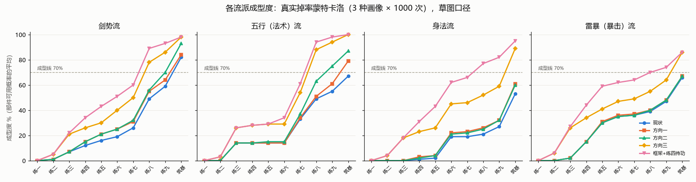

# 墨途 · 构筑与成长 v1 · 03 成长与数值

> 岗位：数值策划。协作：玩法系统（01 系统框架，牵头）、战斗设计（02 流派与机制）、关卡设计（04 投放与地图）。
> 状态：**只出方案，不落地**。没改 `src/` 的任何代码和数据；模拟只在内存里改掉落表。
> 依据：真实掉落表（`src/data/loot.js` + `src/game/loot.js` 的 `rollLoot`）、关卡实测的每局接触数（`04_data.json`，600 种子）、数值组经济模拟（`docs/review/numeric/sim/econ.py`，参数集 `ECON_XIAN`）、游戏内实测（`tools/scenarios/num_ttk.mjs` 新增的流派配装模式）。
> 历史报告：`docs/review/numeric/真气与炼化增益_v1.md`、`难度曲线复核_v1.md`、`药园与重铸_v1.md`。

---

## 0. 一页结论

| 问题 | 结论 |
|---|---|
| **节奏** | 一次回府约升 **2 层**：第 1 局序章 → 第 2 局练一 → 第 3 局练三 → 第 4 局练五（约一半已到区域二）→ 第 5 局练七 → 第 6 局练九 → 第 6–7 局筑基（谨慎 / 贪心 p50 第 6 局，新手第 7 局）。区域一实际只有 2–3 局。**3–6% 的随机心法、3–5 页的残页法术在筑基前大多拿不到**，所以流派的核心件必须走确定来源 |
| **主管草图重算** | 草图的"必 1 / 常 0.6 / 罕 0.25"整体偏乐观，换成真实概率后每个方向的成型都晚 1–2 个境界：方向一 剑势 / 法术筑基、身法 / 暴击不成型；方向二 剑势 / 法术练九；方向三 剑势 / 法术练八、身法 / 暴击筑基（§5） |
| **推荐节奏** | 框架 v0.1 + **练四"玄机子传功"**：★三件 = 练二入门心法 / 练四★法术完本 / 练六法宝匣。五个流派的★三件都是 **p50 练七（第 5 局）、p90 练八（第 6 局）**，全部赶在碧鳞前；在青牙（宜斩练六七）前约 36%（§5.3）。已被玩法、战斗采纳 |
| **成长轴** | 境界是主轴（练三→筑基输出约 ×7）；构筑精进三轴（法术重、法宝祭炼、阵法重）合计到筑基约占输出的 15–20%，每轴每档边际递减，单轴不超过 +12%（§2.6） |
| **法术重** | 二重 = 伤害 +15%、**耗蓝 −15%**（6 悟性）；三重 = 变体二选一（10 悟性）。只加 12% 伤害对总 DPS 只有 1–3%，不值 6 点 |
| **法宝祭炼** | 修 bug 后拿到即一重（极品 bonusLevel +2 = 三重）；本命 1→5 重灵石 **120 / 300 / 700 / 1500**，非本命封顶三重；材料用区域主材 + 妖丹碎片 / 灵玉 + 首领材料，**不用精英妖丹**。经济模拟：2 / 3 重在第 5 / 6 局买到，筑基分钟中位 +4（74→78），设施不受影响 |
| **阵法重** | 阵纹 + 灵石：二重 阵纹 3 + 150 灵石，三重 阵纹 6 + 400 灵石（筑基前多数人到二重） |
| **悟性** | 现在每局约 1–2 点，第 6 局累计只有约 5 点，升不了重。新增 拓碑 +1、遗府首通 +4、青牙 / 碧鳞首杀 +6 / +10 → 第 4 / 6 / 8 局累计约 **11 / 30 / 42**；筑基时够"核心法术三重 + 另一门二重"，还要取舍 |
| **流派平衡** | 实测（`num_ttk` 新增流派配装模式）分成两团：剑势 / 雷暴练九打碧鳞 34–35 秒（机器人），五行 / 身法 / 守御 59–62 秒，比中位快 41–43%。原因是飞剑、《锋锐》《连环》本身带输出，葫芦 / 镇山印 /《凝神》《流云》《金刚体》不带——**选五行 / 身法 / 守御比不选流派还慢约 50%**。按"★件功率对等"加强三派、轻削剑势 / 雷暴约 10% 后，五派都在 ±20% 带内（雷暴 −23% 略出），首领气血不用改（§4） |
| **真气** | 首领战里真气不卡任何流派（卡冷却）；一局预算：五行★（凝神 + 葫芦 / 灵池）可放法术约为非五行的 **1.6–1.9 倍**，满配 4 件续航约 3 倍（冷却上限的一半，不是无限）。葫芦必须加每次回气封顶（现行实测单体 4.9 真气 / 秒）（§4.5） |
| **偏置** | 身上流派偏置建议 **50%**（替换式），与关卡"分区道途 70%"相乘后，在自家道途分区约 70%、分区外约 53%，封顶 75%（§6） |

（图的数据表见 §5.1；颜色之外每条线有不同的点形。）

---

## 1. 方法与工具（都可复跑）

| 脚本 | 作用 | 运行（仓库根目录） |
|---|---|---|
| `tools/build_growth/schedule.py` | 局程：复用 `econ.py`（`ECON_XIAN`），青牙改为可选（区域二只看练五），每局记 区域 / 开局层 / 结束层 / 撤离成败 / 遗府 / 碧鳞首杀 | `PYTHONIOENCODING=utf-8 docs/review/numeric/.venv/Scripts/python.exe tools/build_growth/schedule.py 1000 3` → `work/build_schedule.json` |
| `tools/build_growth/pieces.mjs` | 部件到手的蒙特卡洛：每局按关卡实测接触数，逐个来源调用真实 `rollLoot`（带 profile：机缘、优先未学、once）；撤离失败按 econ 规则丢东西；回府参悟、化悟性、补页；方案只在内存里改掉落表与选择点 | `node tools/build_growth/pieces.mjs 1000 all base,a,b,c,gp,rec,rec_b40,rec2` → `work/build_pieces.json` |
| `tools/build_growth/econ_refine.py` | 把祭炼 / 阵法加重的灵石开销放进经济模拟，看会不会挤掉设施、拖慢筑基 | `… python.exe tools/build_growth/econ_refine.py 1000` |
| `tools/build_growth/mp_budget.py` | 一局真气预算（解析） | `… python.exe tools/build_growth/mp_budget.py` |
| `tools/scenarios/num_ttk.mjs` 新增 `bcurve=1` | 流派配装实测：本体持续 DPS（主角无敌、假人 = 区域二狼首按首领规则结算、气血放大）+ 各五行破盾秒数（从 0 势开打）。新数据（凝神、葫芦去被动回气、灵池）只改页面内存 | `node tools/run.mjs num_ttk "scene=run&region=r2&bcurve=1&build=jian,fa,bao,shen,shou&levels=6,9&sec=30&els=wood,earth,fire"` → `work/num_ttk_build_<tag>.json` |
| `tools/build_growth/balance.py` | 实测 → 青牙 / 碧鳞用时、与中位数的偏差、EHP | `… python.exe tools/build_growth/balance.py` → `work/build_balance.json` |
| `tools/build_growth/charts.py` | 本文的图 | `… python.exe tools/build_growth/charts.py` |

**两种"成型"口径**
- **草图口径**（与主管草图同一公式，只把权重换成模拟出的真实概率）：流派部件表里每件"到这一层已可用"的概率取平均 = 成型度；≥ 70% 记成型，≥ 35% 记定向。"可用" = 已带回洞府 **且** 栏位已开（可用层 = max(拿到那局结束时的层, 开栏层)）。
- **★口径**（战斗设计 02）：入门心法 + 核心法术 + 法宝 / 阵 三件都可用的那一层，按个体给 p50 / p90。

### 1.1 局程（为什么一切都要提前）

| 局 | 开局层 p50 [p10, p90]（谨慎） | 在区域二的比例 |
|---|---|---|
| 1 | 序章 | — |
| 2 | 练一 [1, 1] | 0% |
| 3 | 练三 [2, 3] | 0% |
| 4 | 练五 [4, 5] | 51%（贪心 71%、新手 40%） |
| 5 | 练七 [5, 8] | 98% |
| 6 | 练九 [8, 9] | 100% |
| 7 | 筑基 [9, 筑基] | 100% |

到筑基：谨慎 / 贪心 p50 第 6 局（p90 第 7 局），新手第 7 局（p90 第 8 局）；74–81 分钟。
推论：**"练 X 层"≈ 第 (X+1)/2 + 1 局**；一个随机部件要在筑基前到手，每局至少要有约 25% 的概率（4 局内 ≥ 1 次的概率 ≈ 68%）。

---

## 2. 成长轴曲线

### 2.1 境界（主轴，现状不改）

| 层 | 气血 | 攻击 / 法力 | 防御 | 真气 | 攻速 | 闪身 |
|---|---|---|---|---|---|---|
| 练一 | 200 | 20 | 5 | 120 | 0.65 | 1 |
| 练三 | 260 | 28 | 9 | 144 | 0.73 | 1 |
| 练六 | 350 | 40 | 15 | 180 | 0.85 | 2 |
| 练九 | 440 | 52 | 21 | 216 | 0.96 | 2 |
| 筑基 | 720 | 84 | 36 | 360 | 1.00 | 2 |

- 练气每层是线性增量（+30 / +4 / +2 / +12），**相对增幅递减**：攻击练一→二 +20%，练八→九 +8%。筑基是一次大跳（攻击 +62%、气血 +64%）。这是对数型成长的手感（Schreiber & Romero 第 4 章：等级收益趋平），配合区域内敌人每级 +15% 气血形成"越打越轻松、换区域再吃力"的锯齿。
- 实测（现状配装，主角无敌打假人）：本体 DPS 练三 111 → 练六 270 → 练九 530 → 筑基 822，即**练三到筑基约 ×7.4**（含装备随等级）。构筑轴的总量要和它比，见 §2.6。

### 2.2 法术"重"（悟性）

| 重 | 悟性 | 效果（建议） | 依据 |
|---|---|---|---|
| 一重 | — | 学会即是 | — |
| 二重 | 6 | **伤害 +15%、耗蓝 −15%**（原草案只有伤害 +12%） | 一门法术占流派 DPS 10–25%，+12% 伤害只换来总 DPS +1–3%；加上耗蓝 −15%，真气紧的流派等于多放 18% 次数（一局 15 → 17.6 次） |
| 三重 | 10 | **变体二选一**（解锁后随时免费切换；战斗设计 02 §7.1） | 原"冷却 −15%"让剑气斩 8 秒 × 0.85 = 6.8 秒，越过"冷却 8–18 秒的决策型法术"下限 |

- 每门法术吃满 16 悟性。筑基时悟性约 30（§3.1），所以**只能把 1 门升满 + 另一门二重**——有取舍，没有"全部满重"。
- 变体是侧向的（换玩法，不换强度），平衡口径：变体的 DPS 与原版差 ≤ 10%（战斗设计出变体时用 `num_ttk bcurve` 复测）。

### 2.3 法宝祭炼（修 bug 后）

**先修口径**（玩法 01 §6 第 3 条做存档拆分）：法宝实例新增 `refine`（1–5），`level` 只表示物品等级。
- 掉落 / 赠予的法宝一律 `refine = 1`；极品法宝 = 1 + `bonusLevel`(2) = **三重**。
- 旧存档校正：`refine = 1 + bonusLevel`；被 bug 抬到 4–5 重的本命法宝校正后**补 2 重**（相当于正常节奏第 5 局的水平），另返还 120 灵石作为心理补偿，弹一次提示。理由：bug 期间玩家已经习惯了那件法宝的手感，直接打回一重落差太大；补到二重刚好是正常节奏。

**曲线**：`lv(L) = 1 + 0.25(L − 1)` 不变 → 1.00 / 1.25 / 1.50 / 1.75 / 2.00。每重相对上一重 **+25% / +20% / +17% / +14%**（线性加法 → 相对收益递减）；三重 / 五重另有手感节点（飞剑 3 / 4 剑，02 §6）。

**成本**（本命；非本命封顶三重，只能到 120 + 300）：

| 升到 | 灵石 | 主材（04 §4.5 按法宝五行分产地） | 辅材 | 解锁 | 正常节奏 |
|---|---|---|---|---|---|
| 二重 | 120 | 区域一主材 ×1（狼王遗骨 / 灵蚌珠 / 鸦羽 ×3 / 石傀心） | 妖丹碎片 ×4 | 练六 | 第 5 局 |
| 三重 | 300 | 区域一主材 ×2 | 灵玉 ×2 | 练八 | 第 6 局（筑基前后） |
| 四重 | 700 | 区域二主材 ×2（剑胚 / 水灵玉 / 千年竹心 / 岩髓） | 青牙之牙 ×1 或 碧鳞鳞片 ×2 | 筑基 | 筑基后 1–2 局 |
| 五重 | 1500 | 区域二主材 ×4 | 碧鳞鳞片 ×3 | 筑基 | 筑基后 3–5 局 |

- 灵石"每档约 ×2.3"（Schreiber：递增成本），配合收益递减，每 100 灵石换到的输出从二重的约 +3% 降到五重的约 +0.15%（§2.6）——筑基前买到三重是划算的，四、五重是长线目标。
- **不用精英妖丹**：聚气丹每枚 2 颗妖丹、每层 3 枚，妖丹已经是修为的瓶颈；祭炼再抢会直接拖慢筑基。
- 主材产量（04 §4.5）：区域一的四种都能在专刷一局里拿到 ≥ 0.65 件，普通局 0.15–0.65 件；所以三重的 3 件主材在第 6–7 局凑齐，和灵石的节奏一致。

**经济模拟**（`econ_refine.py`，1000 次 / 画像，祭炼作为必需开销插在炼丹炉 Lv2 之后）：

| 方案 | 到筑基（局 p50/p90、分钟 p50/p90） | 重铸花费 | 祭炼二 / 三 / 四重买到 |
|---|---|---|---|
| 现状（无祭炼） | 谨慎 6/7 局 74/85 分；贪心 6/7、78/95；新手 7/8、81/98 | 885–1191 | — |
| **建议 120 / 300 / 700** | 谨慎 6/7、**78/88**；贪心 6/7、82/97；新手 7/8、85/100 | 676–943 | 100% 第 5 局 / 100% 第 6 局 / 筑基后 1–12% |
| 贵一档 200 / 500 / 1000 | 谨慎 7/7、81/89；新手 7/9、88/103 | 582–842 | 第 5 / 6 局 |
| 建议 + 阵法二重 150 | 与建议值相同 ±1 分钟 | 588–842 | 阵法二重 98–100% 第 6 局 |

- 祭炼挤掉的是**重铸**（余钱出路）和少量炼化，**设施时间点不变**（炼丹炉 Lv2 第 4–5 局、储物袋 32 第 6–7 局）；筑基分钟中位 +4，p90 ≤ 100，都在"中位 7–8 局、p90 ≤ 120 分钟"内。
- 贵一档会让新手 p90 到第 9 局，所以取 120 / 300。

### 2.4 阵法"重"（阵纹 + 灵石，炼器鼎里和祭炼同一页）

| 重 | 阵纹 | 灵石 | 效果（02 §5 草案） | 正常节奏 |
|---|---|---|---|---|
| 一重 | — | — | 阵盘匣取得 | 练七（剑修遗府首通，第 4–5 局） |
| 二重 | 3 | 150 | 数值 +30%（剑阵每击、灵池封顶 45→58、火阵每跳） | 第 6 局 |
| 三重 | 6 | 400 | 改手感（02：灵池阵内首发不耗蓝 / 无前摇等） | 筑基后 |

- 阵纹产量（04 §4.6）：专刷断涧东 ≈ 0.68 座在场 × 2–3 份 + 残阵约 1 份 → 定向一局约 2.5 份，顺手约 1 份。阵盘第 4–5 局才到手，筑基前只剩 2 局左右，所以二重定在 3 份（需要 1–2 局），三重 6 份放到筑基后。
- 灵石 150 已放进经济模拟（上表最后一行），不影响筑基。

### 2.5 心法与词条（不做等级）

- 心法没有等级：强度在"有没有、几本"。第二心法栏练八才开，所以**第二本心法的到手时间**就是心法轴的节奏（§6）。
- 词条数值不改（`AFFIXES` 的 [灵, 宝, 仙] 档 × 区域系数 1 / 1.6 / 2.4）。新增**暴伤词条**（02）：法剑 / 玉佩 10 / 15 / 25%；为了不稀释"攻击"，建议给 `AFFIXES` 加权重（攻击 1.5、附灵 1.3、暴伤 0.8，其余 1；需掉落模块支持权重，难度复核 §8 已提过）。

### 2.6 各轴占比：不让任何一轴碾压

以剑势练九（实测本体 DPS 723，飞剑占 15%，§4）为基准，各轴"拉满到筑基前正常节奏"的贡献：

| 轴 | 正常节奏到筑基 | 对总 DPS | 每档边际 |
|---|---|---|---|
| 境界（练三→筑基） | — | ×7.4 | 每层 +8–20%，筑基 +55% |
| 装备（品级 + 词条） | 宝品 + 2 条 | +15–25% | 每条词条约 +4%（难度复核 §8） |
| 法宝祭炼 | 三重 | 法宝占 15–20% → ×1.5 → **+8–10%** | 二重 +4% / 三重 +3% / 四重 +2.5% / 五重 +2%（每 100 灵石：约 3% → 0.15%） |
| 法术重 | 核心 1 门三重 + 1 门二重 | 法术约占 15% → **+2–3%**（另加耗蓝 −15%） | 二重约 +1.5% / 门 |
| 阵法重 | 二重 | 剑阵约占 5–8% → **+2%** | — |
| 心法第二本 | 练八 60–75% 有 | +8–15%（《连环》《满势》等） | — |

- 构筑精进三轴（祭炼 + 重 + 阵）合计约 **+13–15%**，筑基后祭炼到五重再 +9%。没有一轴超过 +12%，境界仍是主轴。
- **防碾压的硬约束**：任一构筑轴在筑基前对总 DPS 的贡献 ≤ 15%；任两种"同乘区"加成（例如二重伤害和《灵根》的本行伤害）放进同一个桶相加，而不是相乘（D4 伤害桶：同桶相加、异桶相乘，乘区越多膨胀越快）。

---

## 3. 资源经济

### 3.1 悟性

| 来源 | 现状（每局） | 建议新增 |
|---|---|---|
| 重复残页 / 完本化悟性 | 约 1–2 点（学会以后碑 / 精英的重复页） | — |
| 拓碑 | — | **+1 / 块**（每局 1.2–1.5 块） |
| 遗府首通 | — | **+4**（山神庙、剑修遗府各一次） |
| 青牙 / 碧鳞首杀 | — | **+6 / +10** |
| 练四传功时★法术已学会 | — | **直接升到二重**（等价 6 悟性） |

累计悟性（第 4 / 6 / 8 局，模拟）：

| | 谨慎 | 贪心 | 新手 |
|---|---|---|---|
| 现状 | 1.0 / 4.9 / 10.8 | 1.9 / 9.0 / 17.2 | 1.0 / 4.7 / 10.1 |
| 建议 | **11.1 / 29.9 / 42.0** | 13.1 / 34.0 / 47.6 | 9.8 / 25.3 / 38.0 |

- 花法：补页 3 点 / 页；法术二重 6、三重 10。筑基时（第 6–7 局）约 30 点 = 核心法术三重（16）+ 另一门二重（6）+ 补 2–3 页。
- 阵法改用阵纹以后，悟性只给法术和补页，预算不再被阵法分走（玩法 01 已改）。

### 3.2 灵石

一周目带回约 2000–2700 灵石（经济模拟），去向：设施约 1300–1500、每局符箓、重铸（余钱出路）、炼化。祭炼 120 + 300 + 阵法 150 = 570，从重铸和余钱里出（§2.3 表），不影响设施。

### 3.3 材料瓶颈

| 材料 | 现有用途 | 新用途 | 判断 |
|---|---|---|---|
| 精英妖丹 | 聚气丹（2 颗 / 枚，每层 3 枚） | **不给祭炼用** | 已是修为瓶颈 |
| 妖丹碎片 | 碎丹方聚气丹（12 片）、宝品重铸（3 片） | 祭炼二重 4 片 | 低阶怪 22% 掉、普通怪 8%，一局约 3–5 片，够 |
| 灵玉 | 重铸、青玉佩 | 祭炼三重 2 份 | 区域一稀有池 + 灵光点，够 |
| 首领材料 | 青牙剑（青牙之牙）、筑基丹（碧鳞内丹） | 祭炼四 / 五重（之牙 / 鳞片） | 碧鳞内丹不用（筑基丹要），用鳞片 |

### 3.4 正常节奏下第几局能把核心件升到几重（谨慎型 p50）

| 局 | 境界 | 核心法术 | 本命法宝 | 阵法 | 第二心法 |
|---|---|---|---|---|---|
| 2 | 练一→三 | — | — | — | — |
| 3 | 练三→五 | 练四传功 = 一重 | — | — | — |
| 4 | 练五→七 | **二重**（累计悟性约 11） | 练六法宝匣 = 一重 | — | — |
| 5 | 练七→九 | 二重 | **二重**（120） | 剑修遗府阵盘匣 = 一重 | 练八开栏，60–75% 已有 |
| 6 | 练九→筑基 | **三重**（累计约 30） | **三重**（300，主材凑齐约第 6–7 局） | **二重** | — |
| 7+ | 筑基 | 第二门二重 | 四重（筑基后 1–2 局） | 三重（筑基后） | — |

### 3.5 散功、改选、bug 校正

| 项 | 建议 | 依据 |
|---|---|---|
| 改入门心法 | 30 灵石，传功不重发 | 练二的玩家还不懂系统，要便宜可改；不重发防止 30 灵石刷齐五门★法术 |
| 散功（悟性、祭炼灵石、阵纹） | 返还 **80%** | 小代价、可反悔。Diablo IV 早期免费洗点、之后按等级递增收费（参考资料：Blizzard Watch 2023），我们只有一周目 7 局，用固定 80% 更好懂 |
| 筑基一次免费重修 | 100% | 大境界节点给一次全额重来 |
| 旧存档法宝重数校正 | 见 §2.3 | — |

---

## 4. 流派平衡（实测 + 解析）

### 4.1 怎么测

- `num_ttk bcurve=1`：五个流派按"★三件 + 该档常见增强件"配装（`buildPreset`；框架 v0.1 栏位：心法练二 / 练八、法宝练六、阵法练七；本命祭炼 练六一重 / 练八二重；核心法术 练七起二重；练五起带回气丹 3 枚），装备沿用 `curvePreset` 的正常进度（不带随机词条，偏保守）。

| 流派 | 练六配装 | 练九配装 |
|---|---|---|
| 剑势 | 剑气斩 + 凝锋诀；《蓄势》；青冥飞剑 | + 寒冰锥；+《连环》；飞剑二重；剑阵 |
| 五行 | 剑气斩 + 落石诀；《凝神》；紫金葫芦 | 剑气斩 + 火符 + 寒冰锥；+《灵根·火》；葫芦二重；聚灵阵（灵池） |
| 雷暴 | 剑气斩 + 掌心雷；《锋锐》；青冥飞剑（五雷令未做，代用） | + 寒冰锥；+《雷引》；飞剑二重；剑阵 |
| 身法 | 剑气斩 + 止水诀；《流云》；镇山印（定风珠未做，代用） | + 地行术；+《回锋》；剑阵 |
| 守御 | 剑气斩 + 土遁护体；《金刚体》；镇山印 | + 落石诀；剑阵 |

- **本体**：假人 = 区域二狼首，按首领规则结算（剑意削盾 0.2、斩硬直 0.5 秒），去掉护盾、气血放大到 60000，主角无敌，开场满势，打满 30 秒。真气按实耗，法宝 V、阵法 T、回气丹都由机器人使用。
- **破盾**：同一假人给一层木 / 土 / 火护盾（练六 1500、练九 2400，正好是青牙 / 碧鳞每段的量），本体只剩 1 点，从 0 势开打，计破盾秒数。
- 新数据只改页面内存：《凝神》真气 +25%、葫芦去掉被动回气、聚灵阵改灵池（每秒 4.5 × 10 秒 = 45）。
- 青牙 v2 现在有"睡眠 → 入场演出 → 场地"流程，原 `curve=qingya` 刷出的青牙不进战斗（实测 20 秒 0 次普攻），所以改用假人。
- 换算：`defAdj = (100 + 假人防) / (100 + 首领防)`；机器人用时 = Σ 护盾 / (破盾速度 × defAdj) + 气血 / (本体 DPS × defAdj × (1 + 解析加成))；真人 ≈ 机器人 ÷ 0.55（首领输出窗口目标）。青牙 15000 气血 / 防 25 / 木、土盾各 1500；碧鳞 12000 / 防 40 / 火、土、木盾各 2400。
- **测不了的新机制**（雷痕、五雷令、定风珠、凌波、拂柳、不动、轮转）用解析加成叠上：雷暴 +8%（雷痕放大金行伤害约 +4%、自爆天雷约 +4%）、身法 +6%（剑影 / 止水反击；完美闪身类另计，见 4.4）、守御 +5%（不动反震约 27 DPS）；练六按一半。
- 机器人的局限：按住左键、冷却好就放法术，不会完美闪身、不会读招止水——**身法流被系统性低估**（4.4 单独估）。

### 4.2 实测结果（练六 / 练九，机器人下限）

| 流派-层 | 本体 DPS | 蓄势斩占比 | 法术占比 | 法宝占比 | 破盾秒 木 / 土 / 火 | 青牙 机器人 / 真人≈（秒） | 碧鳞 机器人 / 真人≈（秒） | EHP |
|---|---|---|---|---|---|---|---|---|
| 现状通用（锋锐 + 飞剑） 练六 | 270 | 36% | 8% | — | 10.9 / 12.5 / 13.8 | 75 / 136 | 110 / 201 | 574 |
| 现状通用 练九 | 530 | 22% | 14% | 20% | 2.2 / 6.8 / 5.1 | 32 / 58 | 39 / 71 | 838 |
| 剑势 练六 | 305 | 28% | 3% | 25% | 4.1 / 8.8 / 8.8 | 59 / 107 | 79 / 143 | 574 |
| 剑势 练九 | **723** | 32% | 17% | 15% | 2.4 / 5.8 / 7.7 | **25** / 45 | **35** / 63 | 838 |
| 五行 练六 | 219 | 31% | 9% | 2% | 12.2 / 13.3 / 13.5 | 89 / 162 | 124 / 226 | 574 |
| 五行 练九 | **391** | 19% | 33% | 4% | 10.8 / 10.9 / 6.0 | **49** / 89 | **62** / 113 | 838 |
| 雷暴 练六 | 336 | 20% | 7% | 26% | 1.9 / 11.7 / 12.1 | 54 / 97 | 80 / 145 | 574 |
| 雷暴 练九 | **726** | 18% | 26% | 18% | 0.7 / 10.1 / 5.5 | **25** / 45 | **34** / 61 | 838 |
| 身法 练六 | 227 | 25% | 12% | 3% | 12.7 / 12.3 / 12.1 | 84 / 153 | 117 / 213 | 647 |
| 身法 练九 | **339** | 24% | 17% | 1% | 5.1 / 9.6 / 10.1 | **48** / 88 | **62** / 112 | 1022 |
| 守御 练六 | 222 | 35% | 4% | 1% | 6.2 / 12.2 / 11.6 | 80 / 145 | 107 / 194 | 926 |
| 守御 练九 | **382** | 26% | 17% | 3% | 2.8 / 11.3 / 11.2 | **44** / 80 | **59** / 106 | **1439** |

与同档中位数的偏差（机器人用时；目标 ±20%，守御 +35%——战斗设计 02 §8.3。类比 Riot 英雄平衡框架：普通玩家胜率 > 54.5% 算超模、≤ 49% 算弱，[Riot /dev 2019](https://nexus.leagueoflegends.com/en-us/2019/05/dev-champion-balance-framework/)；胜率带换成用时带是推论）：

| | 剑势 | 五行 | 雷暴 | 身法 | 守御 |
|---|---|---|---|---|---|
| 练六 · 青牙（中位 80 秒） | −26% | +12% | −33% | +6% | 0% |
| 练九 · 碧鳞（中位 59 秒） | **−41%** | +6% | **−43%** | +5% | 0% |

原始数据：`work/num_ttk_build_v2.json`（流派）、`work/num_ttk_build_base.json`（现状通用，含练三 / 筑基：本体 111 / 822）、`work/build_balance.json`（换算）。

### 4.3 读法

1. **两团**：剑势、雷暴一团（练九碧鳞 34–35 秒），五行、身法、守御一团（59–62 秒）。中位数落在慢的一团里，所以剑势 / 雷暴偏离 −41~−43%，远出"±20%"带。
2. **差距几乎全来自"★法宝和入门心法本身带不带输出"**：飞剑在剑势 / 雷暴里占 15–26% 的伤害，葫芦 / 镇山印只占 1–4%；《锋锐》《连环》是直接的伤害乘区，《凝神》《流云》《金刚体》不是。结果：**选了五行 / 身法 / 守御，比不选流派的"现状通用配装"（锋锐 + 飞剑，碧鳞 39 秒）还慢约 50%**——成型反而变弱，违背"构筑是核心"。
3. 五行的法术已经放到冷却上限（30 秒 9 次、真气 485 用不完），瓶颈不是真气，是**法术本身的伤害**：法力只随境界涨、装备几乎不加法力（难度复核 §4.2 已提过），一发寒冰锥 ≈ 普攻 1 秒。
4. 破盾：雷暴对木盾 0.7 秒（掌心雷 + 雷引 + 飞剑全是金），剑势靠剑意各盾都在 2–8 秒；五行明明有克制，却要 6–11 秒——法术次数少、单发低。
5. 蓄势斩占比：剑势 28–32%（≤ 40% ✓），雷暴 / 五行 18–31%，身法 24–25%、守御 26–35%（> 20% ✗）。后两者超标是因为分母（总输出）太低，4.4 的加强落地后会降到 20% 附近；但《拂柳》（半势斩）会再加约 5 个百分点，要复测。
6. 生存：守御 EHP 是其他流派的 1.7 倍（金刚体 + 镇山印），符合"慢 35% 以内、但更安全"。

### 4.4 调整建议（数值量级；机制归战斗设计定）

**原则——"★件功率对等"**（Schreiber：同成本给同价值）：每个流派的★法宝在练九二重时对首领的贡献 ≈ 飞剑（约 +15–20% 输出，或等价的破盾 / 窗口收益）；每本入门心法 ≈《锋锐》（约 +15%）。

| 流派 | 改什么（建议值） | 估算效果 |
|---|---|---|
| 五行 | 紫金葫芦主动伤害 ×2.5（每跳 25×lv + 1.5×法力），被动加"法力 +8 × 重"；《凝神》加"法术伤害 +25%（独立乘区）、法力 +15%"；克制法术打盾 ×1.25（凝神"克盾"） | 本体 ×1.36、破盾 ×1.25 |
| 身法 | 机器人测不到的完美闪身 +50%、拂柳半势斩（每 8 秒一次 ≈ +35 DPS）、凌波 +25 气势（约每 12 秒多一刀满势斩）、剑影（+23 DPS）、止水反击（+11 DPS），合计约 +33%；另加 定风珠"场内敌人受伤 +8%"、《流云》"完美闪身后 1.5 秒伤害 +20%" | ×1.50（熟练玩家；只按左键的玩家约 ×1.15，身法本就是技术流） |
| 守御 | 《不动》反震（吸收 ×1.5 + 0.8×法力），镇山印主动基础 50 → 90 | ×1.18（允许比中位慢 35%） |
| 剑势 | 《连环》每层 +4% → +3%、《蓄势》斩伤 +10% → +5%、剑意封顶 60% | ×0.90，护盾段 ×0.9 |
| 雷暴 | 《锋锐》暴伤 +30% → +20%、雷痕每层 +4% → +3%（自爆照旧） | ×0.86 |

建议调整后（估算，`balance.py` 末段）：

| | 剑势 | 五行 | 雷暴 | 身法 | 守御 | 中位（真人≈） |
|---|---|---|---|---|---|---|
| 练六 · 青牙 | 0% | +3% | −8% | −6% | +7% | 65 秒（约 120 秒） |
| 练九 · 碧鳞 | −18% | +1% | −23% | 0% | +12% | 47 秒（约 85 秒） |

- 全部进 ±20% 带，只有雷暴打碧鳞 −23% 略出——雷暴的定位就是"单体爆发最高、土盾段最吃亏"；若要收进来，把雷痕自爆 5× 改 4×。
- 青牙练六真人约 120 秒、碧鳞练九约 85 秒：与青牙 v2 的"练六 150 秒 / 练七 80 秒"口径接近，**不需要改首领气血**。
- **这些是落地前的方向值**：战斗设计定稿机制后用 `num_ttk bcurve=1` 复测，标准就是上表的"±20%（守御 +35%）"和"蓄势斩类占比 剑势 ≤ 40%、其他 ≤ 20%"。

### 4.5 真气收支（法术流单独算）

**首领战**（实测 30 秒）：五行练九 耗 156、回 146——葫芦吸取 **4.9 真气 / 秒**（现行既没有"首领 ×0.5"也没有封顶），9 次施法 = 冷却上限，真气 485 用不完；其他流派耗 44–168、回 0。结论：**首领战里真气不卡任何流派，卡的是冷却**；真气只在"一局总预算"里起作用。

**一局可放法术次数**（`mp_budget.py`，口径同真气报告附录：真气上限 + (携带 + 局内捡到) × 每枚回气 + 续航件，÷ 平均耗蓝）：

| 配置 | 练六 | 练九 | 筑基 | 相对非五行 |
|---|---|---|---|---|
| 非五行（蓝量 + 回气丹） | 14.7 | 15.0 | 23.3 | ×1.0（与真气报告 14.2 / 15.1 / 22.4 吻合） |
| 非五行 + 核心法术二重（耗蓝 −15%） | 17.3 | 17.6 | 27.4 | ×1.18 |
| 五行★：凝神 + 葫芦 | 27.2 | 28.7 | 40.7 | **×1.75–1.92** |
| 五行★：凝神 + 灵池 | 27.4 | 27.2 | 37.6 | **×1.62–1.86** |
| 五行满配：凝神 + 轮转 + 葫芦 + 灵池 + 二重 | 43.7 | 45.1 | 61.3 | ×2.6–3.0 |
| 冷却上限（一局约 5 分钟在打，三门法术） | | | | ≈ 92 次 |

用到的建议值：凝神 真气 +25%、回气丹 +25%（草案 +50% 偏高）；葫芦每次吸取回气 = min(伤害 × 0.3, **15 + 3 × (重 − 1)**)，首领先 ×0.5 再封顶；灵池每阵 **36**（二重 47）；轮转"相生时耗蓝 −25%"（草案 −40%）；凝神克盾返还 40%。

- ★成型的五行流 ≈ 非五行的 1.6–1.9 倍，落在战斗设计 1.6–2 倍的目标里。
- 满配约 3 倍、约为冷却上限的一半——**不是无限蓝**，但它占满两个心法栏 + 法宝 + 阵法、没有输出件，是"选择极致续航"的代价，建议接受；如果用户觉得太多，改成"灵池内葫芦吸取不回真气"即可回到约 2.2 倍。
- 不封顶的葫芦有漏洞：一群同级小怪（练九 4 只蝠妖）一次吸取可回 100–180 真气（4–6 门法术），首领单体实测 4.9 真气 / 秒。**封顶必须做**。
- 全部续航件都符合"不自动回复、击杀不回复"：葫芦只在吸取时按伤害回，灵池只在阵内回且封顶，凝神只在克制打盾时返还，轮转只省不回。

### 4.6 真青牙复核（2026-11-18，详见 05_青牙实测.md）

上面的首领数字来自假人，没算狼威、撞柱、处决、打断，也没测练四–五。05 用真青牙（控制器、石柱、召狼、处决全在）按 00 总纲时间线补测了练四 / 五 / 六 / 七 × 五个流派 + 现状通用 × 莽 / 闪 / 熟，改变了两处判断：
- **"首领气血不用改"仍成立，但青牙要改别的**：现状通用配装练四闪就有 67% 胜、练五 100%（T2 标准 10–30%），**构筑提前没有让它更容易**（流派配装练四闪 42–58%，只有守御 92%）。建议青牙方案 C：威折处决 12% → 6% 最大气血、狼威阈值 100 → 130、攻击 40 → 52（不动气血），各流派练四闪回到 10–30%。
- **练六给法宝只在"青冥飞剑 + 莽"上出界**：飞剑自动清狼，莽练六 0% → 80%；方案 C 下回到 30%。不需要把法宝栏改回练七。
- 守御在练四–五最安全（《金刚体》+15% 后仍闪 30% / 90%），列为用户题。

---

## 5. 主管草图三个方向的重算

### 5.1 草图口径（同一公式，权重换成模拟出的真实概率；3 画像 × 1000 次）

成型度（%），练一 → 筑基（"筑基"列含筑基后 3 局内拿到的）：

| 方案 | 剑势 | 法术（五行） | 身法 | 暴击（雷暴） |
|---|---|---|---|---|
| 现状 | 0 1 7 12 16 19 26 49 59 82 | 0 0 14 14 14 14 33 49 55 67 | 0 0 0 1 2 19 19 21 27 53 | 0 0 2 15 30 35 36 39 47 66 |
| 方向一 | 0 1 7 15 21 25 31 55 64 84 | 0 0 14 14 14 14 34 51 61 79 | 0 0 0 3 4 22 23 26 32 61 | 0 0 2 15 31 36 37 40 48 67 |
| 方向二 | 0 1 7 15 21 25 32 56 70 93 | 0 0 14 14 15 15 37 63 75 87 | 0 0 0 2 4 21 22 25 32 60 | 0 0 2 15 30 35 36 40 48 67 |
| 方向三 | 0 5 21 26 30 40 50 78 86 98 | 0 3 26 28 29 29 54 88 94 100 | 0 4 18 23 26 45 46 52 59 89 | 0 6 26 34 41 47 49 55 64 86 |
| 框架 + 练四传功 | 0 5 22 34 43 51 60 89 93 98 | 0 3 26 28 29 34 61 94 98 100 | 0 4 18 31 43 62 66 77 82 95 | 0 6 27 44 59 62 64 70 74 86 |

### 5.2 成型（≥ 70%）的境界：草图估算 vs 模拟

| 方案 | 剑势 | 法术 | 身法 | 暴击 |
|---|---|---|---|---|
| 现状：草图 / **模拟** | 未 / **筑基** | 未 / **未** | 未 / **未** | 未 / **未** |
| 方向一 | 练八 / **筑基** | 练七 / **筑基** | 未 / **未** | 练七 / **未** |
| 方向二 | 练八 / **练九** | 练七 / **练九** | 未 / **未** | 练七 / **未** |
| 方向三 | 练七 / **练八** | 练七 / **练八** | 练六 / **筑基** | 练六 / **筑基** |
| 框架 v0.1（模拟） | 练八 | 练八 | 筑基 | 筑基 |
| 框架 + 练四传功（推荐，模拟） | **练八** | **练八** | **练八** | **练八** |

**草图为什么偏乐观**：
- "常见 0.6"的件大多是 3–5 页残页：凝锋诀到练六只有 26%、练八 41%；掌心雷练六 35%、练八 40%。
- "罕见 0.25"的件实际更低：《流云》到练九 12%，《雷引》《回锋》《剑影》到练九 6–9%；它们挂在夜明宝箱 / 遗府重探上，**谨慎型几乎拿不到夜明宝箱**（关卡实测 0%）。
- 草图按境界排部件，但一局升 2 层：方向二的本命在青牙首杀，青牙要等练六后的那一局，带回来已是练八。
- 栏位：第二心法栏练八、法宝 / 阵法练七，草图里练六–七就算上的件要等开栏。

### 5.3 ★口径（个体，战斗设计 02 的三件；谨慎型，贪心 / 新手差 0–1 局）

| 方案 | 剑势 | 五行 | 身法 | 雷暴 | 守御 |
|---|---|---|---|---|---|
| 框架 v0.1：成型层 p50 / p90（局） | 练九 / 筑基（6 / 8） | 练八 / 练八（5 / 6） | 筑基 / 筑基（7 / 8） | 练九 / 筑基（6 / 8） | 练七 / 筑基（5 / 7） |
| **框架 + 练四传功** | **练七 / 练八（5 / 6）** | 练七 / 练八（5 / 6） | 练七 / 练八（5 / 6） | 练七 / 练八（5 / 6） | 练七 / 练八（5 / 6） |
| 框架 + 道途残碑（入门送 1 页 + 残碑 50% 出本流派★页） | 练八 / 筑基 | 练七 / 练八 | 筑基 / 筑基 | 练八 / 筑基 | 练七 / 练八 |

练四传功下，青牙前已成型约 28–43%，碧鳞前 100%。

**结论**：三个方向里只有方向三能让四派都在筑基前成型，但身法 / 暴击仍要到筑基；推荐"框架 v0.1 + 练四传功"，五个流派的★三件固定在练二 / 练四 / 练六三拍，p50 第 5 局、p90 第 6 局，随机掉落只负责增强件。

---

## 6. 掉落偏置（身上流派 × 分区道途）

模拟（只有身上偏置，替换式："掉到心法时，以概率 b 换成本流派池里还没有的一本"）——第二本本流派心法的到手率：

| b | 练六 | 练八（第二心法栏开） | 筑基 |
|---|---|---|---|
| 0 | 剑势 45%，其他 0–5% | 剑势 58%，其他 0–8% | 剑势 90%，其他 0–24% |
| 0.4 | 30–54% | 46–69% | 79–95% |
| 0.6 | 45–58% | 62–75% | 90–96% |

和关卡的"分区道途 70%"叠加（分区内 70% 出本区两个流派、各半；30% 全池五选一）：本流派份额 = b + (1 − b) × 基础份额。
- 在自家道途分区：基础 = 0.35 + 0.3 × 0.2 = 0.41；分区外：0.06。
- b = 0.6：分区内 **76%**、分区外 62%（超过 75% 封顶）；**b = 0.5：分区内 71%、分区外 53%**；玩法原案"同流派权重 ×2"：分区内 58%、分区外 11%（分区外几乎没有偏置）。

**建议 b = 0.5（替换式），叠分区道途后封顶 75%**。理由：练八前全局只掉约 2–3 本心法，偏置太弱则第二栏开了没东西装；太强（> 75%）则别的流派的心法几乎见不到，换流派没有素材。

---

## 7. 需要战斗设计 / 关卡确认的数值假设

| # | 假设 | 谁确认 | 影响 |
|---|---|---|---|
| 1 | 每局接触数用关卡 04_data（谨慎 = 区域一入暮前撤、区域二入夜前撤；贪 = 全拿，按 econ 画像的入夜概率 10 / 60 / 30% 混合） | 关卡 | 成型局数 ±0.5 局 |
| 2 | 山神庙在第 3 局、剑修遗府在第一次进区域二那局、青牙在第一次"开局 ≥ 练六"那局（胜率 85%，新手 65%） | 关卡 / 玩法 | 本命、匣的时间 |
| 3 | 入门心法、练四传功、练六法宝匣都在"突破那一刻"给，本局结束回府时生效（一次回府常跨两层，按 入门 → 传功 → 匣 顺序弹） | 玩法 | ★成型层 |
| 4 | 法宝匣三选一时选本流派的★法宝；剑修遗府匣对多数人是第二 / 第三个匣 | 玩法 | 本命 = 练六 |
| 5 | 身法流的完美闪身 / 止水反击收益按熟练玩家估算（+33%），机器人测不到 | 战斗 | 身法强度 ±15% |
| 6 | 雷痕 / 五雷令 / 定风珠 / 不动 / 轮转按 02 草案数值 | 战斗 | 4.4 的调整量 |
| 7 | 葫芦每次吸取回气封顶 15 + 3 ×（重 − 1），首领先 ×0.5；灵池每阵 36；凝神回气丹 +25%；轮转 −25% | 战斗 | 五行真气倍数 |
| 8 | 祭炼主材每局产量按 04 §4.5（区域一 0.15–0.65 件，专刷 ≥ 0.65）；阵纹定向约 2.5 份 / 局 | 关卡 | 三重 / 阵法二重的局数 |
| 9 | 二重 = 伤害 +15% / 耗蓝 −15%（已采纳）；三重变体与原版强度差 ≤ 10% | 战斗 | — |
| 10 | 用"区域二狼首按首领规则"当假人；首领特有的窗口（喘息、潜水、读条）按 0.55 统一折算 | 数值自查 | 真人秒数 ±20% |

---

## 8. 请用户选择（带推荐项）

1. **★核心件怎么来**：A 练四"玄机子传功"直接送★法术完本（**推荐**：五派都在练七–八成型，最稳）/ B 道途残碑 + 入门送 1 页（保留"刷"的感觉，但身法要到筑基）/ C 维持残页随机（剑势 / 雷暴练九，身法筑基）。
2. **五行满配约 3 倍法术次数**：A 接受（**推荐**：它占满两心法 + 法宝 + 阵法、没有输出件，是极致续航的代价）/ B 灵池内葫芦吸取不回真气（降到约 2.2 倍）。
3. **流派平衡的方向**：A 加强五行 / 身法 / 守御的★件、轻削剑势 / 雷暴约 10%（**推荐**，§4.4）/ B 只加强、不削（首领整体更快，碧鳞真人约 70 秒）/ C 只削剑势 / 雷暴（成型的爽感变弱）。
4. **旧存档被 bug 抬高的法宝**（玩法汇总时已定为默认 A，不再单列用户题）：A 校正到二重 + 返还 120 灵石（**推荐**）/ B 校正到一重，不补偿 / C 保留现状重数（超出的截到五重）。

---

## 9. 未对齐的分歧

| # | 分歧 | 我的立场 | 对方 / 状态 |
|---|---|---|---|
| — | 无（偏置已对齐：玩法撤回"权重 ×2"，采用替换式 b = 0.5、封顶 75%） | — | 已对齐 |

已对齐（2026-11-18，战斗设计已改进 02 §5 / §7 / §8.3）：剑势《连环》每层 +3%、《蓄势》斩伤 +5%、剑意封顶 60%（战斗同意小幅下调，§8 第 3 题仍留给用户，备选"只加强其他四派"）；《凝神》回气丹 +25%；《轮转》−25%；葫芦每次吸取封顶 15 + 3 ×（重 − 1）+ 首领 ×0.5；雷痕每层 +3%、自爆 4×（雷暴打碧鳞回到带内）；战斗另把《拂柳》对首领冷却 8 → 12 秒，抵消约 +5 个百分点的蓄势斩类占比。

---|---|---|---|
| 1 | 剑势要不要削 | 削约 10%（《连环》《蓄势》各降一档、剑意封顶 60%）：实测剑势 / 雷暴比中位快 41–43%，只加强其他三派也要加 50% 以上，首领会整体太快 | 战斗 02：剑势"不动"，只补齐其他四派 |
| 2 | 《凝神》回气丹效果 | +25% | 战斗 02 草案 +50% |
| 3 | 轮转耗蓝 | −25% | 战斗 02 草案 −40% |
| 4 | 葫芦"一群小怪 ≈ 回 1 门法术" | 必须加每次封顶（15 + 3 ×（重 − 1）），不封顶实测单体 4.9 真气 / 秒、一群 100+ | 战斗 02 只加了"首领 ×0.5" |
| 5 | 偏置强度 | 替换式 b = 0.5，叠分区后封顶 75% | 玩法 01：同流派权重 ×2（分区外只有 11%） |

---

## 10. 文件

| 路径 | 内容 |
|---|---|
| `tools/build_growth/schedule.py`、`pieces.mjs`、`econ_refine.py`、`mp_budget.py`、`balance.py`、`charts.py` | 本文全部模型（用法见 §1） |
| `tools/scenarios/num_ttk.mjs` | 新增 `bcurve=1`（流派配装：本体 DPS + 五行破盾）、curve 模式的 `build=` / `bots=`、机器人用法宝 V / 阵法 T / 回气丹、真气账 |
| `work/build_schedule.json`、`work/build_pieces.json`、`work/build_balance.json`、`work/num_ttk_build_v2.json`、`work/num_ttk_build_base.json` | 原始数据 |
| `docs/design/构筑与成长_v1/img/03_成型度.png` | 图 |
