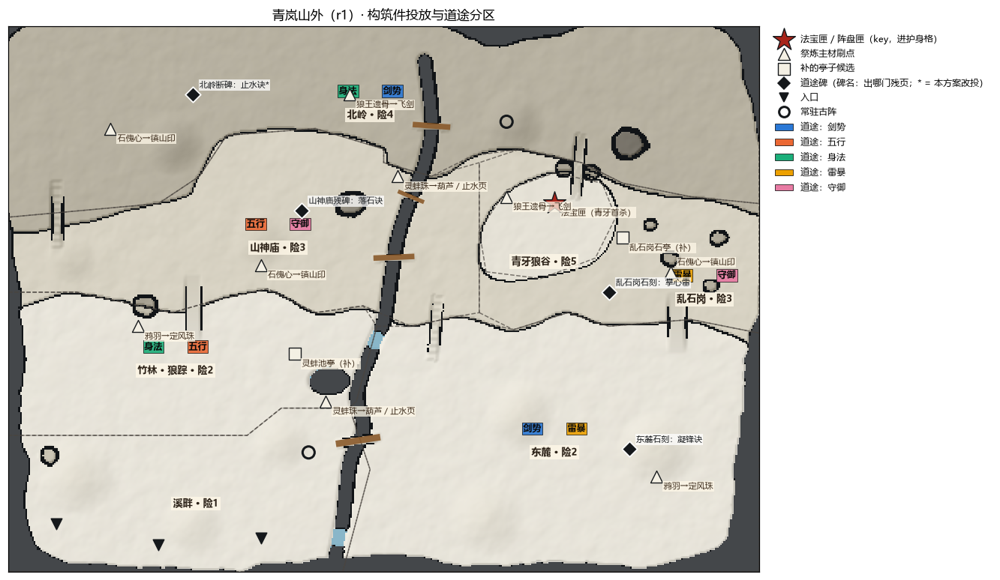
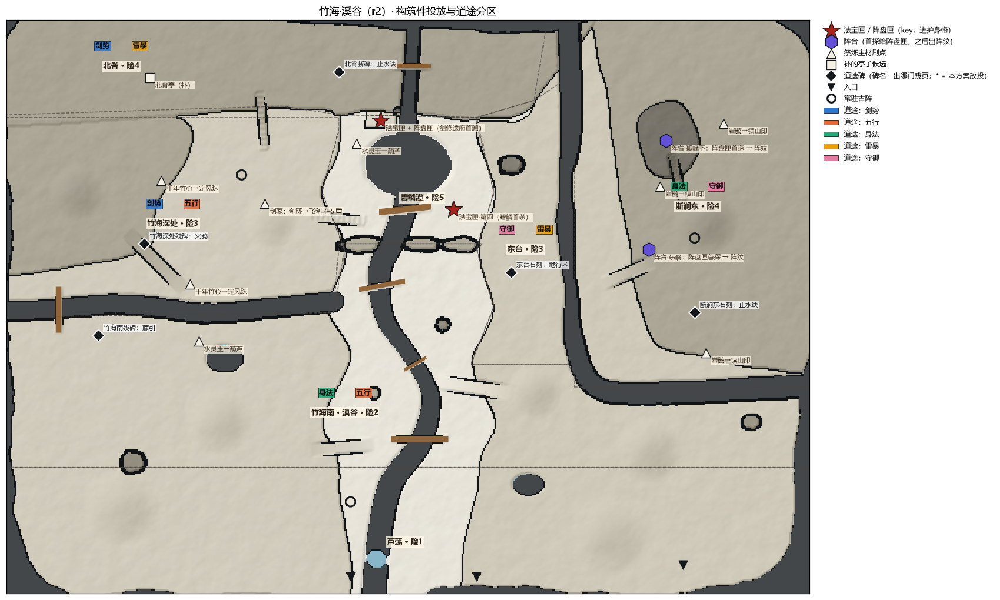

# 墨途 · 构筑与成长 v1 · 04 投放与地图

> 岗位：关卡设计。协作：玩法系统（01 系统框架，牵头汇总）、战斗设计（02 流派与机制）、数值策划（03 成长与数值）。
> 状态：**只出方案，不落地**。没有改 `src/` 下任何代码和数据。下文的点位、规则和数据改动都是建议，落地时由对应岗位执行。
> 依据：`docs/review/level/区域规划_v2.md`、`关卡评审与方案_v1.md`、`src/data/levels/r1.js`、`r2.js`、`src/data/loot.js`、`docs/design/功法体系_v2.md`、本目录 01 的框架 v0.1，以及战斗设计 v0 的部件表（以消息形式发来，正式稿是 02）。
> 实测：`docs/review/level/tools/build_drops.py`（每局数量、天时、定向刷，600 个种子，真实高度场）和 `build_map.py`（投放图）。数据在本目录的 `04_data.json` / `04_data.txt`（现状）和 `04_data_prop.json` / `04_data_prop.txt`（加上本方案补的 3 座亭子）。

---

## 0. 一页结论

| 问题 | 结论 |
|---|---|
| 去哪拿 | **每个流派在每个区域各有 2 个"道途分区"**（一个浅、一个深），见 §3 和投放图。分区内的亭、精英、灵光宝箱优先出该分区两个流派的心法；每个流派的核心法术有一块**道途碑**；每件法宝的祭炼主材有固定的产地。玩家可以说"我练身法，去北岭和竹林"，然后专门去刷 |
| 风险对应 | 入门件 → 浅区（险 2）；道途心法、核心法术残页 → 中区（险 3）；高阶心法、4–5 重祭炼主材 → 深区（险 4）；**三选一的匣 → 首领、遗府、深区首探点（险 4–5）** |
| 选择点放哪 | 入门心法五选一在洞府（不占地图）。**法宝匣**：练六保底在洞府；青牙的匣**开战前就摆在狼王石后**，从北岭往下能看见，是吸引玩家下谷的地标；剑修遗府首通在最后一间的供案上；碧鳞首杀出第 4 个匣。**阵盘匣**：剑修遗府首通 1 个，加上断涧东两座"阵台"（就是现在的阵盘·剑阵灵光点）首探各 1 个，三个都拿到就集齐 3 种阵盘。匣都是 key 物品，进护身格，回洞府再打开 |
| 拿不到的件 | 紫金葫芦、定风珠（新）：法宝匣（4 个匣正好拿全 v1 的 4 件）。聚灵阵（灵池）、火阵：阵盘匣 ×3。《灵根·火》：并入五行道途心法池，另由赤狼异种掉落（25%，作彩蛋） |
| 刷点实测 | 一局（区域一 8.9 分钟，入暮前撤离）：单块指定残碑在场的概率只有 **0.30–0.39** → 必须加"**道途碑必亮**"（每局先点亮一块与你入门心法同流派、你还没学会的碑）。**夜明宝箱只有贪到入夜的人才拿得到**（谨慎型 0%，贪心型区域一 18%、区域二 100%），所以不能当流派核心件的唯一来源。定向刷某流派，区域一要 3.3–5.4 分钟，区域二要 4.9–6.7 分钟，**都不会吃掉整局** |
| 前半程不过载 | 区域一**不加新的选择界面**，只加一个新的场景物件（狼王石后的匣）。构筑意图靠**路线**来承载：去哪个道途分区、拿碑还是背灵光大件、打不打头目。祭炼的 1–3 重**全部用区域一已有的材料**（狼王遗骨、灵蚌珠、石傀心、鸦羽），不新增物品 |
| 区域三接口 | 一张"投放模板"：5 流派 × 2 个道途分区；每流派 1 块道途碑；1 个首领匣、1 个遗府匣、1–2 个深区首探点；新一档祭炼主材。数据只需要 `zones[].dao` 和三条通用规则（§8） |

**请用户选的题**见 §10（4 题）。**和其他岗位没对齐的地方**见 §11（主要是"分区道途"和 01 的"不另立道途"怎么并存）。

---

## 1. 业内依据（结论 → 本方案的用法）

| # | 结论 | 出处 | 用法 |
|---|---|---|---|
| 1 | 把奖励绑在**特定地点**，玩家才有"为了某件东西去某处刷"的目标。PoE 的命运卡按地图掉落（The Doctor 只在 Burial Chambers 出）；Diablo IV 第 4 赛季把特定暗金绑在特定首领身上，让玩家可以定向刷 | [PoE Wiki · Divination card](https://pathofexile.fandom.com/wiki/Divination_card)、[timesaver.gg 3.29 刷卡指南](https://timesaver.gg/blog/poe-3-29-divination-card-farming-guide)；[Blizzard · Season 4 Loot Reborn](https://news.blizzard.com/en-us/article/24077223/galvanize-your-legend-in-season-4-loot-reborn)、[Backdash 首领掉落表](https://thebackdash.com/diablo/diablo-4-endgame-boss-loot-tables-uniques) | **分区道途**：每个分区的容器优先出两个流派的心法；**道途碑**；祭炼主材按产地分 |
| 2 | 选择放在**打完首领之后**，而且选的是"先后"不是"有无"。艾尔登法环：首领的追忆在圆桌换"两样里的一样"，另一样可以靠步行陵墓复制追忆再换 | [Fextralife · Enia](https://eldenring.wiki.fextralife.com/Enia)、[Fextralife · Walking Mausoleum](https://eldenring.wiki.fextralife.com/Walking_Mausoleum) | 法宝匣 ×4、阵盘匣 ×3：第一个匣三选一，后面的匣补齐没选的那几件 |
| 3 | 职业专精的选择点放在**完成一段固定地点的试炼之后**，而且在一处固定的祭坛上选。PoE 的升华职业：打完散在各幕的升华试炼，再通关迷宫，最后在升华祭坛选 | [PoE Wiki · Trial of Ascendancy](https://pathofexile.fandom.com/wiki/Trial_of_Ascendancy)、[PoE Wiki · The Lord's Labyrinth](https://pathofexile.fandom.com/wiki/The_Lord's_Labyrinth) | 匣放在首领的场地和遗府最后一间；"拿到匣"在地图上完成，"选哪件"回洞府再做 |
| 4 | **提前展示奖励、再让玩家选路**；标出"更难、更好"。Hades 的每扇门上都画着下一间的奖励，带骷髅的门更难，奖励也更好 | [Hades Wiki · Chambers and Encounters](https://hades.fandom.com/wiki/Chambers_and_Encounters) | 青牙的匣开战前就看得见；功法匣的来源签直接写"东麓 · 北岭"（沿用功法 v2 已经落地的来源推导，不加新界面） |
| 5 | 最好的东西放在最危险的地方，再用诱饵把人拉进去 | 已收录：Delta Force AZ3 地图访谈（见 `docs/knowledge/关卡设计/方法论.md` §1） | 风险等级 ↔ 部件价值的对应表（§4） |
| 6 | 用"可兑换"抵消坏运气：不要的东西换成想要的。Risk of Rain 2 的回收机 + 3D 打印机 | [RoR2 Wiki · Recycler](https://riskofrain2.fandom.com/wiki/Recycler)、[GameRevolution · Scrapper](https://www.gamerevolution.com/guides/655634-risk-of-rain-2-scrap-machine-what-does-it-do) | 沿用功法 v2 的"重复残页 → 悟性 → 补页"，本方案不再新增兑换系统 |
| 7 | 偏置而不是保证（D3 Smart Loot） | 功法 v2 §1 第 10 条 | 道途碑必亮**只偏一块**，其余仍随机；分区心法池是"优先"，不是"只出" |

---

## 2. 现状实测（2026-11-18，现有地图与掉落规则）

方法：`build_drops.py` 按 `src/world/level.js` 的规则抽每一局的内容，包括宝箱、灵光宝箱、亭（2–4 座）、残碑（1–2 块）、灵光点、精英（间距 ≥ 25 米）、异种、刷怪轮转取前 `spawnPlan.packs` 组，以及刷怪点 `mobs` 循环或按栖息地随机。然后在真实高度场上按 6 米/秒走贪心路线，算上停留和撤离读条。停留时间沿用区域规划 v2：区域一每组 18 秒、精英 35 秒、异种 70 秒；区域二每组 26 秒、精英 50 秒、异种 100 秒；亭 8 秒、碑 6 秒。

三种策略：
- **dusk**：入暮（540 秒）前撤离，区域一的常规打法；
- **night**：入夜（720 秒）前撤离，区域二的常规打法；
- **greedy**：全拿，入夜后会拿到夜明宝箱。

### 2.1 一局能接触到多少（期望值）

| 局 | 时长 p50 | 精英 | 普通箱 | 灵光箱 | 亭 | 残碑 | 灵光点 | 异种 | 入夜 / 夜明宝箱 |
|---|---|---|---|---|---|---|---|---|---|
| r1 普通 · dusk | 8.9 分 | 2.19（狼妖头目） | 5.6 | 1.0 | 2.45 | 1.24 | 1.45 | 0.23 | 0 |
| r1 普通 · greedy | 11.5 分 | 3.0 | 6.0 | 2.0 | 3.0 | 1.49 | 2.0 | 0.34 | 18% |
| r1 山神庙遗府 · dusk | 8.9 分 | 1.16 | 4.2 | 0.24 | 1.55 | 0.67 | 0.78 | 0.10 | 0（greedy 14.9 分，100% 入夜） |
| r1 青牙 · dusk | 9.1 分 | 1.36 | 4.6 | 0.61 | 1.80 | 0.82 | 0.96 | 0.12 | 0（greedy 14.1 分，100%） |
| r2 普通 · night | 12.0 分 | 2.82（灰鬃 1.44 / 千年藤妖 1.38） | 6.5 | 1.18 | 2.17 | 1.01 | 1.20（含阵盘点 0.55） | 0.25 | 0（greedy 17.9 分，100%） |
| r2 剑修遗府 · night | 12.0 分 | 1.36 | 4.1 | 0.66 | 1.24 | 0.54 | 0.45 | 0.10 | 0（greedy 22.7 分） |
| r2 碧鳞 · night | 12.2 分 | 1.82 | 4.9 | 0.84 | 1.50 | 0.75 | 0.65 | 0.15 | 0（greedy 21.7 分） |

每局刷出来的数量：区域一有狼妖头目 3.0、石傀 2.7、鸦妖 1.8、赤狼 0.37；区域二有灰鬃头目 2.01、千年藤妖 1.99、藤妖 5.9、玄鳞蝠 0.40；阵盘点在场 0.69（两个候选里至少亮一个的概率）。

### 2.2 三个影响投放的实测结论

1. **单块残碑每局在场的概率只有 0.30–0.39**：区域一 4 块抽 1–2 块，区域二 5 块抽 1–2 块。如果某门法术只靠一块碑，5 页要 13 局，而区域一一共只有 3–4 局。所以碑只能当"补页"，**除非加偏置**（§4.1 的道途碑必亮）。
2. **夜明宝箱 ≈ 只给贪心型**：谨慎型（dusk / night）入夜率为 0。现在《剑影》《雷引》《回锋》《余波》主要挂在夜明宝箱和遗府重探上，对谨慎玩家来说等于拿不到。夜明宝箱应该是"贪"的额外奖励，不能当核心来源。
3. **定向刷的成本**（先把目标全拿到再顺手拿别的；目标段的时间包含撤离）：

| 区域 | 目标 | 目标段 p50 | 一局拿到 | 落空局 |
|---|---|---|---|---|
| r1 | 石傀 + 山神庙残碑 | 2.3 分 | 石傀 2.67 只 + 碑 0.38（另有地窖固定 2 只） | 9% |
| r1 | 狼妖头目 ×全部 | 4.4 分 | 3.0 只 | 0 |
| r1 | 全部残碑 | 2.1 分 | 1.49 块 | 0 |
| r1 | 灵光箱 + 亭 | 4.1 分 | 2 + 3.0 | 0 |
| r2 | 藤妖（组 + 精英） | 6.1 分 | 藤妖 5.87 + 千年藤妖 1.93 | 0 |
| r2 | 灰鬃头目 | 4.1 分 | 2.07 只 | 4.7% |
| r2 | 全部残碑 | 2.4 分 | 1.49 块（单块 ≈ 0.3） | 0 |
| r2 | 精英 ×全部 | 6.9 分 | 4.0 只 | 0 |

---

## 3. 道途分区：每个流派在每个区域各有两个分区

规则：每个分区标 ≤ 2 个流派；每个流派在每个区域各有 2 个分区，**一个浅（险 2–3）、一个深（险 3–4）**；最浅的分区（溪畔、芦荡）和首领场不标。环境上用"这里发生过什么"来提示（Smith & Worch）：剑势之地有断剑、剑痕；身法之地有竹影、风；五行之地有灵池、五行坛；雷暴之地有焦木、雷击痕；守御之地有石傀、石阵。

| 区域 | 分区（险） | 道途 | 为什么 | 道途碑（出哪门） |
|---|---|---|---|---|
| 青岚山外 | 竹林 · 狼踪（2） | **身法 · 五行** | 竹影；灵蚌池（水） | — |
| | 东麓（2） | **剑势 · 雷暴** | 开阔草坡，适合攒势；高处受雷 | 东麓石刻：凝锋诀（剑势） |
| | 山神庙（3） | **五行 · 守御** | 庙、神龛、五行；石傀 | 山神庙残碑：落石诀（五行） |
| | 乱石岗（3） | **雷暴 · 守御** | 俯瞰狼谷的乱石高地；石傀 | 乱石岗石刻：掌心雷（雷暴） |
| | 北岭（4） | **身法 · 剑势** | 长山脊、高阶狼群 | 北岭断碑：**止水诀（身法，本方案改投）** |
| 竹海·溪谷 | 竹海南 · 溪谷（2） | **身法 · 五行** | 蝠妖（飞）；水灵玉 | 竹海南残碑：藤引 |
| | 竹海深处（3） | **剑势 · 五行** | 剑碑、剑修；竹心 | 竹海深处残碑：火鸦 |
| | 东台（3） | **守御 · 雷暴** | 台地、池 | 东台石刻：地行术 |
| | 断涧东（4） | **身法 · 守御** | 二段跳地形、孤峰岩 | 断涧东石刻：止水诀 |
| | 北脊（4） | **剑势 · 雷暴** | 最高、最暴露的山脊 | 北脊断碑：止水诀 |




**容器是否均衡**：用"只刷本流派两个分区"的目标局来比，方案版补了 3 座亭（`04_data_prop`）。目标段时长：区域一 3.3–5.4 分（全局 8.9），区域二 4.9–6.7 分（全局 12.0）。

| 流派 | r1：亭 / 精英 / 灵光箱 / 普通箱 | r2：亭 / 精英 / 灵光箱 / 普通箱 |
|---|---|---|
| 剑势 | 1.35 / 1.66 / 1.31 / 1.48 | 0.96 / 1.20 / 0.67 / 1.52 |
| 五行 | 0.68 / 1.03 / 0 / 2.75（另有灵蚌 0.69、地窖） | 1.33 / 2.05 / 0.67 / 3.08 |
| 身法 | 1.00 / 1.30 / 1.31 / 1.21 | 1.02 / 2.00 / 0.66 / 3.05 |
| 雷暴 | 1.02 / 0.99 / 0.37 / 2.39 | 0.66 / 1.18 / 0.35 / 1.53 |
| 守御 | 0.70 / 1.02 / 0.37 / 2.45 | 0.70 / 1.58 / 1.01 / 1.57 |

- 偏多的是北岭（6 个灵光宝箱候选里有 4 个在北岭）。这符合"深区出好东西"，不改。
- 偏少的是区域一五行（没有灵光宝箱）和区域二雷暴。建议由数值给"道途心法"的容器设权重：普通箱低、亭和精英中、灵光箱高。或者把区域一 `glowFrom` 里的一个候选（例如 [-66,-40]）挪到山神庙。
- 补的 3 座亭子：灵蚌池亭 [-26,16]、乱石岗石亭 [70,-18]、北脊亭 [-90,-80]，可站、可达都已校验。补完以后乱石岗、北脊的"落空局"分别从 9% 降到 5.5%、从 17% 降到 10.5%。

---

## 4. 部件投放总表

风险 ↔ 价值：险 2 = 入门件、残页；险 3 = 道途心法、核心法术残页；险 4 = 高阶心法、4–5 重主材；险 5 和遗府 = 匣（三选一）、完本。

### 4.1 法术（沿用功法 v2，改 1 块碑，加 1 条规则、1 个来源）

| 流派 | 核心法术（区域一） | 首次 / 随机 | 来源（风险） | 定向刷一局（加了道途碑必亮以后） |
|---|---|---|---|---|
| 剑势 | 凝锋诀 3 页 | 碑保底 + 随机 | 东麓石刻（险 2）、灵光箱 15%、亭 5% | ≈ 1.3–1.4 页 → 2–3 局 |
| 五行 | 落石诀 3 页 | 碑保底 + 随机 | 山神庙残碑（险 3）、石傀 12%、宝箱 5%、亭 4%、地窖重探 30% | ≈ 1.6–1.9 页 → 2 局 |
| 雷暴 | 掌心雷 4 页 | 碑保底 + 随机 | 乱石岗石刻（险 3）、狼妖头目 25%（每局 2.2–3 只）、宝箱 4% | ≈ 1.8–2.0 页 → 2 局 |
| 身法 | **止水诀 5 → 4 页（请数值定）** | 碑保底 + 随机 | **北岭断碑（险 4，由掌心雷改投）**、**灵蚌灵光点 35%（新）**；区域二仍有北脊碑、断涧东碑、夜明、遗府重探、碧鳞 | ≈ 1.24 页 → 4 页约 3 局、5 页约 4 局 |
| 守御 | 土遁护体 | 练三保底（不变） | — | — |

- **道途碑必亮**（新规则，战斗设计已同意）：每局抽残碑时，先从"所属流派 = 心法栏第一格（入门心法）的流派、并且你还没学会这门"的碑里亮 1 块，其余照旧随机。所有碑都学会以后，规则自动失效（重复页按功法 v2 化为悟性）。流派按心法栏第一格现算，不存档（与 01 §4.2 一致）。
- 实现提示：`buildLevel` 的残碑抽取需要一个 `preferSteles: [碑 id]` 参数，由流程按 profile 算好传入。改 `level.js` 由关卡岗位做，流程只负责传参。
- 北岭断碑改投以后，掌心雷还有乱石岗石刻和狼妖头目两个来源，每局约 0.55–0.75 页（够用）。区域二的法术来源不变。

### 4.2 心法

| 件 | 流派 | 来源 | 首次 / 随机 | 风险 |
|---|---|---|---|---|
| 入门五选一：《蓄势》《凝神》《流云》《锋锐》《金刚体》 | 各 1 本 | 洞府 · 玄机子（练二） | 固定 | — |
| 剑势：《连环》《满势》《余波》《回锋》 | 剑势 | **道途分区的亭、精英、灵光箱**：东麓、北岭；竹海深处、北脊 | 随机（分区优先 + 身上流派偏置） | 2–4 |
| 五行：《轮转》《灵根》（新 / 改） | 五行 | 竹林、山神庙；竹海南、竹海深处；**赤狼异种掉《灵根·火》25%（彩蛋）** | 随机 | 2–3 |
| 身法：《凌波》《拂柳》（新）、《剑影》 | 身法 | 竹林、北岭；竹海南、断涧东 | 随机 | 2–4 |
| 雷暴：《雷引》 | 雷暴 | 东麓、乱石岗；东台、北脊 | 随机 | 2–4 |
| 守御：《不动》（新） | 守御 | 山神庙、乱石岗；东台、断涧东 | 随机 | 3–4 |
| 《灵台》（搜取） | 通用 | 沿用灵光箱 / 遗府重探 | 随机 | — |
| 任意道途的第二本 | — | 夜明宝箱、遗府重探、首领重战（**降级为额外来源**） | 随机 | 夜 / 5 |

- **心法池按分区出**：在分区 X 打开的容器或击杀的精英，抽心法时先在 X 的两个流派里抽，比例由数值定，建议 70%；其余 30% 从全池抽。然后再叠加 01 定的"身上流派偏置"。两层偏置是"在哪刷"和"带什么出门"两个独立的旋钮。分区用 `level.zoneAt(x, z)` 现取。
- 奇遇（第 6 局起）和委托（第 5 局起）可以作为补充来源，属于内容模块的事，这里只给建议：
  - "遗骸"奇遇给所在分区的道途心法 25%；
  - 白鹭好感礼给《剑影》（她是剑修散修，剧情顺）；
  - 加一种"拓碑"委托：拓 2 块残碑，奖励悟性。

### 4.3 法宝匣 ×4（v1 四件：青冥飞剑 / 紫金葫芦 / 镇山印 / 定风珠；五雷令第二期）

| 匣 | 物理形态与点位 | 前后路线与撤离 | 内容（01 v0.1 规则） |
|---|---|---|---|
| 练六保底 | 洞府 · 玄机子（突破时） | — | 前提：此前没有打开过任何匣 |
| **青牙首杀** | **狼王石后的"古修骨匣"**，位置 [50,-28.2]，在狼王石北侧 3 米，离两根狼牙石柱各 4.7 米。**开战前就摆在那里**，匣上有冷青微光，从北岭的狼骨门往下能看见。青牙死后才能拾取。环境叙事：狼王守了多年的东西 | 狼骨门 → 狼谷北阶 → 谷心。拿匣到首领出口 [46,-17] 约 12 米，出口读条 3 秒；也可以回北岭走狼谷北古阵（离谷 7.4 秒） | 谁先打开谁是三选一（身上流派对应的那件 + 另两件）；第二个二选一；第三个直接给 |
| **剑修遗府首通** | 遗府最后一间的"剑修遗蜕"供案：**法宝匣 + 阵盘匣**并排，旁边是寒冰锥 | 遗府 → 剑碑古阵约 13.5 秒（深区第三座古阵） | 同上。此时多数玩家已经开过两个匣，所以这里通常没有选择，只有阵盘真正要选 |
| **碧鳞首杀**（第 4 个） | 碧鳞死后从潭心浮出，漂到出口岸边 [16,-34] | 出口读条 3 秒 | 拿全最后一件（战斗设计、玩法系统已同意） |

- 匣都是 key 物品：拾取或击杀后立刻进护身格（沿用 `secureFirstKill`），身陨不失，回洞府再打开。局内不弹选择界面。
- 五雷令（第二期）：建议仍用"匣残片 ×3"，残片来自青牙或碧鳞重战、夜明宝箱。第二期再定。

### 4.4 阵盘匣 ×3 + 阵台（处理原"阵盘·剑阵"灵光点）

| 匣 | 点位 | 风险 / 门槛 | 撤离 |
|---|---|---|---|
| 剑修遗府首通 | 遗府供案（见上） | 险 5，需要二段跳 | 剑碑古阵 13.5 秒 |
| **阵台·孤峰下** | [90,-58]（原阵盘·剑阵灵光点） | 断涧东险 4，需要二段跳过断涧（不跳走不到，已实测） | 断涧东古阵 6.4 秒 |
| **阵台·东岭** | [84,-20]（原阵盘·剑阵灵光点） | 同上 | 断涧东古阵 2.9 秒 |

- 规则与法宝匣一样：先开的三选一，后面的二选一或直接给。剑阵、灵池（聚灵阵）、火阵三个都能拿到。
- 原"阵盘·剑阵"灵光点改成"**阵台**"：
  - 每座阵台**首探给 1 个阵盘匣**（原 `GLOW_ONCE.zhenpan` 一个旗标，改为每座各一个）；
  - 首探以后，阵台改出**阵纹**（阵法二重 / 三重的材料，可重复刷）。
- **首次固定的灵光点在领取前必亮，而且不占 `glows.pick` 名额**（新规则）。现在阵盘点只按 2/6 抽，每局在场概率 0.69，第一次去不一定有，会让"首次固定"名不副实。
- 断涧东险 4、推荐练八–九，阵法栏是练七开。所以"先到阵台的人在阵台三选一"成立，流程顺序可以不同（同 01 的"顺序无关"）。
- 八门阵（第二期）：所有阵盘都拿到以后，阵台再次首探时给，或者走碧鳞重战。第二期定。

### 4.5 祭炼主材（法宝五行 + 产地；1–3 重用区域一材料，4–5 重用区域二材料，只有本命需要 4–5 重；妖丹做通用辅材）

| 法宝 | 1–3 重主材（区域一，**全是现有物品**） | 刷点与每局产量 | 4–5 重主材（区域二） | 刷点与每局产量 |
|---|---|---|---|---|
| 青冥飞剑（金 · 剑势） | 狼王遗骨（灵光点，4 格大件） | 北岭 [-10,-60]、狼谷边 [36,-30]；普通局 dusk 0.15、night 0.60、专刷灵光点 0.65 | **剑胚（新）** | **剑冢（新，固定点 [-50,-36]，在剑碑旁，竹海深处险 3，离剑碑古阵 2.2 秒）每局 1 份** + 剑修遗府重探必得 1–2 |
| 紫金葫芦（水 · 五行） | 灵蚌珠（灵光点） | 竹林 [-17,30]、山神庙 [4,-36]；每局 0.65 | 水灵玉（现有灵光点） | 碧鳞潭 [-18,-57]、竹海南 [-73,12]；每局在场 0.67 |
| 定风珠（木 · 身法） | 鸦羽（鸦妖日常材料） | 竹林 [-72,8]、东麓 [80,52]，以及栖息地随机的鸦群；每局刷鸦妖 1.8 只，每只约 1.1 根 → ≈ 2 根 | 千年竹心（现有灵光点） | 竹海深处 [-76,-8]、[-86,-44]；每局在场 0.64，专刷 0.69 |
| 镇山印（土 · 守御） | 石傀心（石傀日常材料，掉率约 25%） | 山神庙 [-36,-10]、乱石岗 [84,-8]、北岭 [-80,-50] / [30,-62]；专刷 2.67 只 → ≈ 0.67 个；地窖局另有固定 2 只 | **岩髓（新，采集点）** | 断涧东 3 个候选抽 2 个：孤峰脚 [88,-42]、东岭北 [110,-64]、断涧东南 [104,16]；采集 3 秒，专刷约 1.3 个 |
| 五雷令（第二期） | 雷击木（新，采集点，预留） | 乱石岗 [92,-26] / [72,-24]、北岭 [-40,-58]、东麓丘 [80,40] | 雷击木 | 北脊 [-64,-78]、东岭 [120,-30] |

- 所有新点位都用真实高度场校验过：可站、从入口走得到（`04_data.txt` 的 proposal 行）。**Python 不计碰撞体**，落地时要跑 `loop_levels` 看 `bad`。
- 主材放在灵光点（4 格大件）上是有意的：要不要多背一件大件，正是搜打撤里的取舍。
- 每重需要多少件由数值定。产量已经给出：区域一的四种都能在 1 局里定向拿到 ≥ 0.65 件；区域二的 4–5 重只服务本命，量少，固定点每局 1 份就够。

### 4.6 阵纹（阵法二重 / 三重）与悟性

| 资源 | 来源 | 每局 |
|---|---|---|
| 阵纹 | ① 断涧东两座阵台（首探以后），各 2–3 份；② 区域二残阵（每局 2 处，1 处是假阵）：走近勘破真阵给 1 份，可以和"借阵而出"委托连起来；③ 碧鳞五行坛 ×3（只在首领局） | 专刷断涧东 ≈ 0.68 座在场 × 2–3 份（若"必亮"规则也用在阵台上则是 2 座）+ 残阵约 1 份 |
| 悟性 | 沿用功法 v2：重复残页、重复完本、补页；碑出已学会的那门时直接化为悟性 | 区域一每局约 1.2–1.5 块碑；学会以后每块碑约 1 点悟性，狼妖头目的掌心雷页约 0.55–0.75 |

---

## 5. 选择点在地图和流程上的位置

> 局数口径以数值的"一次回府约升两层"为准（`00_总纲.md` §3）。下表的"第几局"只表示顺序。

| 第几局（正常进度） | 境界 | 选择 / 新件 | 在哪 | 路线 / 撤离 |
|---|---|---|---|---|
| 1 序章 | 练一 | 剑气斩 | 洞府 | — |
| 2 | 练一 → 二 / 三 | 局后：**入门心法五选一** | 洞府 · 玄机子 | 不占地图；舆图上的来源签开始指向你的道途分区 |
| 3 | 练三 | 第二法术栏；**你的道途碑第一次必亮** | 山神庙地窖（缠藤诀）+ 道途碑（东麓 / 山神庙 / 乱石岗 / 北岭） | 地窖 19 秒、碑 20–31 秒，离古阵 16–19 秒；遗府局按入暮前撤离，实测 8.9 分 |
| 4 | 练四–五 | 道途心法、核心法术集齐；灵光大件开始有用途 | 两个道途分区 + 狼妖头目 | 专刷 3.3–5.4 分，余下时间顺手拿 |
| 4–5 | 练六 | **第一个法宝匣**：练六保底，或青牙首杀 | 洞府，或狼王石后 | 狼骨门是唯一的入口；首领出口 3 秒 |
| 5 | 练五–七 | 搬家首探区域二；新的道途分区 | 竹海南 / 东台（浅、中区） | — |
| 6 | 练七 | **剑修遗府首通：阵盘匣（三选一）+ 法宝匣** | 遗府最后一间 | 剑碑古阵 13.5 秒 |
| 6–7 | 练七–八 | **阵台首探：阵盘匣**（二选一或直接给） | 断涧东（二段跳） | 断涧东古阵 3–6 秒 |
| 7 | 练八–九 | **碧鳞首杀：第 4 个法宝匣** | 碧鳞潭出口 | 出口 3 秒 |
| 筑基以后 | — | 祭炼 4–5 重、阵纹、未拿全的心法 | 剑冢、断涧东、北脊 | 后期的"定向刷"目标 |

---

## 6. 成长资源刷点结论（给数值建模用）

- **一局拿多少**：见 §2.1 的表，以及 `04_data.json` 的 `runs.<局型>/<策略>.contact`。每个分区、每个流派的目标局见 `targets`。
- **跑图只占一局的一小部分**：专刷一个流派，区域一只要 3.3–5.4 分（全局 8.9 分），区域二 4.9–6.7 分（全局 12 分）。"定向刷"的代价是少拿别处的东西，不是一局的时间。
- **风险梯度成立**：
  - 道途碑的"暴露"（入口到点 + 点到古阵）：区域一 37–48 秒，区域二 34–72 秒；
  - 剑冢 54 秒，阵台 31–42 秒（断涧东靠近古阵，但要二段跳）；
  - 狼王石的匣 61 秒；剑修遗府 76 秒。
- **为什么夜明宝箱不能当核心**：谨慎型拿到的概率是 0，见 §2.2。
- **异种不当核心来源**：赤狼每局刷 0.37 只，谨慎型实际打到 0.23 只；《灵根·火》25% 换算下来每局约 0.06 本，只能算彩蛋。

---

## 7. 前半程（区域一，练一–六）：选择够多，但不过载

- **每局最多一个新的构筑概念**：第 2 局后是入门心法；第 3 局是道途碑和第二法术；第 4 局是集齐，没有新概念；练六是法宝匣和本命。这和 01 §3.3 的概念预算一致。
- **区域一不加新的选择界面**，只加 1 个新的场景物件（狼王石后的匣）和 2 座亭子候选（容器类型不变）。
- **额外的构筑决定靠路线来做**，不靠菜单（Hades 的门：先看到奖励，再选路）。每局都有：
  - 去哪个道途分区（浅的还是深的）；
  - 拿碑（快，6 秒）还是背灵光大件（祭炼主材，4 格，要打守卫精英）；
  - 打不打狼妖头目（掌心雷页、道途心法）；
  - 下不下狼谷（匣）。
- **祭炼 1–3 重的材料全是区域一已有的物品**。练六拿到法宝时，玩家仓库里多半已经有狼王遗骨、灵蚌珠、石傀心、鸦羽，不需要再学新的材料名。
- 回复 01 §9 第 3 条："某个亭子或残碑给二选一"——**不建议**。练三已经有第二法术的取舍，再加一个界面就超出了每局一个概念。如果用户想要，可以把"山神庙地窖首通"改成"缠藤诀 / 落石诀完本 二选一"（§10 第 3 题）。

---

## 8. 给区域三和后续内容留的接口

- **投放模板**（每个新区域照抄）：
  - 5 流派 × 2 个道途分区（一浅一深）；
  - 每个流派的核心法术 1 块道途碑；
  - 1 个首领首杀匣、1 个遗府首通匣、1–2 个深区首探点（阵台式）；
  - 新一档祭炼主材（6 重以上或第二法宝栏），每件法宝 1 个产地；
  - 夜明宝箱只放"第二本"或高品级件。
- **数据接口**（建议，不落地）：
  - `zones[].dao: ["剑势", "雷暴"]`：分区道途。掉落按 `zoneAt` 取，舆图来源签也从它推导；
  - `steles.from[].zone` 沿用，`STELE_ZONE` 映射功法；
  - `glows.from[].first: true`：领取前必亮、不占名额；
  - `points.boxes: [{ id, kind: "art" | "array", pos, once, reveal: "prefight" }]`：匣点（青牙骨匣、阵台），由流程读；
  - `buildLevel(..., { preferSteles })`。
- **第二期**：五雷令（雷击木的采集点已预留）、八门阵（阵台再探 / 碧鳞重战）、匣残片。黑风岭（`最小闭环` §9.4）可以作为五雷令和八门阵的首发地。

---

## 9. 数据改动清单（建议，落地时由各岗位执行）

| 文件 | 改动 | 谁做 |
|---|---|---|
| `src/data/loot.js` | `STELE_ZONE.beiling: "thunder" → "zhishui"`；灵光点"灵蚌"加止水残页 35%；心法条目从夜明宝箱、遗府重探挪到亭、精英、灵光箱，并按分区建池；赤狼掉《灵根·火》25%；剑冢、岩髓、阵纹的掉落；`GLOW_ONCE.zhenpan` 改成每座阵台一个旗标；`RUINS.jianxiu.first` 的飞剑换成两个匣；`BOSSES.bilin.first` 加匣 | 数值 / 内容 |
| `src/data/levels/r1.js` | `points.boxes`（青牙骨匣 [50,-28.2]）；亭子候选加灵蚌池亭 [-26,16]、乱石岗石亭 [70,-18]；`zones[].dao` | 关卡 |
| `src/data/levels/r2.js` | 剑冢 [-50,-36]；岩髓采集点 ×3；北脊亭 [-90,-80]；阵盘灵光点改名"阵台"并 `first` 必亮；`zones[].dao` | 关卡 |
| `src/world/level.js` | `preferSteles`；`first` 灵光点必亮、不占名额；匣点的物件（骨匣：程序化造型，之后可换 glb） | 关卡 |
| `src/game/run/*` | 传 `preferSteles`；匣拾取进护身格；碧鳞匣漂到岸 | 流程 |

新场景件（骨匣、阵台、剑冢）要遵守 `docs/性能优化_v1.md` 第 7 节：微光用共享 uniform，不每帧新建对象；新材质加进预热。

---

## 10. 请用户选择

> **2026-11-18 汇总处理（玩法系统，见 `00_总纲.md`）**：
> - 第 1 题：三方一致（分区 70%、身上偏置 b = 0.5、同流派封顶 75%），不再单独请用户选；
> - 第 2、3 题：按推荐采纳（骨匣开战前可见；区域一不加菜单式二选一）；
> - 第 4 题：数值落地时定（传功已送身法完本，不影响主线）。
>
> 下面保留原题，作为记录。

1. **心法掉落要不要和地点挂钩？**
   - A：**分区道途**——分区的容器优先出两个流派的心法，再叠加身上流派的偏置。"去哪刷"有答案。
   - B：只按身上流派偏置（01 现方案），哪里刷都一样。
   - **推荐 A**：这是用户原话"为某个流派有目的地去某处刷"的直接答案。界面上只是来源签写"东麓 · 北岭"，不新增概念。
2. **青牙的匣什么时候露出来？**
   - A：**开战前就摆在狼王石后、看得见**，当作诱饵地标。
   - B：首杀后才出现，是个惊喜。
   - **推荐 A**：先展示再选路（Hades 的门）；北岭一直俯瞰狼谷，正好看见。
3. **区域一要不要再加一个菜单式的二选一**（山神庙地窖首通：缠藤诀 / 落石诀完本）？
   - A：**不加**，靠路线承载构筑意图。
   - B：加。
   - **推荐 A**：练三已经有第二法术的取舍，再加会超出概念预算。
4. **止水诀的页数**：
   - A：**5 → 4 页**，区域一定向刷约 3 局。
   - B：保持 5 页，约 4 局，身法流的核心法术多半要到区域二才齐。
   - **推荐 A**（数值复核后定）。

---

## 11. 未对齐 / 待定

| # | 事项 | 现状 |
|---|---|---|
| 1 | **"分区道途"和 01 §4.2"不另立道途"怎么并存**：01 不想要"道途"这个存档概念。本方案的分区道途是**地图属性**（`zones[].dao`），不进存档、不用改选，和 01 的身上偏置是两个独立旋钮 | **已对齐**（玩法系统 2026-11-18）：可以并存——分区回答"去哪刷"，身上偏置回答"刷到哪本"，两层相乘，由数值封顶（同流派约 75%）。01 总纲会把本文 §10 第 1 题和它的偏置题合并成一题 |
| 2 | "道途碑必亮"要读心法栏第一格的流派 | 战斗设计同意；玩法系统在 01 §4.2 已写"关卡的道途碑必亮读心法栏第一格"，**已对齐** |
| 3 | 法宝 v1 是 4 件（五雷令放第二期）、4 个匣 | 战斗设计、玩法系统已同意碧鳞第 4 个匣；以 01 最终汇总为准 |
| 4 | 阵法重是"悟性"还是"阵纹" | **已定**（玩法系统）：阵法加重用**阵纹 + 灵石**（在炼器鼎，与法宝祭炼同一页），不用悟性。数值定量 |
| 5 | 各容器的"道途心法"权重、分区池比例（建议 70%）、每重主材数量 | 数值定 |
| 6 | 新点位的碰撞体复核 | 落地时跑 `loop_levels` |

---

## 12. 文件与复跑

| 路径 | 内容 |
|---|---|
| `docs/review/level/tools/build_drops.py` | 每局数量、局型 × 策略、定向刷（按目标、分区、流派）、点位表、提案点位校验。`PROP=1` 时加上补的亭子 |
| `docs/review/level/tools/build_map.py` | 投放图 → `img/04_r1.png`、`img/04_r2.png` |
| `04_data.json` / `.txt`、`04_data_prop.json` / `.txt` | 现状 / 方案版的数据 |

复跑（在 `docs/review/level` 下）：

```
node tools/export_hf.mjs ../../../src/data/levels/r1.js _cache/bld_r1    # r2 同理
./.venv/Scripts/python tools/build_drops.py 600
PROP=1 ./.venv/Scripts/python tools/build_drops.py 600
./.venv/Scripts/python tools/build_map.py
```
