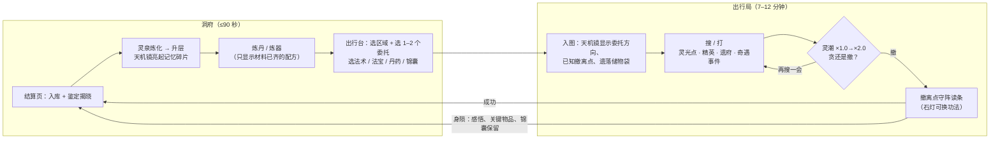

# 《墨途》玩法评审 v1（针对《最小闭环设计 v1.1》）

> 评审人：玩法 / 系统策划（外部视角）　评审对象：`docs/最小闭环设计_v1.md`（v1.1，两区域版）、`docs/设计文档_v0.3.md` §1、§4、`docs/开发约定_v1.md`，以及当前原型数据（`src/data/player.js`、`skills.js`、`items.js`、`enemies.js`、`src/game/shields.js`）。
> 本文**只提建议、不改主文档**。每条建议标注：影响、成本（S 半天内 / M 1–3 天 / L 一周以上）、建议放在 v1 还是后续。
> 结论先行：**骨架是对的**——"搜打撤 + 洞府转化 + 境界即钥匙"能形成正反馈；主要风险是：①一处会卡死流程的**栏位矛盾**；②前 30 分钟**概念过载**、局间**菜单过多**；③每局**缺少"为什么出发"的目标和奇遇**；④**大奖几乎不会出现**；⑤构筑在前半程几乎不存在。

---

## 0. 评审方法

| 方法 | 用在哪里 |
|---|---|
| 竞品循环拆解：塔科夫 / 暗区突围（安全箱、装备恐惧）、Marathon（新手流失）、哈迪斯（"每一局都算数"）、怪物猎人（狩猎—制作）、暗黑 2（随机掉落的"老虎机"）、潜水员戴夫（单机"下潜—经营"双循环）、鬼谷八荒（修为 + 突破材料的目标—反馈体系） | §2 优点、§3 问题的佐证 |
| 自我决定理论（SDT：胜任感 / 自主感 / 关联感）、Quantic Foundry 动机模型（力量、发现、策略、幻想、故事……） | 判断每个系统在满足哪种动机，找出缺口 |
| 新手引导原则（一次只教一件事、在需要的时刻教、先教核心循环） | §3.2 概念过载统计 |
| 文档内数值推算（掉落概率、栏位时间线、局间时长） | §3.1、§3.4 的量化证据 |

---

## 1. 一句话结论

> **这是一个"单机、低惩罚的搜打撤 × 修仙成长"游戏，最该守住的体验是："每次撤回洞府，都能马上变强一点；每次出门，都有一个想去的地方和一个可能的惊喜。"**
> 现在的设计把"变强"做得很扎实，但"想去的地方"（每局目标）和"惊喜"（奇遇、大奖）偏弱，而前半程又塞进了太多需要学习的规则。

---

## 2. 优点（保持）

| # | 优点 | 为什么好（依据） |
|---|---|---|
| 1 | **"失败也不白来"**：斩妖感悟立即入体、锦囊、本命法宝、地图着墨都保留 | 与哈迪斯"every run counts"一致：多条永久进度通道让死亡不再是"清零"（[Tom's Guide 采访 Kasavin](https://www.tomsguide.com/features/hades-exclusive-interview-supergiant)）。塔科夫类游戏的"装备恐惧"来自"死亡 = 回到负数"（[遊星歯車機関](https://note.com/planetary_gear/n/nc6910fd52ad6?hl=en)），本作有效规避 |
| 2 | **风险随区域递增**（教学零损失 → 区域一保留 50% → 区域二全押） | Marathon 的教训：新手"死亡是唯一的一步"导致流失，官方随后加入低风险模式与更早的高品质保底（[Bungie 1.1.0](https://www.bungie.net/7/en/News/Article/marathon_update_1_1_0)、[Upcomer](https://upcomer.com/death-was-the-only-step-bungie-admits-marathon-missed-the-mark-and-plans-a-reset/)）。本作从一开始就把风险做成坡道 |
| 3 | **贴身锦囊**（1→3 格） | 暗区突围的安全箱证明：小容量安全格让玩家"总能带回点什么"，而且容量本身就是成长目标（[Wikipedia: Arena Breakout](https://en.wikipedia.org/wiki/Arena_Breakout)） |
| 4 | **修为 + 突破材料的双目标** | 鬼谷八荒把"突破"拆成"修为 + 材料"两个小目标，派生出整个目标—反馈体系（[机核分析](https://www.gcores.com/articles/134972)）。本作的"筑基丹 = 碧鳞内丹 + 何首乌"同理，且把 Boss 变成了必经节点 |
| 5 | **鉴定放在洞府** | 暗黑式"拉老虎机"的快感（[TheGamer 采访 Brevik/Schaefer](https://www.thegamer.com/diablo-2-loot-interview/)）放在安全区揭晓，同时让局内"未知宝光"制造是否冒险的悬念——一举两得 |
| 6 | **五行护盾 × 法术获取地** | 让新拿到的法术马上有用武之地，避免"废技能"；也让区域有辨识度 |
| 7 | **境界即钥匙**（二段跳 → 断涧，御剑 → 孤峰） | 能力解锁 = 地图解锁，是"修炼有手感"支柱的最佳表达 |
| 8 | **背包灵值实时显示** | 把"贪不贪"量化，降低认知负担，让取舍可比较 |

---

## 3. 问题（按严重度排序）

### 🔴 P1【阻断】青牙战的"法术切换"与栏位时间线矛盾

- 文档 §9.1：Boss **青牙**护盾 **木 → 土**，设计意图是"剑气斩 → 缠藤诀，学会切换"。
- 但 §13.1：**第 2 个法术栏在练气 5 才开**；§10.3：第 4 局打青牙时是**练气 4**；§12：法术只能在洞府备战时配置。
- 结果：玩家只有 1 个法术栏，**无法同时带剑气斩和缠藤诀**。土盾阶段只能用非克制五行（×0.25）或普攻（×0.15）去磨约 800 点护盾，按当前数值估算，剑气斩每 8 秒只能削约 60 点护盾，**实际上是一堵墙**。
- 碧鳞（火 → 土 → 木）在练气 9 时也只有 2 个栏位；文档靠"飞剑（金）补位木盾"解决，可行，但必须明确告诉玩家，否则同样卡关。
- 附带不一致：开发占位 `src/data/progression.js` 把法宝栏放在练气 5，而 §13.1 写的是练气 7–8，需要统一（交给内容模块）。

### 🔴 P2【高】前 30 分钟概念过载、局间菜单过多

**按文档逐局统计"新概念"数量：**

| 局 | 新引入的规则 / 系统（依据各章节） | 数量 |
|---|---|---|
| 1 教学 | 移动、闪身、普攻、采集运笔、丹药、撤离、身陨、入库、炼化、突破、剑气斩、遁地符 | 12 |
| 2 | 天时、撤离读条、妖潮、储物袋满取舍、锦囊、未鉴定 / 鉴定、五行护盾、精英、灵光点、残阵、石灯打坐点、化灵 | 12 |
| 3 | 遗府机关、缠藤诀、法衣器方与法衣栏、修丹炉、火候小游戏、药园、丹药囊 2 格、储物袋升级、心法栏 | 9 |
| 4 | Boss、护盾阶段切换、聚气丹、丹毒、二段跳、第 2 法术栏、玉佩栏 | 7 |
| 5 | 搬迁、高风险区、装备风险、认主、护器符、遗落储物袋、假阵 | 7 |
| 6 | 剑修遗府机关、法宝栏 / 本命、寒冰锥、阵法栏 / 剑阵、护脉丹 | 5 |
| 7 | 残卷参悟、筑基丹、心魔、御剑、土遁、第 3 法术栏 | 6 |
| **合计** | | **≈ 58** |

- **前 3 局（约 30 分钟）塞进约 33 个新概念**，平均不到 1 分钟一个。这正是 Marathon 自己承认的问题——"要求新玩家学得太多太快"（[GameRant](https://gamerant.com/marathon-addressing-complaints-season-2/)）。业界共识是"先教核心循环，复杂的制作、天赋树延后"（[Apple: Onboarding for Games](https://developer.apple.com/app-store/onboarding-for-games/)、[Meta VR Growth Insights](https://developers.meta.com/vr/blog/growth-insights-series-building-competency-new-user-onboarding/)）。
- **局间时长**：文档定为 2–3 分钟 × 6 次 ≈ 12–18 分钟，占 80 分钟的 **15–22%**，而且除火候外都是纯菜单。怪物猎人的分析指出"在城镇、准备界面、任务选择之间频繁切换会打断专注"，原则是"每个活动都要么直接增强核心玩法、要么为它做准备"（[Kokutech](https://www.kokutech.com/blog/gamedev/design-patterns/flow-state/monster-hunter-world)）。潜水员戴夫的经营半场能撑住，是因为它本身是一个小游戏（[AV Club](https://www.avclub.com/dave-the-diver-review-gameplay-loop-roguelike-fish-restaurant-management)）；而本作的仓库 → 鉴宝 → 炼化 → 药园 → 炼丹 → 炼器 → 参悟 → 出行台是 8 个站点的跑腿清单，**有"家务化"风险**。

### 🔴 P3【高】每局缺少"为什么出发"——目标与奇遇不足

- 现在每局的目标基本是"搜够了就撤"。七局里只有 3、4、6、7 局有明确目标（遗府、Boss），**第 2、5 局（以及任何补材料、复仇局）是无目标的"跑图"**。
- 鬼谷八荒制作人把修仙的乐趣拆成三件事：**努力、奇遇、社会关系**（[GameRes 访谈](https://www.gameres.com/forum/t/880533)）；其常见批评也是"副本毫无关卡设计、后期重复刷"（[知乎](https://www.zhihu.com/question/641116217/answer/3386324641)）。本作把"努力"做足了，**"奇遇"只有灵光点，"社会关系"只有玄机子**。
- SDT 研究表明自主感、胜任感、关联感各自独立预测乐趣与再玩意愿（[Ryan, Rigby & Przybylski 2006](https://www.semanticscholar.org/paper/The-Motivational-Pull-of-Video-Games:-A-Theory-Ryan-Rigby/dca79f12c1923582fe4f71fc79fd4d6a8d1c76ad)）。当前设计的胜任感（变强）强，**自主感（我选择这局干什么）和关联感（世界对我有反应）弱**。

### 🟠 P4【中高】"大奖"在 v1 里几乎不会出现

- 极品法宝：Boss 首杀 1%、重复 0.5%、夜明宝箱 0.5%，外加隐藏机缘值。
- 一次 v1 通关大约有 **2 次 Boss 首杀 + 0–1 次重复 + 1–3 个夜明宝箱**，合计中奖概率约 `1 − 0.99² × 0.995³ ≈ 3.5%`。机缘值每次 +0.2% 只能把它推到 5% 左右。
- 也就是说 **约 95% 的玩家在 v1 里见不到"这一把发了"**。这个时刻是暗黑式掉落动机的核心（"像拉老虎机"，[TheGamer](https://www.thegamer.com/diablo-2-loot-interview/)），也是 Quantic Foundry 中"力量"动机的高光（[Quantic Foundry](https://quanticfoundry.com/)），v1 不应缺席。
- 同理，"仙品"在 v1 的期望出现次数也只有 1–2 件，惊喜间隔太长。

### 🟠 P5【中】构筑在前半程几乎不存在，护盾克制是"唯一解"

- 第 1–4 局（约 45 分钟，超过一半流程）：普攻 + **1 个法术**，无法宝、无阵法、心法要到练气 4。设计支柱"构筑是核心"要到最后三局才出现。
- 五行护盾目前的解法是**唯一的**："看到火盾 → 装寒冰锥"。这是一道有标准答案的题，满足的是"知识"而不是"策略 / 自主"。Quantic Foundry 的"策略"动机需要的是**多条可行路线之间的取舍**（[动机模型参考 v3](https://quanticfoundry.com/wp-content/uploads/2026/09/Gamer-Motivation-Model-Reference-v3.pdf)）。

### 🟠 P6【中】身陨规则条目多、跨区域有"悬崖"，关键材料可能丢失

- 规则条目：教学豁免、区域一 50%、区域二全失、消耗品失、随机 1 件装备、按品质加权、本命、认主、护器符、锦囊、遗落袋 100% / 60%、二次身陨清空、首次中途关页豁免……**玩家很难在出发前算清"我会丢什么"**。
- 区域一 → 区域二是**一步跳到最高风险**，而区域二只有 3 局，其中第 7 局是最终 Boss。如果第 6–7 局身陨，**碧鳞内丹、千年何首乌这类筑基必需品**会进入遗落袋，甚至因二次身陨消失——这是**进度阻断**，不只是"损失"。
- 暗区突围把安全箱容量做成独立的成长目标（[3×3 安全箱获取](https://www.mmoexp.com/News/arena-breakout-infinite-how-to-get-the-3-3-case.html)），玩家会优先把最关键的物品放进去。但本作锦囊只有 1–3 格，而千年竹心这类材料占 4 格，放不进去。因此**关键物品需要不同于普通战利品的保护**。

### 🟡 P7【中】天时压力可能变成"催促感"，而不是"贪心的抉择"

- 区域一一局目标 7–10 分钟，暮从第 7 分钟开始、夜从第 10 分钟开始。也就是说**正常节奏的每一局都会撞上"暮"**，压力是常态，而不是玩家主动选择"再贪一点"。
- "探索有回报"是支柱之一；如果计时器总在背后推，玩家会只走熟悉的高收益路线，探索被挤压。
- 推运（push-your-luck）设计的关键是：**留下来的回报要和风险同时、肉眼可见地增长**。现在只有夜明宝箱和"午后灵光点品质 +1"，回报曲线不明显。

### 🟡 P8【中】"搜"的手感：采集小游戏的重复次数

- 采集"运笔"小时机在 7 局里会触发数十次。常见灵草每次都做，很快会从"有趣"变成"打断"。

### 🟡 P9【中低】叙事钩子有好设定，但缺少"节拍"

- 天机镜（裂屏手机，修为越高亮起越多现代画面）是很好的情感锚，满足"幻想 / 故事"动机和关联感。但文档只在筑基处安排了一次"完整亮起"，**中间 6 次突破没有叙事回报**。

### 🟡 P10【中】v1 范围仍偏大

- 2 张手工大地图、6 类敌人 + 2 Boss + 心魔、2 个带机关房的遗府、8 个洞府设施、炼丹与炼器、药园、假阵、认主与护器符……对"1.3 小时内容"来说，**系统数量多于内容数量**，开发风险集中在"做了很多半成品系统"。

### ⚪ P11【低】v1 结束后没有可重玩内容

- 筑基后只有结尾演出和下一章预告。如果试玩反馈"好玩"，玩家没有继续玩的东西，也就收集不到更多试玩数据。

---

## 4. 优化建议

### 4.1 必须做（v1，修复阻断与核心体验）

| 编号 | 建议 | 解决 | 影响 | 成本 |
|---|---|---|---|---|
| **G1** | **调整法术栏时间线**：第 2 栏提前到**练气 3**（缠藤诀到手时、青牙之前），第 3 栏提前到**练气 7**（剑修遗府之后、碧鳞之前）；筑基的奖励改为御剑 + 土遁护体 + 属性跃升。同步统一法宝栏为练气 7（修正开发占位的练气 5） | P1、P5 | 消除卡关；构筑提前进入中段 | S（只改 `progression.js` 数据与文档） |
| **G2** | **石灯打坐点可"换功法"**：激活石灯后可以重新配置法术和法宝（每灯每局 1 次），丹药不可补 | P1、P5、P3 | 局内应变：遇到没带克制的护盾可以绕路去石灯换；增加路线决策 | S |
| **G3** | **关键物品护身**：标记为"关键"的物品（突破材料、遗府首通秘宝、剧情物品）不参与任何身陨损失，拾取后自动进入专属"护身格"（不占锦囊） | P6 | 消除进度阻断；高风险只作用于"可再获得的东西" | S（物品 `tags: ["key"]` + 结算判断） |
| **G4** | **大奖曲线重排**：①每局至少 1 件宝品（灵光点保底）；②第 2–3 局内必出第 1 件仙品；③**第 1 件极品在 v1 内必出**——用"机缘值"做成**可见的天机镜"机缘"刻度**，满了时下一个 Boss / 夜明宝箱必出极品（预计第 5–7 局）；之后恢复低概率 | P4 | 保证每位玩家都经历"这一把发了"，并制造"机缘快满了，再出一趟"的动机 | S（掉落数据） |
| **G5** | **回府一键整理，设施合并**：结算页直接完成入库与**鉴定揭晓**（开箱演出放在结算页，最爽的时刻不再要求玩家走到鉴宝台）；"参悟"并入仓库的"使用"；药园回府**自动收获**；洞府总览只显示"现在能做的 1–3 件事"，点一下直达 | P2 | 局间目标 ≤ 90 秒（现为 2–3 分钟）；菜单站点从 8 个降到 4 个（灵泉 / 炼丹 / 炼器 / 出行台） | M |
| **G6** | **设施与机制按局解锁**（每局最多引入 3–4 个新概念，见 §5 时间表）：例如药园、认主 / 护器符、假阵、注灵推到后续或区域二 | P2、P10 | 前 3 局新概念从约 33 个降到约 18 个 | S（引导与解锁数据） |

### 4.2 强烈建议（v1，补足"为什么出发"与奇遇）

| 编号 | 建议 | 解决 | 影响 | 成本 |
|---|---|---|---|---|
| **G7** | **出行委托（玄机子悬赏）**：出行台每次给 3 个委托，选 1–2 个带出门（如"斩狼妖头目 1 只""采凝露花 ×5""在入夜后从残阵撤离""带回 1 件未鉴定宝物"）。完成给修为、器方残页或机缘值。数据驱动，随区域刷新 | P3、P7 | 每局都有目标和路线；"入夜撤离"类委托把天时压力变成主动挑战；满足自主感 | M |
| **G8** | **奇遇事件池（v1 先做 4 个）**，每局随机出现 0–2 个，全部是"小选择、有后果"： ① **受伤灵狐**：救它（耗回春丹）→ 下局它在药园留下一株稀有灵草；或取其内丹。 ② **前辈遗蜕**：开棺（50% 宝品，50% 引出尸傀精英）或叩拜（得少量修为与一句线索）。 ③ **散修"白鹭"**：可交易、可结伴撤离（她帮你守阵读条）；第 3 次相遇触发剧情（她也在找留白）。 ④ **灵雨**：60 秒内采集必为完整品，但会引来妖兽 | P3、P9 | 修仙核心幻想"奇遇"进入 v1；散修 NPC 提供关联感与剧情线；7 局不再重复 | M（事件框架 + 4 个事件） |
| **G9** | **天时改为"灵潮推运"**：HUD 天时条旁显示"**灵潮 ×1.0 → ×1.5 → ×2.0**"，即掉落品质 / 灵值倍率随天时上升；同时把区域一的"暮"推迟到第 9 分钟（让正常节奏的局基本在白天结束）。夜晚危险不变 | P7 | 留下来的回报与风险同步、肉眼可见；"贪不贪"从被催变成主动选择 | S（数据 + HUD 文案） |
| **G10** | **五行破盾"多解"**：除了克制法术，再提供 2 条路：①**五行符**（一次性，炼器可做，3 张一组，破盾 ×2）；②炼器"**附灵**"让法剑带一种五行（普攻对该护盾按"克制"结算的 50%）。护盾仍然鼓励换法术，但不再是唯一答案 | P5、P1 | 策略与自主感：带法术 / 带符 / 附灵剑三种准备方式 | M（符 S，附灵 M） |
| **G11** | **天机镜叙事节拍**：每次升层都"亮起"一个现代记忆碎片（共 9 段：工位、地铁、母亲的语音……），筑基时第一次能"拨出"一条消息；玄机子每次突破有一句不同的反应 | P9 | 用 9 次突破把"回家"变成持续的情感驱动；成本几乎只有文案 | S |

### 4.3 可选（v1 视进度，或放后续）

| 编号 | 建议 | 解决 | 成本 | 建议 |
|---|---|---|---|---|
| G12 | 采集：常见灵草**免小游戏**、直接拾取；只有稀有灵草（何首乌、千年竹心）触发运笔 | P8 | S | v1 |
| G13 | **装备风险改为"押注"**：区域二默认赌注 = 储物袋 + 消耗品；出行准备里可以勾选"**押上法器**"，换取本局灵潮倍率 +0.3（按用户"高区也赌装备"的决定，把它保留为**可选**，或保留为默认但给出押注收益） | P6 | S | v1（需用户确认，见 §8） |
| G14 | 区域一 → 区域二之间加"**半高风险**"过渡：区域二前两局身陨保留 30% 储物袋 | P6 | S | v1 |
| G15 | v1 结束后开放"**悬赏挑战**"：重访两区的高难委托（夜间开局、强化碧鳞），奖励机缘值与仙品 | P11 | M | v1.1 |
| G16 | 散修 NPC 的完整人物线、灵兽、坊市 | P3 | L | 后续 |

---

## 5. 建议的引入时间表（落实 G6，每局 ≤ 4 个新概念）

| 局 | 新引入（建议） | 推迟或合并 |
|---|---|---|
| 1 教学 | 移动、普攻、闪身、撤离（无读条）——**4 个**；结尾学剑气斩、第一次突破（演出带过） | 采集、丹药、身陨移到第 2 局；遁地符移到第 3 局 |
| 2 | 采集（直接拾取）、回春丹、撤离读条、储物袋满取舍 | 天时只显示不加压；锦囊、鉴定移到第 3 局 |
| 3 | 五行护盾精英、锦囊、未鉴定（结算页揭晓）、遁地符 | 灵光点照常出现但不教学 |
| 4 | 山神庙遗府、缠藤诀、**第 2 法术栏（练气 3）**、修丹炉 + 火候 | 药园推到区域二 |
| 5 | Boss 青牙（两段护盾，两个栏位都可用）、二段跳、出行委托（G7） | — |
| 6 | 搬迁、高风险、遗落储物袋、奇遇事件（G8） | 认主 / 护器符二选一保留；假阵推到后续 |
| 7 | 剑修遗府、青冥飞剑（法宝栏）、寒冰锥、**第 3 法术栏（练气 7）**、剑阵 | — |
| 8 | 碧鳞、筑基丹、心魔、御剑 | — |

> 局数从 7 增加到 8：教学拆细后多出一局，但每局更短（教学 5 分钟、第 2 局 7 分钟），总时长基本不变（约 80–85 分钟）。

---

## 6. 修订后的循环图

---

## 7. 体验走查（采纳 §4.1–4.2 之后）

### 7.1 前 15 分钟

| 时间 | 发生了什么 | 玩家的感受 / 学到的 |
|---|---|---|
| 0:00–1:30 | 开场（可跳过）：展厅、雨声、古画、墨汁吞没画面 → 溪边醒来，裂屏手机亮起 | 好奇：我在哪？手机怎么还亮着？ |
| 1:30–4:00 | 教学局：捡锈剑，砍两只落单狼妖（顿帧、墨点飞溅）；闪身躲开第三只的扑咬 | 战斗爽、操作跟手（胜任感） |
| 4:00–5:00 | 天机镜指向崖下墨点"破洞府"，走进去即撤离（无读条）；结算页出现第一件战利品 | "撤离 = 安全回家"的概念一次学会 |
| 5:00–7:00 | 玄机子登场吐槽："联什么网？"；灵泉炼化 → **练气一层**，天机镜亮起第一块画面：深夜的工位 | 变强 + 情感钩子 |
| 7:00–7:30 | 学会剑气斩；出行台只有一个按钮"出发" | 局间只做一件事，不被菜单淹没 |
| 7:30–14:00 | 第 2 局（区域一）：剑气斩扫狼群；采青灵草（直接拾取）；储物袋第一次满，必须丢一捆普通草才能装下狼王遗骨；天时条显示"灵潮 ×1.2"；赶到古传送阵，**第一次读条守阵**，狼群扑来 | 第一次"贪不贪"的取舍；第一次守点的紧张 |
| 14:00–15:00 | 结算页：狼王遗骨、一件"未鉴定 · 宝光"当场揭晓——灵品法剑；炼化后升到**练气二层**，天机镜亮起地铁站 | 每局回家都变强、都有惊喜 |

### 7.2 一局典型出行（第 7 局，区域二的第 2 次出行，练气 6）

1. **出行台（40 秒）**：三个委托里选"斩火盾藤妖 ×2"和"入夜后从残阵撤离"。法术栏是剑气斩 + 缠藤诀；没有克制火盾的寒冰锥，于是带 3 张**水符**（G10）。法剑认主；出行准备提示"高风险：储物袋与消耗品遗落；未认主装备可能遗落"。
2. **晨（0–5 分钟）**：入口在竹海西侧。天机镜标出上一局的**遗落储物袋**（里面有一件宝品法衣）——先去捡回来。路上遇到**奇遇"受伤灵狐"**，花一枚回春丹救它。
3. **午（5–9 分钟）**：第一个火盾藤妖用水符破盾、缠藤诀定住一群；第二个藤妖在断涧对面，二段跳过去。发现一处灵光点：千年竹心（4 格），背包放不下——丢掉三份普通紫藤。
4. **暮（9–11 分钟）**：灵潮 ×1.5，HUD 灵值 1,240。最近的古传送阵在 40 秒路程外；委托要求"入夜后从残阵撤离"。决定再搜一个宝箱，等天黑。
5. **夜（11–13 分钟）**：第一波妖潮。残阵是**真阵**（靠近确认），读条 12 秒（夜晚 ×2）；在阵内一边闪身一边用剑阵守点；读条剩 3 秒时气血见底，喝下最后一枚回春丹。
6. **结算**：撤离成功。千年竹心 + 夜明宝箱里的未鉴定仙光——**结算页揭晓：仙品玉佩（撤离读条 −25%）**。机缘刻度涨了一格（"还差两格"）。两个委托完成，得到器方残页。
7. **洞府（60 秒）**：炼化千年竹心 → 升到练气七层，**第 3 个法术栏解锁**，天机镜亮起母亲的语音气泡。下次打碧鳞可以带齐三个法术。

---

## 8. 需要用户决定的问题

1. **G1 栏位时间线**：同意把第 2 法术栏提前到练气 3、第 3 栏提前到练气 7 吗？（不调整的话，青牙战需要改成单盾，碧鳞改成两段。）
2. **G13 装备风险**：保留"区域二默认赌装备"，还是改为"可选押注（押上法器换更高灵潮倍率）"？
3. **G7 / G8**：同意 v1 加入"出行委托"和 4 个"奇遇事件"吗？（会占用开发资源，但这是"每局都想出发"的关键。）
4. **G5**：同意把"鉴定揭晓"挪到结算页、"参悟"并入仓库、药园自动收获吗？（鉴宝台可以保留为装饰性场景。）
5. 散修 NPC"白鹭"作为 v1 的第二个角色（G8 ③），还是先只保留玄机子？

---

## 9. 参考资料

- Supergiant / Hades："every run counts" 与多通道永久进度：[Tom's Guide 采访 Greg Kasavin](https://www.tomsguide.com/features/hades-exclusive-interview-supergiant)；[Collider: How Hades Succeeds by Making Failure the Point](https://collider.com/hades-gameplay-mechanics/)
- 塔科夫的死亡设计与"装备恐惧"：[遊星歯車機関: Designing Death](https://note.com/planetary_gear/n/nc6910fd52ad6?hl=en)；[Frank151: Gear Fear](https://frank151.com/gear-fear-what-it-is-and-how-to-get-over-it/)；[Wikipedia: Extraction shooter](https://en.wikipedia.org/wiki/Extraction_shooter)
- 暗区突围安全箱：[Wikipedia: Arena Breakout](https://en.wikipedia.org/wiki/Arena_Breakout)；[MMOEXP: 3×3 安全箱](https://www.mmoexp.com/News/arena-breakout-infinite-how-to-get-the-3-3-case.html)；[LevelUpTalk: 装备恐惧横向比较](https://leveluptalk.com/news/comparing-gear-fear-tarkov-ab-df-games/)
- Marathon 的新手流失与调整：[Bungie: Marathon Update 1.1.0](https://www.bungie.net/7/en/News/Article/marathon_update_1_1_0)；[GameRant](https://gamerant.com/marathon-addressing-complaints-season-2/)；[Upcomer](https://upcomer.com/death-was-the-only-step-bungie-admits-marathon-missed-the-mark-and-plans-a-reset/)；[Forbes (Paul Tassi)](https://www.forbes.com/sites/paultassi/2026/06/23/marathon-is-running-out-of-casual-player-onboarding-cards-to-play/)
- 暗黑掉落设计：[TheGamer: Diablo 2 Designers Talk Addictive Loot](https://www.thegamer.com/diablo-2-loot-interview/)；[Game Developer: The Logistics of Loot](https://www.gamedeveloper.com/design/the-devil-is-in-the-details-of-action-rpgs---part-one-the-logistics-of-loot)
- 怪物猎人循环：[Kokutech: How to Design Satisfying Gameplay Loops](https://www.kokutech.com/blog/gamedev/design-patterns/flow-state/monster-hunter-world)；[Cosmic Anomaly: Monster Hunter's Meaty Design](https://www.cosmicanomaly.dev/blog-and-analysis/monster-hunters-meaty-design)
- 潜水员戴夫的双循环：[AV Club](https://www.avclub.com/dave-the-diver-review-gameplay-loop-roguelike-fish-restaurant-management)；[Wikipedia: Dave the Diver](https://en.wikipedia.org/wiki/Dave_the_Diver)
- 鬼谷八荒：[GameRes 制作人访谈](https://www.gameres.com/forum/t/880533)；[机核：修仙之旅为何让我着迷](https://www.gcores.com/articles/134972)；[知乎策划答主分析](https://www.zhihu.com/question/641116217/answer/3386324641)
- 动机理论：[Ryan, Rigby & Przybylski (2006)](https://www.semanticscholar.org/paper/The-Motivational-Pull-of-Video-Games:-A-Theory-Ryan-Rigby/dca79f12c1923582fe4f71fc79fd4d6a8d1c76ad)；[PENS](https://selfdeterminationtheory.org/player-experience-of-needs-satisfaction-pens/)；[Przybylski, Rigby & Ryan (2010)](https://selfdeterminationtheory.org/SDT/documents/2010_PrzybylskiRigbyRyan_ROGP.pdf)；[SDT 在游戏研究中的局限（arXiv）](https://arxiv.org/html/2405.12639v1)；[Quantic Foundry](https://quanticfoundry.com/)；[动机模型参考 v3](https://quanticfoundry.com/wp-content/uploads/2026/09/Gamer-Motivation-Model-Reference-v3.pdf)
- 新手引导：[Apple: Onboarding for Games](https://developer.apple.com/app-store/onboarding-for-games/)；[Meta: Building Competency in New User Onboarding](https://developers.meta.com/vr/blog/growth-insights-series-building-competency-new-user-onboarding/)；[Ludolib: 8 Core FTUE Principles](https://ludolib.net/en/game-design--and--art/game-design/how-to-design-a-great-ftue)
