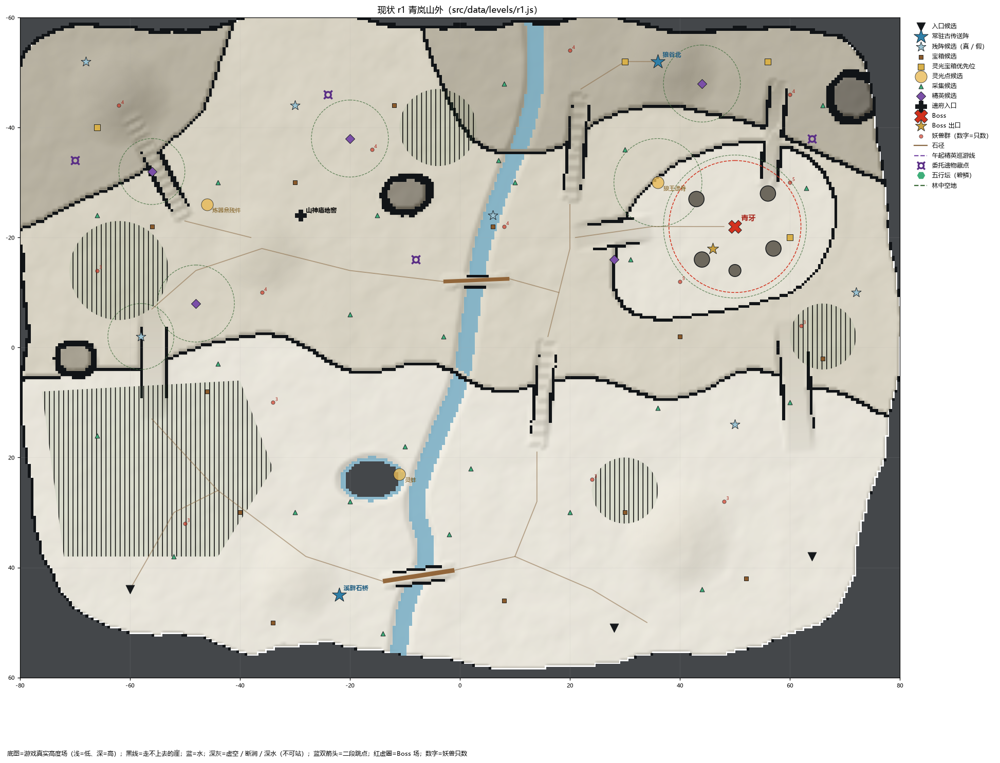
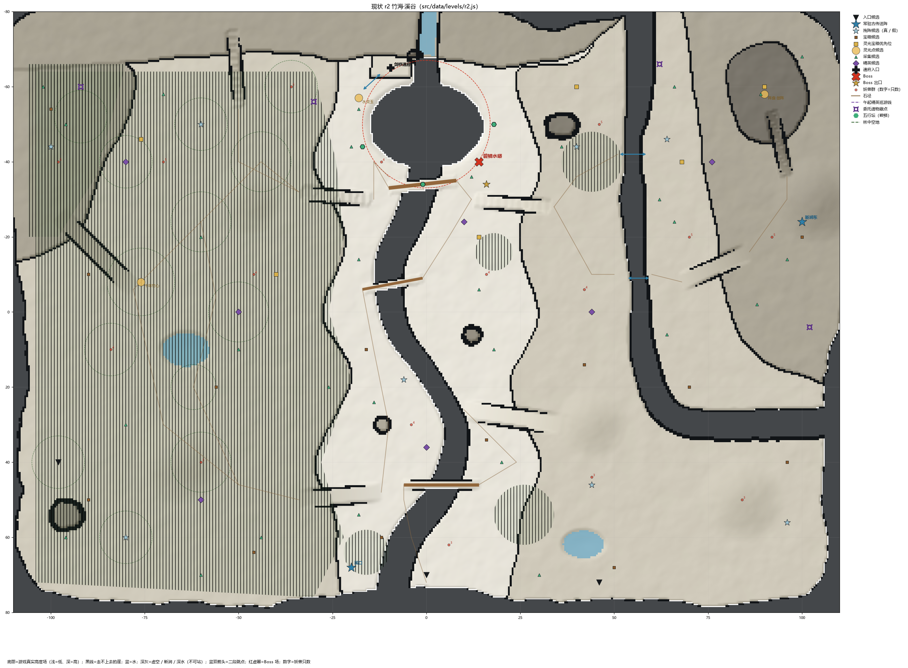
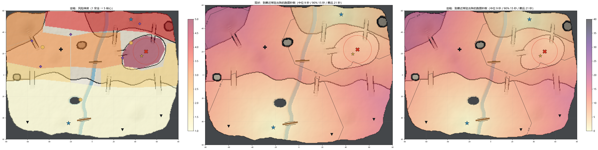
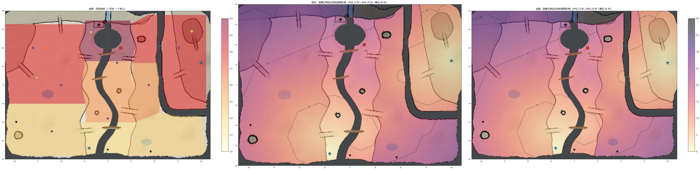
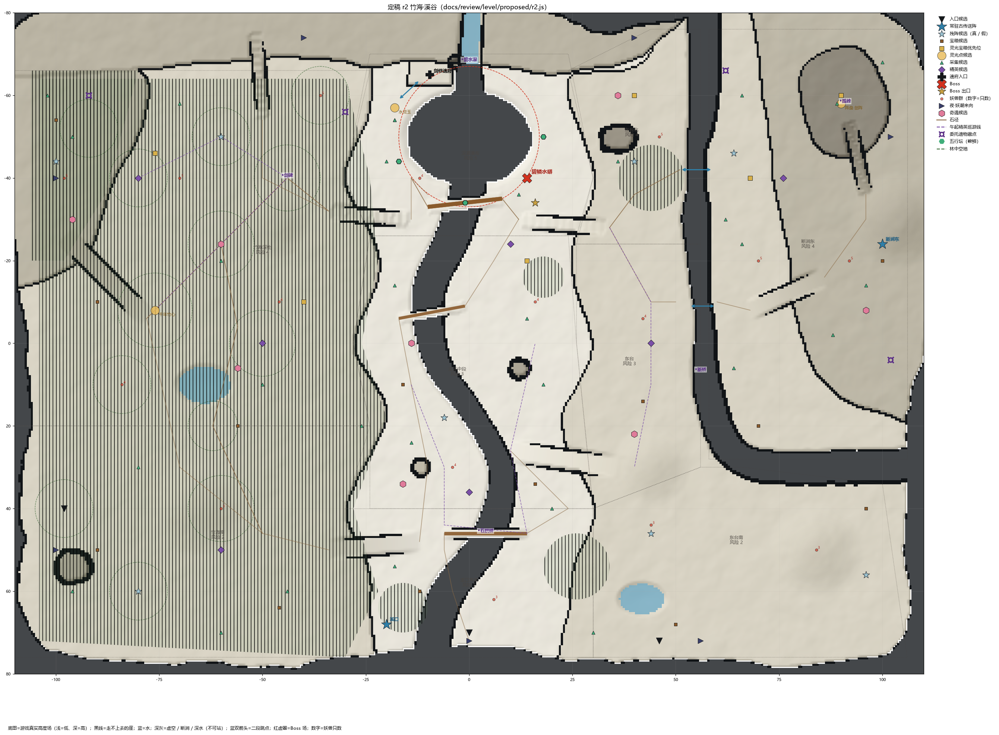
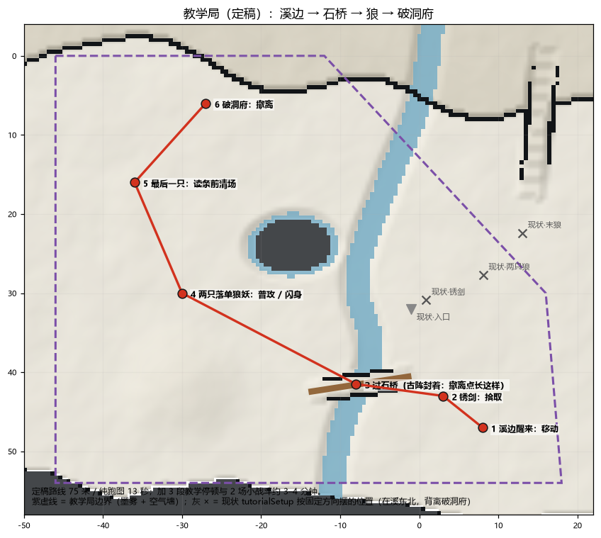
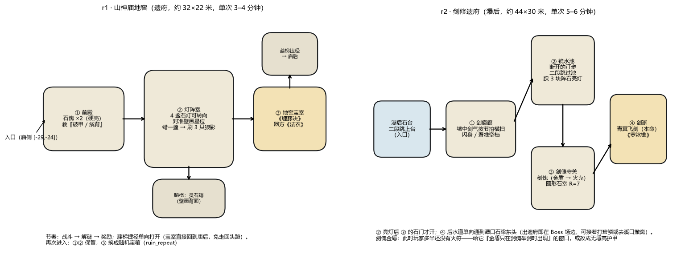
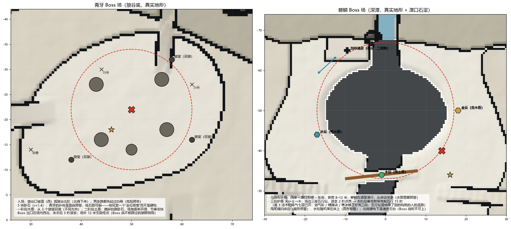
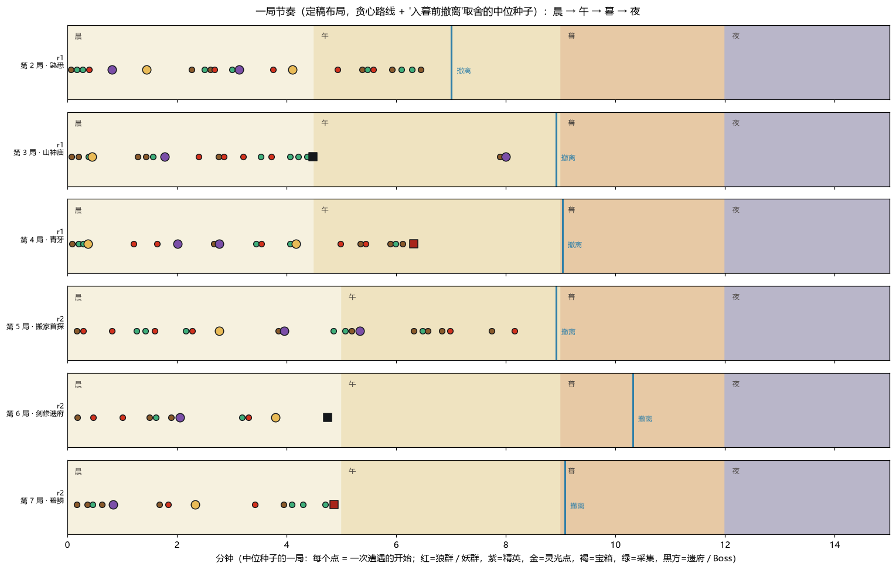

# 墨途 · 关卡评审与方案 v1（青岚山外 r1 / 竹海·溪谷 r2）

> 角色：关卡策划评审。依据：《最小闭环设计_v1》v1.1 §4/§6/§7/§9/§10.3、《开发约定_v1》§3.2、关卡开发已写的 `src/data/levels/r1.js` / `r2.js` / `src/world/heightfield.js` / `level.js`、流程的 `src/game/run/regions.js` / `run.js`、内容的 `enemies.js` / `skills.js` / `quests.js` / `encounters.js`。
> 已经确认采纳的玩法改动都按"已生效"处理：灵潮（天时回报倍率，r1 第 9 分钟入暮）、出行委托（3 选 1–2）、4 个奇遇、关键物品不丢、只做两个区域。
> **这份方案会直接落地，所以每个区域只给一版定稿**，数据就是关卡开发现有文件的"改版"，地形格式不变：
> - **`docs/review/level/tools/overrides.mjs`：定稿相对关卡开发现有数据的全部改动**，用数据写成 diff，每条都注明编号和理由。
> - `docs/review/level/proposed/r1.js`、`r2.js`：由 `tools/make_proposed.mjs` 自动生成，等于"最新的 `src/data/levels/<id>.js` + overrides"，可以直接替换同名文件。关卡开发以后改了地形，重跑 `sh tools/run_all.sh` 就会重新生成并校验。
> - `docs/review/level/proposed/heightfield_hardCliffs.diff`：P0 的一行引擎补丁。**不打这个补丁，定稿里的崖线和关口都不成立**。
> - `docs/review/level/levels_proposal.json`：机器可读。`regions.<id>.def` 是完整的关卡定义；`regions.<id>.contract` 是 buildLevel points 契约下的全部候选点，pos 为 `[x, y, z]`，y 是地面高度。

---

## 0. 一页结论

| # | 问题（现状） | 证据 | 定稿怎么改 |
|---|---|---|---|
| **P0-1** | **崖线到处漏**。台地和狼谷的崖边不走坡道也能上下：r1 有 18 处，其中狼谷沿 8 处，所以狼谷四面敞开；r2 有 12 处 | `tools/leaks.py`：封掉所有坡道和石阶后，用与 `level.js flood` 相同的规则找路（§3.1） | heightfield 加 `def.hardCliffs`，崖边取硬台阶（1 行补丁，已验证：两张图的渗漏全部归零） |
| **P0-2** | **剑修遗府不用二段跳就能进**。可以从北脊顺着瀑布缺口一路走下遗府石台 | 无二段跳时从入口到遗府 202 米可达 | 缺口处加一块峭壁 `crag [-3.5,-68.5]`。改后不带二段跳不可达 ✔ |
| **P0-3** | **教学局第一分钟就让人背着目标走**。`run.js tutorialSetup` 按固定方向 (1,0,-0.6) 摆锈剑和狼，位置在溪东北；破洞府却在溪西北 | 图 `tutorial.png` 里的灰色 × | `tutorialLayout.steps` 给出一条沿溪向西北的单线，再加 `bounds`（墨雾围栏）。全程 75 米，约 3–4 分钟 |
| P1-1 | **r1 风险梯度被东入口打穿**。东入口 [70,24] 到狼王遗骨和青牙都只有 9 秒；风险 1 区里还放了 450–700 气血的精英 | 路程表 §5 | 入口全部放到南缘；狼王遗骨挪出 Boss 场；精英只放在风险 ≥2 的区。东入口到青牙改为 17 秒 |
| P1-2 | **灵光宝箱可能刷在出生点旁边**。现在是抽中的前 N 个宝箱直接升级成灵光宝箱 | `level.js`：`tier: i < glow ? "glow"` | 新增 `chests.glowFrom`，全部是风险 ≥3 的点 |
| P1-3 | **开局刷怪纯随机**。`run.js` 只取打乱后的前 `packs` 组（r1 5 组 / r2 7 组），可能全落在南边的安全区 | `spawnInitial` | 每组带 `zone`。先从最高风险区抽 1 组，其余按区的风险加权；组的大小也随风险从 3 递增到 5 |
| P1-4 | **碧鳞场被出潭的河切成两半**。东岸打不到西岸，也绕不了潭 | 图 `arenas.png` | 新增"潭口石梁"，场地连成马蹄形；五行坛 ×3 |
| P1-5 | **断涧东只有一个跳点**。过了跳点 26 米就是古阵（东岸的风险等于零），夜里妖潮一堵跳点就出不去 | 现状图 | 新增断涧北口跳点；断涧东古阵挪上东岭 [100,-24]（高处、暴露） |
| P1-6 | **假阵规则会惩罚人**。两个残阵里随机一个是假的，可能出现"唯一近的出口是假的" | `level.js` | 新增 `ruins.fakeFrom`，假阵只从离两座古阵都远的中段抽 |
| P1-7 | **委托数量凑不齐**。"晨露"委托最多要 4 株凝露花或寒露草，r1 每局只刷 3 株凝露花 | `quests.js` 对照 `r1.js` | 凝露花 4/8，寒露草 5/9 |
| P1-8 | **第 5 局（r2 首探）没有克火的手段**，精英却可能是火盾。寒冰锥要到第 6 局才拿到 | `enemies.js` 与 §10.3 | 南半区精英限定土盾（缠藤诀可破），火盾只在北半区出现 |
| P2 | 竹海是一整片密竹，45° 镜头下人会被整个盖住；西半张图没有地标；夜潮从随机方向刷；午巡游精英没有路线数据 | — | 13 块林中空地、竹海石径、剑碑（地标）；`night` 来向 ×6–7；`patrols` ×3 |

**时长结论**（按真实地形模拟 300 个种子，§6）：
- r1：全拿是 7.0 / 10.3 / 9.4 分（熟悉局 / 遗府局 / Boss 局）。若在入暮前收手，三局都在 9 分钟内撤离，内容拿到 82–100%。**符合 7–10 分钟的目标**。
- r2：全拿要 12–17 分钟，超出 9–13 分钟的目标；入暮前收手只能拿到 45–76%。这是有意保留的"贪不贪"空间，但遗府局 79% 会进入暮，需要靠灵潮倍率把"留下"包装成选择（§6）。
- **两张图的跑图时间只占一局的 15–30%**。160×120 米的图按 6 米/秒，任意两点不超过 45 秒。所以局长和撤离压力都靠内容密度、天时和守阵读条来做，靠地图尺寸做不出来（§3.4）。

---

## 1. 方法与工具（都可以复跑）

| 工具 | 作用 |
|---|---|
| `tools/export_hf.mjs` | 直接 import 游戏的 `src/world/heightfield.js` 和关卡数据，把 0.5 米网格（walk / ground / 到水距离）导出给 Python。**分析用的就是游戏里的真实高度场**，不是手绘示意。`HF=tools/hf_hard.mjs` 时用硬崖补丁 |
| `tools/lvl.py` | 可走图采用与 `level.js flood` 相同的规则：4 邻接，上 ≤0.55、下 ≤0.9，walk ≥ −0.8；二段跳点双向连通。路程估算另开对角步。用 scipy 跑 Dijkstra，再按统一图例出图 |
| `tools/leaks.py` | 崖线渗漏检查：封掉坡道和石阶走廊后找"从低层到高层"的最短路；找到一处就在那里封 5 米，再找下一处 |
| `tools/analyze.py` | 现状与定稿对照：点位校验、路程表、撤离压力、一局蒙特卡洛模拟（按每局抽取规则抽点 → 贪心路线 → 跑图 + 停留 → 撤离）、全部出图、导出 JSON |
| `tools/hf_hard.mjs` | heightfield 硬崖补丁原型（自动从 src 生成，只改 1 行） |

模拟里各类内容的停留时间按数值评审的敌人曲线估：

| 区域 | 狼群 / 妖群 | 精英 | 灵光点 | 宝箱 | 采集 | 遗府 | Boss |
|---|---|---|---|---|---|---|---|
| r1 | 18 秒 | 35 秒 | 45 秒 | 4 秒 | 3 秒 | 200 秒 | 150 秒 |
| r2 | 26 秒 | 50 秒 | 55 秒 | 4 秒 | 3 秒 | 300 秒 | 240 秒 |

撤离另计：读条 × 天时倍率，再加 10 秒守阵。

---

## 2. 研究要点 → 本作怎么用

| 原则（来源） | 用在哪里 |
|---|---|
| **最好的东西放在最危险的中心**，再用"诱饵"把人拉进去：Delta Force 新图 AZ3 的核心区与高价值物资（Xbox Wire） | 狼谷、深潭、断涧东是风险 5 / 4；灵光宝箱只刷在风险 ≥3 的区（`glowFrom`）；狼王遗骨和水灵玉放在 Boss 场边 |
| **撤离点分常驻、条件、随机三类，常驻的放在咽喉处，越到后期越危险**：Tarkov 撤离类型、Dark and Darker 的蓝门 / 红门（门会在计时后段才开） | 常驻古阵 ×2，开局只显示离入口最近的那个；残阵是随机的；暮 / 夜读条 ×1.5 / ×2，读条时吸引 30 米内的妖兽；断涧东古阵放在高处 |
| **地点从自然地形里长出来，每处要有独特剪影**：Hunt 1896 / Lawson Delta 的制作谈 | 山神庙飞檐、青岚瀑、狼谷白骨、孤峰、剑碑、断桥：每个区一个剪影 |
| **密林是安全通道，最高的视点也最暴露**：Hunt 的地图设计访谈 | 竹海里用石径 + 空地做出"密林走廊 → 空地战斗"的节奏；东岭古阵最高也最暴露 |
| **Weenie（远处的诱目地标）按顺序出现，把人一路拉过去**：迪士尼乐园研究（Level Design Book、Theory of Theme Parks）、Scott Rogers 在 GDC 2009 的分享 | 南岸 → 石桥红灯 → 瀑布白练 → 狼谷白骨（r1）；渡口 → 剑碑 → 瀑布水雾 → 孤峰（r2） |
| **固定俯视镜头下的可读性**：Hades 的镜头框定、Diablo IV 放弃第三人称镜头的理由 | 所有关键物件都要在 28×23 米的一屏内能读出来（30° FOV、距离 30 米 ≈ 28 米宽 × 23 米深）；竹子不能盖住战斗空地；石径就是"往哪走"的答案 |
| **用光、色、线引导玩家**：Jacob Wheeler《35 种引导方式》、Chiaroscorner、Game Designers Hub 的视觉语言 | 古阵旁加石灯；夜潮来向用墨线箭头；残阵 30 米内揭示真伪 |

---

## 3. 现状评审（`src/data/levels/r1.js` / `r2.js`）

先说好的地方：整体结构是对的。南低北高；溪流纵贯全图；r1 的山神庙和狼谷、r2 的"溪谷 + 竹海 + 断涧 + 孤峰"都有清楚的地理逻辑；石阶、坡道、桥都用数据描述，种子随机、候选点池、`reachable()` 自检这些机制也已经齐了。下面只列问题。

### 3.1 P0-1 崖线渗漏（引擎层）

heightfield 用 smoothstep 在 1 米宽的范围里过渡崖边（`w=1`），再加 `rough` 噪声让崖线起伏。问题出在 0.5 米网格上：只要崖线方向接近网格的行或列，就会出现一串"沿着崖边慢慢升高"的格子，形成一条 0.5 米宽的侧向坡。`walk()` 的保崖插值救不了这种情况，因为每个格子四角的高差都小于 0.9。主角和敌人都能顺着它上下崖。

`tools/leaks.py` 在现状地形上找到的渗漏点（每处都已封住再找下一处）：

| 区域 | 位置 | 渗漏点（x, z） |
|---|---|---|
| r1 | 狼谷沿（8 处） | (50,-8) (40,-6) (34,-6) (56,-9) (61,-11) (66,-16) (68,-28) (61,-36) |
| r1 | 溪畔 ↔ 台地（10 处） | (-12,4) (-4,4) (4,7) (-40,-2) (-46,0) (26,6) (33,8) (42,8) (51,4) (68,8) |
| r2 | 竹海崖（6 处） | (-20,18) (-22,-14) (-23,-25) (-24,54) (-24,70) (-24,-55) |
| r2 | 东台崖（2 处） | (26,-12) (28,-47) |
| r2 | 北脊（4 处） | (-40,-70) (-59,-68) (-68,-68) (-75,-67) |

后果：狼谷不需要走"狼谷口"和"狼谷北阶"；石阶、坡道失去意义，关卡里所有咽喉和路线选择都不成立。

**修法**（`proposed/heightfield_hardCliffs.diff`）：`edge()` 在 `def.hardCliffs` 为真时返回 0 或 1，于是崖边成为一道真正的台阶，只有坡道和石阶能上下。补丁只有 1 行，带开关，老关卡不受影响。用补丁重新烘焙后，`leaks.py` 在两张图上**全部归零**，所有候选点仍然可达（§4 的校验）。崖面渲染会更陡，这正好符合水墨的"斧劈皴"。

> 风险：0.5 米网格上的硬台阶，在斜向崖线处可能出现锯齿状的崖面。如果美术上不能接受，可以只硬化 `walkG`（碰撞），`groundG`（网格）保持平滑。代价是崖边 1 米内脚底和崖面最多有 0.5 米的偏差。注意：开发最新版把崖边默认宽度 `w` 从 1 改成了 1.8，并给多边形加了弧线平滑。这只会让侧向缓坡更多，上表就是在最新版上测的。

### 3.2 其他问题

- **P0-2 遗府石台**：一条路线可以从北脊 (-5,-71) 下到瀑布缺口 (-2,-69)（高 7.3），再到 (-6.5,-68.5)（5.7），再到石台 (-8.5,-67.5)（2.6），每一步都在可走范围内。二段跳这道门因此失效。
- **P0-3 教学局**：现状的入口 [-1,32] 在溪东；锈剑、两只狼、末狼按固定方向摆在东北；破洞府 [-27,6] 在溪西北，中间还隔着溪。第一次进游戏的人会先往反方向走。另外教学局能看到整张 r1，没有边界。
- **P1-1 风险梯度**：r1 东入口到青牙和狼王遗骨都只有 9 秒；精英候选 [-48,24]、[56,12] 在风险 1 的溪畔；狼王遗骨 [64,-26] 在青牙场内（arena 12 米），拿骨头就等于开 Boss。
- **P1-2 / P1-3**：灵光宝箱和开局刷怪都是纯随机，风险和回报对不上。
- **P1-4 碧鳞场**：深潭（rx 16 / rz 12）南边接着出潭的河（walk < −0.8，不可站），东岸和西岸只能隔水对望。Boss 战的走位空间是两条 8–12 米宽的岸，互不相通。
- **P1-5 断涧东**：东岸只能从唯一的跳点 (52.6,-9) 进出，古阵 [76,12] 离跳点 26 米。东岸的高价值（阵盘·剑阵、赤炎果、何首乌）几乎不用承担撤离风险。
- **P2 水的规则不一致**：r1 的溪深 0.65 米，可以涉水，全程都能走，桥只是装饰；r2 的河深 1.7 米，不可站，桥是唯一的通道。两种规则都可以，但同一款游戏里要让玩家一眼看出来。建议 r1 涉水时减速到 ×0.7，作为水墨里"浅滩"的语义（这项归主角模块，不在关卡数据里）。
- **P2 竹海遮挡**：竹海 density 5.2，覆盖西半张图。`level_veg` 的 `reserved` 只给候选点留出 2–5 米，而 45° 镜头下 6–8 米高的竹子会把人盖住，战斗和拾取都看不见（透墨只能救主角本人）。
- **P2 夜潮与巡游**：`run.js` 的妖潮在主角周围 16 米随机方向刷出，玩家无法预判；午巡游精英目前只有一句 toast，没有路线数据。
- **P2 奇遇**：`ENCOUNTER_RULES.minRun = 6`，所以 r1 的奇遇只在重玩时出现。定稿仍给了 r1 候选点，供重玩和以后用。

### 3.3 设计层面的再确认（对照最新的数值和栏位）

- 第 3 法术栏已提前到练气七层（数值评审 G1），碧鳞三段盾（火→土→木）正好可以用寒冰锥（水）、缠藤诀（木）、剑气斩（金）全部克制。原先担心的"栏位不够"已经不成立。定稿仍保留五行坛（P2），给带了别的构筑的人一条退路。
- 断涧二段跳和"r2 解锁"都在练气五层，所以它算不上门槛，而是一个"教二段跳"的地形。定稿顺着这个定位，把它做成"高回报路线 + 两个跳点"。
- 剑傀（剑修遗府守关）是金盾，克制它的是火。第 6 局的玩家多半还没有火符，所以建议金盾只在剑傀举剑时出现（给一个破绽窗口），或者干脆改成无盾、高护甲（见 `ruins.png`）。

### 3.4 撤离距离被压缩了（结构性事实，不是 bug）

到最近常驻古阵的跑图时间：

| 区域 | 中位 | 90% | 最远 |
|---|---|---|---|
| r1 | 9 秒 | 15 秒 | 21 秒 |
| r2 | 14 秒 | 25 秒 | 37 秒（定稿 45 秒） |

所以这款游戏的"撤"要靠下面几件事来做出压力：
1. 开局只显示离入口最近的那座古阵，另一座要去探索。
2. 读条时吸引 30 米内的妖兽，暮 / 夜读条 ×1.5 / ×2，夜里每 60 秒一波妖潮。
3. 古阵放在开阔或高处（守阵难）。
4. 残阵 6 秒、离得近，但要先走近确认真伪。

这在单人、爽快向、单局 7–13 分钟的前提下是合理的，**不建议为了撤离压力把地图做大**。

---

## 4. 定稿布局

### 4.1 r1 青岚山外（`proposed/r1.js`）

**分区与风险**（`zones`，天机镜着色、刷怪配额、灵光宝箱位、奇遇筛选都读它）：

| 区 | 风险 | 内容 |
|---|---|---|
| 溪畔（南缘低地） | 1 | 3 个入口、溪畔石桥古阵、灵蚌池（灵光点）、凉亭；狼群 3 只一组 |
| 竹径台地 / 东坡台地 | 2 | 竹林（有空地）、残阵候选、石阶 / 坡道上台 |
| 山神庙 / 台地北·瀑下 / 松岭 | 3 | 山神庙地窖（遗府）、炼器鼎残件（精英守）、青岚瀑；石傀 + 灰狼 4 只一组 |
| 北脊 | 4 | 狼谷北古阵（北脊小丘，高处）、巡游精英；4 只一组 |
| 狼谷 | 5 | 狼王遗骨（谷西狼窝，精英守）、青牙；5 只一组。**只有两个口**：西边的狼谷口坡道、北边的狼谷北阶 |

**关键改动**（`overrides.mjs` 的 `r1()`）：

| 字段 | 现状 → 定稿 | 理由 |
|---|---|---|
| `hardCliffs` | 无 → `true` | P0-1 |
| `points.entries` | [30,50] [-68,30] [70,24] → [-60,44] [28,51] [64,38] | 全部在风险 1 区；离青牙 ≥ 17 秒；西入口不再生在密竹里 |
| `gates.r1_gate_north` | [59,-53] → [36,-52] | 北脊小丘居中，同时服务山神庙和狼谷两条线；不再贴着 Boss |
| `ruins.from` | 去掉 [-66,34]（安全区），换成 [50,14] | 残阵都在风险 2–4 区，离古阵 ≥ 35 米 |
| `chests.glowFrom` | 新增 4 个点（风险 4–5） | P1-2 |
| `glows` | 狼王遗骨 [64,-26] → [36,-30]；炼器鼎残件 [-41,-22] → [-46,-26] | 狼王遗骨挪出 Boss 场；炼器鼎残件让开庙的 6 米保留区 |
| `elites.from` | 去掉 [-48,24]、[56,12]（风险 1），加北脊 [44,-48]、庙西 [-48,-8] | 风险梯度 |
| `spawns` | 12 组随机 → 14 组，带 `zone`、组的大小随风险从 3 递增到 5、`mobs` 按区（石傀在庙前） | P1-3 |
| `gathers.ninglu` | 3/6 → 4/8 | P1-7 |
| `veg.bamboo` 竹径 | 南缘 z46–48 → z38 | 西入口留出空地 |
| `veg.clearings` | 新增 7 块（6–13 米） | 精英、灵光、Boss 场无遮挡（`level_veg` 需要读它，和 `reserved` 一样处理） |
| `props` | 加古阵石灯 ×2、谷口白骨 ×2、Boss 场卧石 ×5（新 `type: "boulder"`，碰撞半径 1.4） | 地标、危险预告、Boss 场走位 |
| `paths` | 加 2 条（西入口 → 竹径、北脊石阶 → 狼谷北古阵） | 往哪走 |
| 新增 `landmarks` / `night` / `patrols` / `encounters` / `relics` | 见 JSON | 地标、夜潮来向、午巡游、奇遇、委托遗物 |
| `tutorialLayout` | 重写（§4.3） | P0-3 |

### 4.2 r2 竹海·溪谷（`proposed/r2.js`）

| 区 | 风险 | 内容 |
|---|---|---|
| 溪口芦荡 / 竹海南 / 东台南 | 2 | 3 个入口、溪口古阵、东台池；蝠妖 3 只一组；精英只有土盾 |
| 溪谷中段 / 东台 | 3 | 竹桥、石拱桥、急流；蝠 + 藤 4 只一组 |
| 竹海深处 / 东台北 / 断涧东 | 4 | 千年竹心（精英守）、剑碑林、紫藤、何首乌；断涧东有赤炎果、阵盘·剑阵（孤峰顶）、断涧东古阵（东岭）；5 只一组 |
| 深潭瀑布 | 5 | 碧鳞、水灵玉、剑修遗府（瀑后石台，二段跳） |

**关键改动**（`overrides.mjs` 的 `r2()`）：

| 字段 | 现状 → 定稿 | 理由 |
|---|---|---|
| `hardCliffs` | 无 → `true` | P0-1 |
| `crags` | 加 [-3.5,-68.5] | P0-2：封住瀑布缺口 |
| `bridges` | 加"潭口石梁" [-10,-33] → [8,-35] | P1-4：马蹄形环场 |
| `gorges` | 断涧在 z −46…−38 收窄成 3.4 米 | 第二个跳点"断涧北口" |
| `jumps` | 加 `gorge_n` [51.2,-42] → [58.8,-42] | P1-5 |
| `gates.r2_gate_gorge` | [76,12] → [100,-24]（东岭） | 东岸要承担撤离风险；高处最暴露 |
| `ruins.fakeFrom` | 新增 | P1-6 |
| `chests.glowFrom` | 新增 6 个点 | P1-2 |
| `elites.from` 的第三分量 | `{ shield }`：南半区只有土盾 | P1-8 |
| `spawns` | 带 `zone`、按区配怪（南边蝠妖，北边狼 + 藤），潭边加一组蝠妖 | P1-3 |
| `gathers.hanlu` | 4/8 → 5/9 | P1-7 |
| `veg.clearings` | 13 块竹海空地 | P2 遮挡 |
| `paths` | 加竹海主路 ×2、石梁两头、东台北一条 | 竹海里有方向 |
| `props` | 剑碑（`stele` 加 `scale: 3.2`，高过竹梢）、古阵石灯 ×2、五行坛 ×3（新 `type: "shrine"`） | 西半张图的地标、碧鳞机制 |
| `boss.shrines` | 新增 | 碧鳞五行坛位置 |

### 4.3 教学局（`proposed/r1.js` → `tutorialLayout`）

> **已被 [序章设计_v2.md](序章设计_v2.md) 取代**（2026-11-16 用户试玩反馈"内容太少、看不出在教学"）。新版有 6 场战斗、1 个精英，约 7 分钟，数据在 `src/data/levels/tutorial.js`。下面保留 v1 的记录。

1. **溪边醒来**：[8,47]，教移动。
2. **锈剑**：[3,43]，教拾取。
3. **过石桥**：[-8,41.5]。桥边是封着的古阵，先让玩家认得"撤离点长这样"。
4. **两只落单狼妖**：[-30,30]，教普攻和闪身。
5. **最后一只**：[-36,16]，读条前先清场。
6. **破洞府**：[-27,6]，撤离。

路线全长 75 米，纯跑图 13 秒；加 3 段教学停顿和 2 场小战斗，约 3–4 分钟。`bounds` 是一个五边形，四周用墨雾和空气墙围住。**流程需要改的地方**：`tutorialSetup` 不再按固定方向摆东西，改为按 `steps` 的 id 取位置（sword / wolves / wolf_last / cave）。

### 4.4 两座遗府（内部是独立小场景）

**山神庙地窖**：约 32×22 米，单次 3–4 分钟。
- 节奏：前殿（石傀 ×2，教破甲和绕背）→ 灯阵室（转 4 盏石灯对准壁画星位，转错一盏刷 3 只狼影）→ 宝室（缠藤诀 + 法衣器方）。
- 另有暗格灵石箱。
- 藤梯捷径单向打开，从宝室直接回到庙后。
- 再次进入时，宝室换成 `ruin_repeat`。

**剑修遗府**：约 44×30 米，单次 5–6 分钟。
- 节奏：剑痕廊（按节拍横扫的剑气，用闪身躲）→ 镜水池（二段跳过断开的汀步，再踩 3 块阵石亮灯）→ 剑傀守关 → 剑冢（青冥飞剑 + 寒冰锥）。
- 出口是单向水道，通到潭口石梁东头，出来就在 Boss 场边。

### 4.5 两个 Boss 场

**青牙**：狼谷底，arena 12 米。
- 5 块卧石挡住直线扑咬，给玩家一个走位的答案。
- 一阶段木盾（剑气斩可破），从 3 个狼窝（`boss.adds`）召狼。
- 二阶段土盾（缠藤诀可破），青牙会撞碎卧石，场地逐渐开阔，节奏越来越快。
- Boss 出口在场内。场外 12 米内没有刷怪点。

**碧鳞**：深潭马蹄形环场，西岸、潭口石梁、东岸各宽 8–12 米。
- 碧鳞在潭里潜行，从岸边突袭，水面墨圈预警。
- 三座五行坛（水坛 [-17,-44]、金坛 [18,-50]、木坛在石梁中段 [-1,-34]）：读条 2 秒点亮，之后 15 秒内普攻附带对应五行。
- 北侧瀑布下是遗府石台，Boss 战时不可上去（二段跳点在潭西北，战斗中锁住）。

---

## 5. 路程表（真实地形，6 米/秒，含二段跳点；不含闪身）

**r1 定稿**（括号里是现状；现状入口是 [30,50] [-68,30] [70,24]）：

| 目标 | 西入口 [-60,44] | 南入口 [28,51] | 东入口 [64,38] |
|---|---|---|---|
| 溪畔石桥古阵 | 38 米 / 6 秒 | 52 米 / 9 秒 | 89 米 / 15 秒 |
| 狼谷北古阵 | 163 米 / 27 秒 | 118 米 / 20 秒 | 115 米 / 19 秒 |
| 山神庙地窖 | 84 米 / 14 秒 | 108 米 / 18 秒 | 121 米 / 20 秒 |
| 青牙 | 148 米 / 25 秒 | 103 米 / 17 秒 | 102 米 / 17 秒（现状东入口 9 秒） |
| 狼王遗骨 | 139 米 / 23 秒 | 94 米 / 16 秒 | 98 米 / 16 秒（现状 9 秒） |
| 灵蚌 | 60 米 / 10 秒 | 50 米 / 8 秒 | 81 米 / 14 秒 |
| 炼器鼎残件 | 76 米 / 13 秒 | 126 米 / 21 秒 | 139 米 / 23 秒 |

**r2 定稿**（入口不变：南 [0,70]、西 [-98,40]、东南 [46,72]）：

| 目标 | 南 | 西 | 东南 |
|---|---|---|---|
| 溪口古阵 | 71 米 / 12 秒 | 100 米 / 17 秒 | 115 米 / 19 秒 |
| 断涧东古阵（东岭） | 157 米 / 26 秒 | 240 米 / 40 秒 | 137 米 / 23 秒（现状 20 秒） |
| 剑修遗府 | 160 米 / 27 秒 | 144 米 / 24 秒 | 172 米 / 29 秒 |
| 碧鳞 | 117 米 / 20 秒 | 145 米 / 24 秒 | 127 米 / 21 秒 |
| 水灵玉 | 148 米 / 25 秒 | 131 米 / 22 秒 | 161 米 / 27 秒 |
| 千年竹心 | 146 米 / 24 秒 | 57 米 / 10 秒 | 189 米 / 32 秒 |
| 阵盘·剑阵（孤峰顶） | 183 米 / 30 秒 | 267 米 / 44 秒 | 164 米 / 27 秒 |

点位校验（`analyze.py`）结果：
- 定稿两张图所有候选点都落在可站的地面上，并且从入口可达。这里的候选点包括奇遇、委托遗物、巡游节点、夜潮来向、五行坛和教学步骤。
- "需要二段跳才能到"的只有两类，符合设计：剑修遗府，以及断涧东的全部内容。

---

## 6. 一局时长与节奏（晨 → 夜）

蒙特卡洛 300 个种子，按每局的抽取规则抽点。"全拿"表示把抽到的内容全部拿完；"入暮前收手"表示每拿一样之前先算一下，拿完再去目标点并撤离能否赶在入暮前完成，来不及就跳过。

| 局 | 全拿：p50 时长 | 全拿：入暮比例 | 入暮前收手：p10 / p50 / p90 | 收手时内容拿到 | 跑图占比 |
|---|---|---|---|---|---|
| r1 第 2 局 · 熟悉 | 7.0 分 | 0% | 6.8 / 7.0 / 7.3 分 | 100% | 27% |
| r1 第 3 局 · 山神庙 | 10.3 分 | 100% | 8.8 / 8.9 / 9.0 分 | 82% | 16% |
| r1 第 4 局 · 青牙 | 9.4 分 | 77% | 8.7 / 9.0 / 9.1 分 | 95% | 19% |
| r2 第 5 局 · 搬家首探 | 12.2 分 | 100% | 8.7 / 8.9 / 9.0 分 | 76% | 27% |
| r2 第 6 局 · 剑修遗府 | 17.2 分 | 100% | 8.9 / 10.8 / 14.0 分 | 49% | 14% |
| r2 第 7 局 · 碧鳞 | 16.0 分 | 100% | 8.9 / 9.1 / 9.2 分 | 45% | 15% |

**读法与建议**：
- **r1 在 7–10 分钟的目标之内**。灵潮把入暮推迟到第 9 分钟后，熟悉局和 Boss 局基本在白天结束。遗府局如果全拿会进入暮，这正好就是第一次"贪不贪"：灵潮 ×1.5，读条 ×1.5。
- **r2 内容量大于时间**。全拿要 12–17 分钟，正常玩家会主动放弃一部分。这正是灵潮要包装的选择：留下来是 ×1.5 / ×2 的回报，走就安全。遗府局即使收手也有 79% 会进入暮。建议把剑修遗府内部控制在 4–5 分钟（定稿的 `ruins.png` 是 5–6 分钟，可以把剑痕廊缩成 2 段）。另外委托"夜行人"天然适合放在 r2。
- **两张图的跑图时间都只占 15–30%**，局长由内容和天时决定。所以以后调局长时，**调候选点的 pick 数比调地图大小有效**：按模拟的停留时间估，r1 开局刷怪 `packs` 每 ±1 组约 ±20–25 秒，宝箱 pick 每 ±1 个约 ±8–10 秒（含绕路）。

**各天时的遭遇节奏**（两张图通用，数值按 `regions.js` 的灵潮版）：

| 天时 | r1 时段 | r2 时段 | 地图上发生什么 | 关卡数据的支撑 |
|---|---|---|---|---|
| 晨 | 0–4.5 分 | 0–5 分 | 入口在风险 1–2 区，周围 1–2 组小群；开局只显示最近的古阵；先采集、开箱 | `zones` 风险 1–2、`glowFrom` 不在这里 |
| 午 | 4.5–9 分 | 5–9 分 | 巡游精英沿线出现（r1 有庙前、东坡、北脊；r2 有竹海、溪谷、东台）；灵光点品质 +1；玩家开始进入风险 3–4 区 | `patrols` |
| 暮 | 9–12 分 | 9–12 分 | 敌人 +20%，读条 ×1.5，灵潮 ×1.5；残阵的价值变高（6 秒 vs 8 秒 ×1.5） | `ruins.fakeFrom` 保证"近的那个"不会被设计成陷阱 |
| 夜 | 12 分起 | 12 分起 | 每 60 秒一波妖潮，**从离主角最近的两个来向之一涌入**（地图边缘，HUD 用墨线箭头提示），读条 ×2，夜明宝箱 | `night` 来向 6 / 7 个 |

---

## 7. 天机镜显示什么（建议）

| 时机 | 显示 |
|---|---|
| 开局 | 全图地标剪影（`landmarks`）、区域边界与风险着色（淡朱 = 风险 4–5）、本局入口周围 30 米、**离入口最近的 1 座古阵**、上一局的遗落储物袋、委托目标方向（扇形，不给点） |
| 走过的地方 | 着墨半径 14 米（现状），显示宝箱 / 采集点的"墨点"（不区分品质） |
| 打坐点石灯 | 点亮 60 米内的撤离点（古阵直接点亮，残阵显示"未明"） |
| 30 米内 | 残阵真伪揭示（现状） |
| 白鹭奇遇 | `reveal: 1`，点亮最近的未知撤离点（`encounters.js` 已有） |
| 不显示 | 精英、Boss 的实时位置；灵光点在走到 30 米内之前只显示"灵气"波纹，不显示品种 |

---

## 8. 委托 / 奇遇 / 灵潮在关卡数据里的支撑

| 系统 | 数据 | 规则 |
|---|---|---|
| 斩妖 / 精英 / 伐藤 | `spawns[].zone`、`elites`、`patrols` | r1 开局 5 组 × 3–5 只 ≈ 18 只，够 hunt n ≤ 14；精英 pick 2 + 午巡游 3 |
| 采药 / 晨露 | `gathers[].pick` | 每类的 pick ≥ 委托上限：凝露花 4、寒露草 5 |
| 故人遗物（retrieve） | `points.relics`：r1 4 处、r2 4 处，都在风险 ≥3、离路 ≥5 米 | 流程从中抽 1 处放遗物，`{place}` 用来替换委托文案 |
| 踏勘（explore） | `zones` | 新着墨 10–18%：天机镜着墨跨局保留，第 2 局以后要往没去过的风险区走才能完成，正好是引导 |
| 夜行人 / 借阵而出 | `night`、`ruins.fakeFrom` | 夜潮来向可预判；假阵不在近处 |
| 奇遇 | `points.encounters`：r1 7 个、r2 8 个，每个带 `types` | 白鹭放在路口或高处（能指撤离方向）；灵狐放在林边、离路 6–10 米；遗蜕放在偏僻崖角；灵雨放在草多的开阔地。仍要遵守 `ENCOUNTER_RULES` 的距离限制 |
| 灵潮 | 不需要额外数据 | 风险区和灵潮叠加：入暮后在风险 5 区开灵光宝箱，是一局里最高的回报点 |

---

## 9. 改动清单（按优先级；负责模块按《开发约定》）

| 优先级 | 改什么 | 文件 | 负责 | 估时 |
|---|---|---|---|---|
| **P0** | 打 `heightfield_hardCliffs.diff`，r1 / r2 设 `hardCliffs: true`。之后用 `tools/leaks.py` 回归，确认渗漏为 0；`level.reachable()` 自检所有候选点 | `src/world/heightfield.js`、关卡数据 | B | 0.5 天 |
| **P0** | 采用 `proposed/r1.js`、`r2.js`（= 现有数据 + `overrides.mjs`：遗府缺口峭壁、新入口 / 古阵 / 点位） | `src/data/levels/` | B | 0.5 天 |
| **P0** | 教学局按 `tutorialLayout.steps` 摆东西，加 `bounds` 墨雾围栏 | `src/game/run/run.js`（tutorialSetup）、`level.js` | A + B | 0.5 天 |
| P1 | `chests.glowFrom`、`ruins.fakeFrom`、`elites.from[i][2].shield` 的读取 | `src/world/level.js`（pickPoints）、`src/game/enemies/**` | B + D | 0.5 天 |
| P1 | 开局刷怪按 zone 风险加权（先抽最高风险区 1 组） | `run.js spawnInitial` | A | 2 小时 |
| P1 | 潭口石梁、断涧北口跳点、东岭古阵（数据已含）；碧鳞潜行与上岸点按马蹄形环场重排 | 数据 + `enemies/bilin` | B + D | 0.5 天 |
| P2 | `veg.clearings` 的读取（和 `reserved` 一样处理，半径更大） | `src/world/level_veg.js` | B | 2 小时 |
| P2 | 新 prop：`boulder`（碰撞半径 r）、`shrine`（五行坛，可读条）、`stele.scale` | `src/world/markers.js`、`level.js` | B | 0.5 天 |
| P2 | 午巡游精英按 `patrols` 走线；夜潮按 `night` 来向生成并在 HUD 上画来向箭头 | `run.js` | A | 0.5 天 |
| P2 | 奇遇从 `points.encounters` 按 types 抽点；retrieve 委托从 `points.relics` 抽点 | `src/game/quests/**` | E | 2 小时 |
| P2 | r1 涉水减速 ×0.7（让桥有意义） | `src/game/player.js` | 主管 | 1 小时 |
| P3 | 剑傀金盾改为"举剑时才出盾"或无盾高甲；剑修遗府内部控制在 4–5 分钟 | 遗府场景、`enemies.js` | C / D | — |

---

## 10. 文件

| 路径 | 内容 |
|---|---|
| `docs/review/level/关卡评审与方案_v1.md` | 本文 |
| `docs/review/level/levels_proposal.json` | 定稿：`regions.r1/r2.def`（完整关卡定义）、`.contract`（buildLevel 契约下的全部候选点，含 y）、`.pickRules`、`.checks`；`tutorial.layout` |
| `docs/review/level/tools/overrides.mjs` | **定稿 = 现有关卡数据 + 这些改动**（带编号和理由的数据 diff） |
| `docs/review/level/proposed/r1.js`、`r2.js` | 自动生成的定稿关卡数据，可直接替换 `src/data/levels/` 下的文件 |
| `docs/review/level/proposed/heightfield_hardCliffs.diff` | P0 硬崖补丁（1 行） |
| `docs/review/level/tools/*.py`、`*.mjs`、`run_all.sh` | 生成定稿、导出高度场、寻路、渗漏检查、模拟、出图。一键复跑：`cd docs/review/level && sh tools/run_all.sh`（`.venv` 里装了 numpy / matplotlib / scipy） |
| `docs/review/level/img/` | `cur_r1/r2`（现状）、`new_r1/r2`（定稿）、`risk_r1/r2`（风险梯度与撤离压力对照）、`tutorial`、`ruins`、`arenas`、`pacing` |

---

## 11. 参考来源

- Xbox Wire，Delta Force AZ3 地图：https://news.xbox.com/en-us/2026/06/30/reinventing-extraction-inside-delta-forces-most-ambitious-map-yet/
- All Out Emo，Extraction shooter 概述：https://alloutemo.co.uk/extraction-shooter/
- Wikipedia，Extraction shooter：https://en.wikipedia.org/wiki/Extraction_shooter ；Arena Breakout：https://en.wikipedia.org/wiki/Arena_Breakout
- PC Gamer，Hunt: Showdown 1896 地图访谈：https://www.pcgamer.com/games/this-is-the-most-polished-map-we-ve-ever-shipped-hunt-showdown-1896-director-goes-deep-on-hunt-s-first-new-map-in-3-years/
- Shacknews，Mammon's Gulch 访谈：https://www.shacknews.com/article/141007/hunt-showdown-1896-mammons-gulch-dev-interview
- Crytek，The making of the Lawson Delta map：https://www.huntshowdown.com/news/the-making-of-the-lawson-delta-map
- Dark and Darker Wiki，Portals：https://darkanddarker.wiki.spellsandguns.com/Portals ；PlayerAuctions 撤离点指南：https://www.playerauctions.com/dark-and-darker-guide/tips-guides/all-dark-and-darker-extract-locations-how-to-escape-each-map/
- Escape from Tarkov 撤离类型：https://dontlag.com/articles/escape-from-tarkov-extraction-types-explained ；Streets：https://www.eft-ammo.com/wiki/escape-from-tarkov-streets-map ；Customs 撤离指南：https://steamcommunity.com/sharedfiles/filedetails/?id=3607826537
- Hades 的镜头与框定：https://www.socratopia.app/library/game-design-compelling-en/chapter-14 ；Matt Demers：https://mattdemers.com/hail-hades-supergiants-mount-olympus/ ；GameDevPills：https://www.gamedevpills.com/p/from-bastion-to-hades-how-supergiant
- Diablo IV 镜头取舍：https://gamingbolt.com/diablo-4-developers-once-considered-full-third-person-camera-view ；Game Informer 访谈：https://gameinformer.com/interview/2019/11/12/how-blizzard-approached-diablo-ivs-story ；Blizzard 2021 年 10 月季度更新：https://news.blizzard.com/en-us/article/23731236/diablo-iv-quarterly-updateoctober-2021
- The Level Design Book，Disneyland：https://book.leveldesignbook.com/studies/irl/disneyland ；Theory of Theme Parks，Weenie：http://theoryofthemeparks.blogspot.com/2015/08/wayfinding-in-themed-design-weenie.html
- Scott Rogers GDC 2009（Boing Boing 整理）：https://boingboing.net/2009/03/27/gamedesign-lessons-f.html
- Jacob Wheeler，35 ways to guide the player：https://jacobryanwheeler.medium.com/game-level-design-35-ways-to-guide-the-player-4bbc324204f4 ；Chiaroscorner：https://chiaroscorner.wordpress.com/2018/07/11/level-design-guiding-the-player/ ；Game Designers Hub，Visual language：https://game-designers.net/visual-language-in-game-level-design
