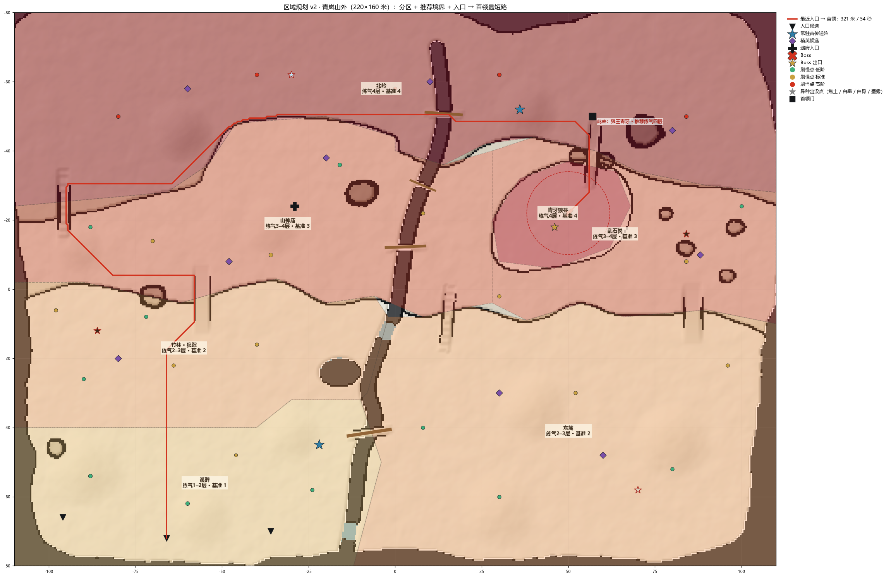
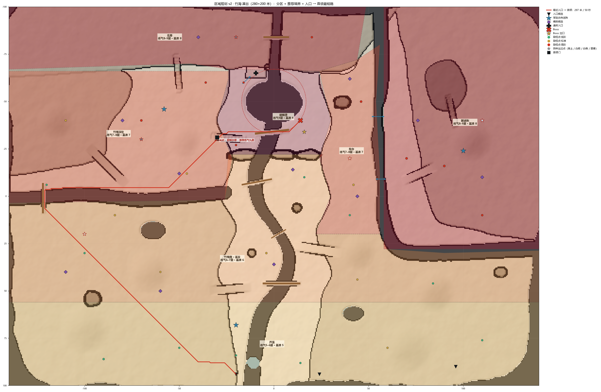

# 区域规划 v2：按境界分区、地图扩大、深水与亭子

> 依据：
> - 用户反馈："出门就遇到青牙，我才练气一、二层""河流可以直接跨过去不合理""亭子只是摆设"。
> - 主管派单：区域规划 v2、深水与亭子。
> - 和数值策划（docs/review/numeric/怪物生态_v1.md）、敌人模块 D、战斗设计（docs/design/boss_青牙_v2.md）共同约定。
>
> 落地文件：
> - `src/data/levels/r1.js`、`r2.js`（重写）、`tutorial.js`（未改，序章仍可用）；
> - `src/world/heightfield.js`（深水、渡口、踏石）、`level.js`（分区、精英间距、异种、首领门、亭子、刷怪轮转、御剑判定）、`level_mesh.js`（踏石外观）、`terrain.js`（`isDeepWater`）。
>
> 校验：`docs/review/level/tools/` 下的 `region_v2.py`、`water_check.py`、`detour.py`、`leaks.py`，以及 `node tools/run.mjs` 的 `loop_levels`、`loop_flow_levels scene=run`、`num_glows`。全部通过（§8）。

---

## 0. 结论

| 问题 | v1 | v2 |
|---|---|---|
| 出门就遇到青牙 | 东入口到青牙 9 秒（现状）／17 秒（评审定稿）；青牙谷有 3 个口 | **入口只在最浅的溪畔**，到青牙要依次经过溪畔 → 竹林 → 山神庙 → 西岭石阶 → 北岭 → 狼骨门 → 狼谷，**纯跑图约 54 秒（320 米）**，打掉路上必经的怪大约 3–4 分钟。狼谷只有北阶一个口 |
| 怪物强度只随玩家境界缩放 | levelFor = 玩家层数夹在区域范围里 | **分区基准等级 + 少量修正**：敌人等级 = 分区 baseLevel + clamp(玩家层数 − 分区推荐最低层, 0, 1)。浅区的怪弱，深区的怪强（数值策划定 baseLevel） |
| 低阶怪少 | r1 只有狼 / 灰狼 / 石傀 | 新增 5 种低阶怪：r1 的 rat 山鼠妖、crow 鸦妖、spider 蛛妖，r2 的 snake 竹叶青、toad 寒蟾。每个刷怪点带 `habitat` 栖息地，**低阶组占 41%（r1）/ 36%（r2）** |
| 地图小 | r1 160×120，r2 220×160 | **r1 220×160，r2 280×200**。扩出来的地方给浅区和中区，入口到最近古阵仍 ≤ 30 秒 |
| 河可以直接蹚过去 | r1 的溪 0.65 米深，全程可涉水 | **河与池都是深水**，只能走桥、踏石或浅滩渡口（渡口涉水减速 ×0.7）。另外提供 `level.isDeepWater(x, z)` 和 `canStand(…, { fly: true })` 给御剑用 |
| 亭子只是摆设 | r1、r2 各 1 座 | r1 7 个候选、r2 8 个候选，全部建出来；**每局随机启用 2–4 个当容器**，数据在 `points.pavilions` |
| 一个地方看到三只首领 | 精英随机抽，没有间距限制 | 抽取时保证**两两相距 ≥ 25 米、离首领 ≥ 30 米**。r1 每局 3 只，r2 4 只，溪畔不放 |

**单局时长**：真实地形，300 个种子，按"来不及撤离就收手"的策略模拟。
- r1：普通局、遗府局、首领局的中位数都在 **8.9–9.1 分钟**，目标是 ≤ 10 分钟。
- r2：中位数 **12.0–12.2 分钟**，目标是 ≤ 13 分钟。
- 如果把抽到的内容全部拿完，r1 要 10.6–13.9 分钟，r2 要 16.5–21.4 分钟，**多出来的部分是给玩家的"贪不贪"空间**。数值策划已经拿这些数据去跑到筑基的 sim。

---

## 1. 用到的方法

| 方法 | 用在哪 | 出处 |
|---|---|---|
| 风险梯度：从入口外缘到危险核心逐级升高，最好的东西放在最深处 | 入口只放在最浅的分区；首领、灵光宝箱、深区古阵放在深区 | Delta Force AZ3 地图访谈（Xbox Wire）；本岗位 v1 评审 §2 |
| 门槛 / 阈限空间：用"门"标记进入新区域，门不一定是真门 | 西岭界碑（上北岭）、狼骨门（下狼谷）、裂谷石桥（进竹海深处）、碧鳞门（下深潭），走近有提示 | Totten《An Architectural Approach to Level Design》中的 thresholds / arrivals |
| 展示 → 遮挡 → 揭示，以及 prospect / refuge | 北岭是一条长山脊，走在上面始终俯瞰狼谷和乱石岗，到狼骨门才下谷；竹海用裂谷先"挡"后"放" | Totten；GDC Level Design Workshop |
| 节奏曲线：强度锯齿式上升，大的峰值之前先留低谷 | 分区由浅到深，组大小从 3 只递增到 5 只；首领门之前是没有刷怪的北岭坡顶（休息点） | GDC Level Design Workshop：Pacing（Half-Life 2 / L4D）；Game Developer "Trinity: Intensity Ramps" |
| 分区与推荐等级：固定区域等级，加有上限的随玩家缩放 | baseLevel 固定，再按玩家层数最多 +1 | Last Epoch 的固定区域等级 vs Diablo IV 的跟随缩放之争 |
| 环境叙事："What happened here?" | 异种出没处有焦土、白霜、白骨、墨雾；首领门有狼骨；裂谷口有界碑 | Smith & Worch, GDC 2010 |
| 可达性与旅行时间量化 | 真实高度场 + 寻路（Dijkstra，4 邻接，和游戏 flood 同一规则）；崖线渗漏检查；绕路比；蒙特卡洛单局模拟 | 本岗位工具（docs/knowledge/关卡设计/工具.md） |

---

## 2. 区域一 · 青岚山外（220×160）



**地形骨架**（从南到北）：
- 南边是溪畔低地（入口）；
- 中间是台地，3.6 米高：西边山神庙，东边乱石岗，东北陷下狼谷；
- 北边是北岭，7.8 米高。原来的松岭和北脊连成一道横贯东西的山脊。

**两道关口把路线串成一条"之"字**：
1. **北岭只能从最西边的西岭石阶上去**。原来的松岭石阶和北脊石阶都删掉了。
2. **狼谷只能从北岭东头的狼骨门（狼谷北阶）下去**。原来的狼谷口坡道删掉了。北阶穿过谷北那条台地窄带的地方，两侧用崖石夹住，不能从台地横插进石阶。

| 分区 | 推荐境界 | 基准等级 | 风险 | 内容 | 刷怪（低阶 / 总组数） | 怪 |
|---|---|---|---|---|---|---|
| 溪畔 | 练气 1–2 | 1 | 1 | 3 个入口、溪畔石桥古阵、溪口渡、溪口亭、溪畔望亭 | 3 / 4 | 山鼠妖 + 落单狼 |
| 竹林 · 狼踪 | 2–3 | 2 | 2 | 竹径、西岸竹丛、灵蚌池（灵光点）、竹径坡（上台地） | 2 / 5 | 山鼠、鸦妖、狼、灰狼 |
| 东麓 | 2–3 | 2 | 2 | 过溪（石桥 / 渡口）、东麓凉亭、东坡（上乱石岗） | 3 / 5 | 山鼠、鸦妖、狼 |
| 山神庙 | 3–4 | 3 | 3 | 山神庙地窖（遗府）、瀑下、西岭石阶口 | 2 / 5 | 石傀、蛛妖、灰狼 |
| 乱石岗 | 3–4 | 3 | 3 | 一簇乱石，俯瞰狼谷；焦土异种点 | 1 / 3 | 石傀、蛛妖 |
| 北岭 | 4 | 4 | 4 | 狼谷北古阵、白霜异种点、瀑上亭、狼骨门 | 0 / 5 | 灰狼、石傀（高阶） |
| 青牙狼谷 | 4（首领） | 4 | 5 | 青牙；谷内不刷怪，狼从三个狼窝召出（战斗设计 v2） | — | — |

**入口 → 首领**（纯跑图，6 米/秒，不打怪）：

| 入口 | 到最近古阵 | 到狼骨门 | 到青牙 | 依次经过的分区 |
|---|---|---|---|---|
| [-96, 66] | 13.8 秒 | 50.3 秒 | 54.6 秒（328 米） | 溪畔 → 竹林 → 山神庙 → 北岭 → 狼谷 |
| [-66, 72] | 9.2 秒 | 49.2 秒 | 53.6 秒（321 米） | 同上 |
| [-36, 70] | 5.1 秒 | 49.8 秒 | 54.2 秒（325 米） | 同上 |

关口校验：把西岭石阶封掉之后，北岭和狼谷都**走不到**；只封掉狼骨门以外的路，从台地也进不了狼谷。说明这两道关口是唯一的通路。

> 目标是"60–90 秒路程"，现在的纯跑图是 50–55 秒，差 5–10 秒。原因是地图深度只有 160 米，进一步延长就要做迷宫。正常推进时要清掉路上的组（溪畔、竹林、山神庙、北岭各 1–2 组），实际耗时约 3–4 分钟，已经够让玩家"先过两个分区"。如果一定要 ≥ 60 秒，下一步可以把竹径坡往东挪到 [-44, …]，大约能多 +17 米。

---

## 3. 区域二 · 竹海·溪谷（280×200）



**两道关口**：
1. **竹海裂谷**：新加的一条深谷，把西侧竹海台地切成南北两半，只有最西头的裂谷石桥能过。
2. **峡口**：潭南两岸的乱石把溪谷截断，深潭只能从竹海石阶（碧鳞门）下去。原来的东台石阶删掉了。

另外加了**北脊石桥**（北脊东西两段），并在深区加了第三座古阵**剑碑古阵**，让深入的局不用再走回南边撤离。

| 分区 | 推荐境界 | 基准等级 | 风险 | 内容 | 刷怪（低阶 / 总组数） |
|---|---|---|---|---|---|
| 芦荡 | 练气 5–6 | 5 | 1 | 3 个入口、溪口古阵、芦荡渡、渡口亭 | 5 / 6（竹叶青、寒蟾） |
| 竹海南 · 溪谷 | 6–7 | 6 | 2 | 竹海南坡、石拱桥、急流踏石、竹桥、骨堆异种点 | 3 / 7 |
| 竹海深处 | 7–8 | 7 | 3 | 裂谷石桥以北、剑碑、剑碑古阵、墨雾异种点、碧鳞门 | 1 / 5 |
| 东台 | 7–8 | 7 | 3 | 东台池、东台亭；断涧两处窄口（二段跳）；白骨异种点 | 1 / 3 |
| 断涧东 | 8–9 | 8 | 4 | 东岭、孤峰（阵盘·剑阵）、断涧东古阵、白霜异种点 | 0 / 3 |
| 北脊 | 8–9 | 8 | 4 | 北脊石阶、北脊石桥、墨雾异种点 | 0 / 2 |
| 碧鳞潭 | 9（首领） | 9 | 5 | 碧鳞、剑修遗府、水灵玉；离碧鳞 30 米以外有 2 组 | 0 / 2 |

| 入口 | 到最近古阵 | 到碧鳞门 | 到碧鳞 | 依次经过的分区 |
|---|---|---|---|---|
| [-20, 94] | 12.5 秒 | 41.6 秒 | 49.5 秒（297 米） | 芦荡 → 竹海南 → 竹海深处 → 碧鳞潭 |
| [24, 94] | 22.7 秒 | 58.8 秒 | 66.7 秒（400 米） | 同上 |
| [96, 90] | 26.9 秒 | 63.0 秒 | 71.0 秒（426 米） | 同上 |

关口校验：把裂谷石桥封掉之后，竹海深处和碧鳞潭都**走不到**；东台仍然可达，因为东台本来就是独立的一片中区。

---

## 4. 数据约定（与数值策划、敌人模块 D 共同确认）

**分区**：`def.zones[]`
```
{ id, name, realm: [最低层, 最高层], baseLevel, danger: 1–5, risk(= danger), poly, boss? }
```
- 运行时用 `level.zoneAt(x, z)` 返回 `{ id, name, risk, danger, realm, baseLevel }`，重叠时取 danger 高的。
- 也可以读 `level.points.zones`。

**刷怪点**：`points.spawns[]`
```
{ pos, pack, zone, habitat: "nest"|"burrow"|"grass"|"water"|"ruin"|"rock", tier: "low"|"mid"|"high", mobs?, baseLevel? }
```
- `baseLevel` 缺省时由 level.js 从分区补上。
- 没写 `mobs` 时，敌人模块按 habitat + tier 选怪：low 只选低阶怪；mid 选标准怪，混 1–2 只同栖息地的低阶怪；high 只选标准怪，等级 +1。
- 低阶怪的栖息地：

| 怪 | 栖息地 |
|---|---|
| rat 山鼠妖 | burrow、grass |
| crow 鸦妖 | nest、rock、ruin |
| spider 蛛妖 | ruin、rock |
| snake 竹叶青 | grass、water |
| toad 寒蟾 | water、rock |

- 刷怪顺序：先从风险最高的分区抽 1 组，其余**按分区由浅到深轮转**。所以流程取前 N 组时，每个分区都有怪。
- 建议的开局组数写在 `def.spawnPlan.packs`（r1 9 组、r2 11 组），运行时是 `level.points.spawnPacks`。

**精英**：`points.elites`
```
{ pick, minGap: 25, bossClear: 30, from: [[x, z, { shield?, zone?, baseLevel? }]] }
```
- level.js 在抽取时保证间距和首领距离。
- 敌人模块另有运行时兜底：每局上限 r1 3 只、r2 4 只，管住巡游和夜潮刷出的精英。

**异种**：`points.rares`
```
{ pick: [0, 1], chance, from: [{ pos, sign: "scorch"|"frost"|"bones"|"bloom"|"mist", note }] }
```
- 每局 0–1 只，chance：r1 0.35，r2 0.40。
- 只放在推荐最低层 ≥ 2（r1）、≥ 6（r2）的分区。
- level.js 会在出没处铺一片贴地墨渍作为环境暗示：焦土是焦褐色，白霜是霜白色，白骨是骨白色，墨雾是灰蓝色。
- sign 对应的怪：scorch 对应赤狼；mist、bones 对应玄鳞蝠；frost、bloom 暂时映射到本区那一只。

**首领门**：`points.bossGate`（或 `bossGates[]`）
```
{ pos, r, zone, boss, text: "此去：狼王青牙 · {realm} · 宜练气六层以上", sub: "谷中可读条穿雾而退" }
```
- `{realm}` 由流程用 `enemies.realmLabel(boss)` 替换：看不清时显示"练气?"，练气五层起或首杀后显示"练气七层"。`sub` 是第二行小字（boss_青牙_v2 §2.2）。
- 青牙的境界定为练气七层；"推荐练气四层"的写法作废。狼谷分区的 realm 和 baseLevel 只管谷里的小怪，首领等级由敌人模块固定。

**等级**（数值策划采纳）：
```
敌人等级 = (spawn.baseLevel ?? zone.baseLevel) + clamp(玩家层数 − zone.realm[0], 0, 1)
```
- 精英 +1。
- 首领固定：青牙 4，碧鳞 9。异种也固定：赤狼 8，玄鳞蝠 10。
- 筑基按第 10 层算。

---

## 5. 深水、过河点与御剑接口

**规则**：`def.deepWater = true` 时，河与池都是深水。heightfield 的 `_deep()` 把这些格子的可站高度设成 −40，于是主角、敌人和可达性 flood 都走不进去。

例外有三种：
- **桥**：`bridges` 的 `style` 为 stone 或 wood。
- **踏石**：`style: "stones"`，石面贴着水面，石与石之间能连续走。
- **浅滩渡口**：`rivers[i].fords: [{ at, r, depth }]`。渡口处河床抬到 0.35 米深，可以涉水，`moveScale` 减速 ×0.7。

| 区域 | 过河点 |
|---|---|
| r1 | 溪畔石桥、**溪畔渡口**、**溪口渡**、台地木桥、**瀑下踏石**、**北脊木桥** |
| r2 | 竹桥、石拱桥、潭口石梁、**急流踏石**、**芦荡渡**、**北脊石桥**；跨裂谷的**裂谷石桥** |

r1 的溪同时加宽、加深：3 → 3.6 米宽，0.65 → 1.1 米深，看上去就跨不过去。

**绕路评估**（`tools/detour.py`）：在可涉水的旧版和深水的新版之间，随机抽 2,000 多对点比较路程。r1 的绕路比 p90 是 1.04，最多多走 13 米；r2 原本就是深河，绕路比 p90 是 1.00。

**给战斗模块的御剑接口**：
- `level.isDeepWater(x, z)`、`terrain.isDeepWater(x, z)`：脚下是否深水。
- `level.isFord(x, z)`：是否渡口。
- `level.canStand(x, z, fromY, r, { fly: true })`：御剑时用。无视深水、断涧和崖高，只受地图边界和碰撞体限制。
- 青牙谷的御剑围栏：`points.boss.fence`，多边形就是狼谷 pit。


---

## 6. 亭子容器

- 数据：`points.pavilions: { pick: [2, 4], from: [{ id, name, pos, ry }] }`。候选全部建成亭子当景物，每局用种子启用 2–4 个。
- 运行时：`level.points.pavilions = [{ id, kind: "pavilion", name, ry, pos(亭基石面高度), object }]`。
- 搜取模块（UI 设计师）读这份数据接容器；掉落表 `pavilion` 由数值策划定。

| 区域 | 候选 |
|---|---|
| r1 | 东麓凉亭、溪畔望亭、竹径亭、松岭亭、瀑上亭、溪口亭、东麓南亭 |
| r2 | 东台亭、芦荡亭、竹海亭、东台北亭、东台南亭、东岭亭、渡口亭、裂谷亭 |

---

## 7. 单局时长与节奏（`region_v2.py`，300 个种子）

**收手策略**：每拿一样东西之前，先算拿完之后去目标并撤离还来不及得及；来不及就跳过。r1 按入暮（9 分钟）算，r2 按入夜（12 分钟）算。

| 局 | p10 / p50 / p90（分钟） | 一局平均接触：低阶 / 标准 / 高阶组 | 精英 | 灵光点 | 宝箱 | 拿到的内容 |
|---|---|---|---|---|---|---|
| r1 普通撤离 | 8.6 / 8.9 / 9.0 | 2.5 / 3.1 / 2.0 | 2.5 | 1.6 | 7.2 | 88% |
| r1 山神庙遗府 | 8.8 / 8.9 / 9.0 | 1.8 / 2.5 / 0.3 | 1.5 | 1.0 | 5.0 | 60% |
| r1 青牙 | 9.0 / 9.1 / 9.2 | 2.1 / 2.7 / 0.6 | 1.6 | 1.2 | 6.0 | 68% |
| r2 普通（搬家首探） | 11.7 / 12.0 / 12.1 | 2.3 / 2.2 / 2.9 | 3.2 | 1.3 | 8.1 | 76% |
| r2 剑修遗府 | 11.9 / 12.0 / 12.1 | 1.4 / 1.4 / 1.4 | 1.5 | 0.5 | 5.3 | 45% |
| r2 碧鳞 | 11.9 / 12.2 / 12.2 | 1.6 / 1.6 / 1.9 | 2.0 | 0.7 | 6.1 | 54% |

不收手、全部拿完的时长：r1 是 10.6 / 13.9 / 12.7 分钟，r2 是 16.5 / 21.4 / 20.4 分钟。

模拟的停留时间沿用 v1 评审：r1 每组 18 秒、精英 35 秒、遗府 200 秒、首领 150 秒；r2 每组 26 秒、精英 50 秒、遗府 300 秒、首领 240 秒。

> r2 的遗府局和首领局只能拿到一半左右的内容。这是有意为之：深入的局用时间换遗府和首领，回报在遗府和首领身上。如果试玩觉得太赶，第一个可调的是剑修遗府的内部时长（建议 4–5 分钟），其次是 r2 南半区主路上的低阶组数，而不是怪的血量。

---

## 8. 校验结果

| 项 | 结果 |
|---|---|
| `water_check.py r1 r2 tutorial`（所有候选点可站、不飞可达，含巡游节点、五行坛、异种点、首领门） | 三张图都是 0 个问题 |
| 关口校验（封掉关口后深区应不可达） | r1：去掉西岭石阶后北岭、狼谷都不可达 ✔；r2：去掉裂谷石桥后竹海深处、碧鳞潭都不可达 ✔ |
| 精英抽满率（间距 ≥ 25 米、离首领 ≥ 30 米） | r1 抽 3 只，100% 抽满；r2 抽 4 只，100% 抽满 |
| 首领 30 米内的刷怪点 | 两张图都没有 |
| `loop_levels` | r1 / r2 / 序章 `bad: []`；深水抽检 8/8、9/9；所有桥和渡口 ok；fly 可越过深水；亭子启用 3/7、4/8 |
| `loop_flow_levels scene=run` | 全部 PASS（序章引擎、r1 / r2 的采集、精英、夜潮、巡游、开箱） |
| `num_glows` | 43 项全部 PASS |
| 序章（`prologue.py`） | 点位全部可达，时长不变（新手约 7 分钟） |

---

## 9. 需要其他模块接的事

| 模块 | 事项 |
|---|---|
| 流程 A | `regions.js` 的 `packs` 改为读 `level.points.spawnPacks`（r1 9、r2 11）；走近 `points.bossGate` 的 r 米时弹出提示（`text`）；可选：异种出现时 toast"此地有异种气息" |
| 敌人 D | `levelFor` 按 §4 实现（已确认）；没写 `mobs` 的刷怪点按 habitat + tier 选怪；`points.rares` 按 sign 选异种 |
| 搜取 / UI | 读 `points.pavilions` 接亭子容器 |
| 数值 | `pavilion` 掉落表；按 §7 跑到筑基的 sim（数据已发） |
| 战斗设计 | 青牙谷点位已写入 `points.boss`（perch、pillars、totems、gates、moonPaths、fence、trigger 10）。场景件 fang_pillar、wolf_totem、wolf_rock、mist_gate 和遮月接口，等用户拍板 boss 文档 §12 之后由关卡实现 |

---

## 10. 文件

| 路径 | 内容 |
|---|---|
| `src/data/levels/r1.js`、`r2.js` | v2 关卡数据 |
| `src/world/heightfield.js` | 深水 `_deep()`、渡口 fordG、踏石、`deep()` / `ford()` |
| `src/world/level.js` | 分区字段与 `zoneAt`；精英间距；刷怪按分区轮转与 `spawnPacks`；`rares` 与贴地暗示；`bossGate(s)`；`pavilions`；`isDeepWater` / `isFord` / `canStand(…, { fly })`；植被避让奇遇、遗物、异种点 |
| `src/world/level_mesh.js` | 踏石外观 |
| `src/world/terrain.js` | `isDeepWater` |
| `tools/scenarios/loop_levels.mjs` | 新增深水、桥、渡口、御剑、亭子的检查，以及 `pavilion:*` 点位检查 |
| `docs/review/level/tools/region_v2.py`、`water_check.py`、`detour.py` | 分区、路线、时长；可达性；绕路 |
| `docs/review/level/img/region_v2_r1.png`、`region_v2_r2.png` | 分区图 |
| `work/shots/loop_levels_r1_river_s.png`、`_river_n.png`、`_wolf_gate.png`；`loop_levels_r2_rift.png`、`_bilin_gate.png` | 截图 |
