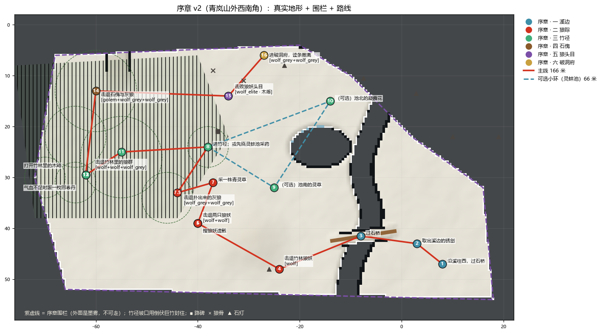
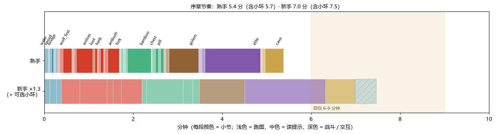

# 序章设计 v2（教学局重做）

> 起因：用户试玩反馈——"从新卷到找到第一个破洞府的内容也很少……至少要打个几组的小野怪，再打个精英怪吧？是教学局么？UI 上也没体现是在教学。"
> 改动：`src/data/levels/tutorial.js`（此文件现在归关卡）。没有改 run.js、UI、enemies.js，也没有改任何数值。
> 校验：`docs/review/level/tools/prologue.py`（真实高度场 + 围栏 + 可达性 + 时长模型）、`node tools/run.mjs loop_levels`。

---

## 1. 先回答用户

**是的，这一段就是教学局（序章）。** 新卷 → 开场 → 教学局（凡人状态，捡锈剑）→ 走到破洞府撤离 → 第一次回府觉醒练气一层、学剑气斩。

**内容为什么少**：上一轮按玩法评审 G6 的引导节奏，"一次只教一个新概念"。教学局只教了移动、普攻、闪身、撤离四件事，采集、丹药、宝箱、护盾都推到了后面几局。结果整段变成：
- 75 米的直线；
- 3 只狼（2 只同时上、1 只单独）；
- 1 株草；
- 没有宝箱、没有精英；
- 撤离也不读条。

按停留模型算，熟手不到 2 分钟就走完。另外，UI 上没有任何"这是序章"的标识，只有几条一次性的 toast，所以玩家感觉不到自己在教学里。

**改成什么样合适**：同类俯视 ARPG 的开场段，经验上做到 5–10 分钟、平均每 30–60 秒出现一次"新东西"（新敌人、新物件、新操作）比较合适。教学和内容并不冲突：每个新概念都配一场战斗或一个奖励来教，就不会显得空。

本版按这个思路做：
- **熟手约 5.5 分钟，第一次玩约 7–7.5 分钟**；
- **6 场战斗**，难度逐步上升：单只 → 两只 → 灰狼伏击 → 三只混编 → 石傀混编 → 精英（木盾）；
- **10 个概念**依次教完；
- **1 条岔路 + 1 个可选小环**，1 个宝箱，3 株灵草；
- 每一段都有**"序章 · 几 · 小节名"**的标题和目标卷轴（§5 是给流程组的 UI 清单）。

---

## 2. 路线与步骤

| # | 小节 | 步骤 id | 位置 | 敌人 | 教什么 | 完成条件 |
|---|---|---|---|---|---|---|
| 1 | 一 溪边 | wake | [8,47] | — | 移动（WASD，画面上方是北） | 走到锈剑 |
| 2 | 一 溪边 | sword | [3,43] | — | 拾取（武器直接佩上） | 拾取锈剑 |
| 3 | 一 溪边 | bridge | [-8,41.5] | — | 跟墨箭走 | 过桥 |
| 4 | 二 狼踪 | wolf_first | [-24,48] | wolf ×1 | 普攻（三段连招） | 全灭 |
| 5 | 二 狼踪 | wolves | [-40,39] | wolf ×2 | 闪身 / 完美闪避 | 全灭 |
| 6 | 二 狼踪 | loot | [-40,39] | — | 拾取进储物袋、Tab 看格子 | 拾取掉落 |
| 7 | 二 狼踪 | herb | [-37,31] | — | 采灵草（站定读条，挨打会打断） | 采 1 株 |
| 7.5 | 二 狼踪 | ambush | [-44,33] | wolf_grey ×2（采完后从竹林扑出） | 闪身绕侧面 | 全灭 |
| 8 | 三 竹径 | fork | [-38,24] | — | 岔路：西 · 竹径（宝箱）／东 · 灵蚌池（可选） | 到达 |
| 9 | 三 竹径 | pool_s（可选） | [-25,32] | — | 采灵草 | 采 1 株 |
| 10 | 三 竹径 | pool_n（可选） | [-14,15] | — | 采凝露花（"支路的东西回府都能换修为"） | 采 1 株 |
| 11 | 三 竹径 | bamboo | [-55,25] | wolf ×2 + wolf_grey | 被围时边退边打 | 全灭 |
| 12 | 三 竹径 | chest | [-62,29.5]（箱子在 [-64,31]） | — | 开宝箱 | 开箱：**回春丹 ×2、金符 ×3**（固定内容） |
| 13 | 三 竹径 | pill | 同上 | — | 丹药（按 2 服回春丹） | 服 1 枚；满血时自动跳过 |
| 14 | 四 石傀 | golem | [-60,13] | golem + wolf_grey ×2 | 硬壳：打不断，等它砸完再绕背 | 全灭 |
| 15 | 五 狼头目 | elite | [-34,14] | **wolf_elite（木盾）** | 精英与护盾：**金克木，按 3 掷金符破盾** | 击杀 → 洞口藤蔓松开 |
| 16 | 六 破洞府 | cave | [-27,6] | 读条开始时刷 wolf_grey ×2（来自西边） | 撤离读条 5 秒，离圈暂停 | 撤离 |

**地标与空间**：
- 起点在溪东。石桥是第一个过渡，过桥就进入"狼踪"。
- 岔路口立一块**路碑**，西指竹径、东指灵蚌池。
- 竹林里开了 4 块空地，战斗和宝箱都不会被竹子挡住。
- 狼头目守在崖下，地上散着**狼骨**，破洞府口有**石灯**，洞口被藤蔓封住，直到狼头目死去才打开。
- 围栏是墨雾，竹径坡口用倒伏巨竹封住，玩家不会走丢。

**可选小环**（灵蚌池，66 米）让第一次玩的人在序章就体验到"支路有收获、主线不卡人"。小环的两端都接回岔路口，所以不会让玩家提前绕到狼头目面前。

**旁白**：`say` 字段给了林墨的 7 句心里话。他是穿越者，所以台词带一点现代人的吐槽，例如"采个草都有埋伏，这地方不讲武德"。旁白不暂停游戏。

---

## 3. 精英怎么打：金符，不提前给剑气斩

**决定**：序章的精英带一层木盾。宝箱里给 **金符 ×3**（现有物品 `fu_metal`，五行符，按 3 掷出），用它来教"金克木"。**剑气斩仍然在第一次回府时才学**。

这样和设定是对得上的：
- 符箓是消耗品，凡人也能用；
- 回府觉醒后学的剑气斩属金，正好可以写成"把金符的道理炼进剑里"，序章的体验自然接上第一个法术；
- 不需要改"第一次回府学剑气斩"，也不用在序章发卷轴。

用现有数值估算（`shields.js`：护盾 = 0.4 × 气血，克制 ×2，无属性 ×0.25）：

| 项 | 数值 |
|---|---|
| 狼头目气血 | 600 |
| 木盾 | 240 |
| 金符每张伤害 | 30 + 法力 16 × 1.2 ≈ 49，克制 ×2 ≈ 98 |
| 破盾所需 | 3 张金符 ≈ 294，足够；剩余部分也可以用普攻磨 |

- 普攻也能破盾，只是慢：每剑约 4，要四五十剑。这样"不会用符"的人也能过，只是体会到"打不动"，自然会去读提示。
- 破盾后有 2.5 秒眩晕和 6 秒易伤 30%，打本体约 30–40 剑。
- 整场估计 60–90 秒，是序章里最长的一场，正好当作序章的"小 Boss"。

> ⚠ **请数值策划确认**（他们正在复核开局难度）：狼头目（600 气血、扑咬约 30 伤害）对凡人主角（160 气血 + 2 枚回春丹）偏硬，三连扑大约能打掉一半血。我没有改数值。
> - 如果偏难，建议在关卡数据侧加一个序章专用倍率（如 `spawn.hpMul: 0.6`），由数值决定是否采用。
> - 身陨兜底沿用现有的 `rescued`：序章在狼头目处身陨 = 剧情救援，醒来已在破洞府（对应设计文档"第一次死亡或找到破洞府"）。

---

## 4. 时长与节奏（真实地形校验）

`tools/prologue.py` 的校验结果：
- 18 个步骤点（含 1 个兼容旧版的 legacy 点）、7 组刷怪点、3 株灵草、1 个宝箱、破洞府：**全部可站，且从入口可达**。可达性采用 4 邻接、不用二段跳、按围栏裁剪。
- 主线 **166 米**（纯跑图 28 秒），可选小环 **66 米**。

时长估计：

| 玩家 | 只走主线 | 含可选小环 |
|---|---|---|
| 熟手 | 5.4 分 | 5.7 分 |
| 第一次玩（×1.3） | 7.0 分 | 7.5 分 |

序章的玩家都是第一次玩，所以 **7–7.5 分钟**落在 6–9 分钟的目标里。

停留模型（秒）：
- 战斗：单狼 12 / 双狼 22 / 伏击 16 / 三狼 32 / 石傀组 40 / 狼头目 75 / 守读条 20
- 交互：拾取 3、采集 4、开箱 4、服丹 4
- 阅读：每条教学提示 3 秒

| 小节 | 累计（熟手） | 新东西 |
|---|---|---|
| 一 溪边 | 0.3 分 | 移动、拾取、锈剑 |
| 二 狼踪 | 1.7 分 | 普攻、闪身、储物袋、采集、伏击 |
| 三 竹径 | 2.7 分 | 岔路、群战、宝箱、丹药、金符 |
| 四 石傀 | 3.5 分 | 硬壳敌人 |
| 五 狼头目 | 4.9 分 | 精英、护盾、五行相克 |
| 六 破洞府 | 5.4 分 | 撤离读条、守读条 |

`node tools/run.mjs loop_levels`：教学局能建造，点位检查 **`bad: []`**（全部可站、不在碰撞体里、可达），主角从入口走动正常。附带说明三点：
- 测试脚本里的 `fence` 探针 [-60,20] 现在落在新围栏**里面**（序章往西扩到了竹径），所以报 `true`。这是探针点过时了，不是围栏失效。建议关卡测试把探针换成 [-74,40]。
- 日志里的 `computeBoundingSphere NaN` 在 r1 / r2 上同样出现，与本改动无关。
- 现在的 run.js 只认 `sword / wolves / wolf_last / cave` 四个 id，所以**在流程组按 §6 实现之前**，游戏里的序章仍然只有旧版的 3 只狼。我保留了这四个 id，让旧代码能继续运行：wolves = 双狼，wolf_last 指向第一只狼的位置。

---

## 5. UI 需求清单（交给流程组 / UI；run.js 和 UI 代码由他们实现）

**常驻显示**
1. **序章标题条**：屏幕左上（气血条下方）或正上方，墨笔书法字"**序章 · 二 狼踪**"。
   - 进入新小节时，标题以"落款印章"的方式淡入，约 2 秒后缩成小字常驻。
   - 文案取 `step.chapter`。
2. **目标卷轴**：右侧竖向的半透明宣纸条，宽约 220 像素，显示当前步骤的 `goal`。
   - 可选步骤用浅墨"（可选）"标注。
   - 岔路步骤（`branch`）显示两行，如"西 · 竹径／东 · 灵蚌池（可选）"。
   - 卷轴下方列出本小节的进度点（○○●），让玩家看出这一节还剩多少。
3. **墨箭**：画在主角脚下或屏幕边缘的一笔墨箭，指向当前步骤的 `pos`（宝箱步指向 `target`）。离目标 4 米内隐去。
4. **教学提示**：当前的 toast 改成**墨笔对白条**，放在屏幕下方、技能栏上方。
   - 提示与旁白分两种样式：`hint` 用浅墨框；`say` 是林墨的心里话，用斜体、句首加"（"。
   - 提示里的按键（WASD / 空格 / F / Tab / 1 / 2 / 3）用**键帽小图标**替代纯文字。
   - 同时最多 1 条，后来的排队；`say` 不暂停游戏。

**每一步完成时**
5. **完成反馈**：
   - 目标卷轴上当前一行被**朱笔一勾**划掉；
   - `done` 文案（如"完美闪避！""狼头目伏诛 · 洞口的藤蔓松开了"）以金色小字在卷轴上方飘出约 1.5 秒；
   - 配一声轻的木鱼或磬；
   - 下一步淡入。
6. **小节完成**：一个小节最后一步完成时，标题印章"盖章"动画约 0.6 秒，再进入下一节。
7. **特殊瞬间**：
   - 完美闪避：短暂慢动作约 0.15 秒，加上"完美闪避"的金字；
   - 破盾：护盾碎裂的墨点四散，加上"破盾！"；
   - 破洞府藤蔓松开：镜头轻推向洞口约 1 秒，可以跳过。

**操作与进度**
8. **按键提示随步骤出现**：技能栏在序章只显示已经教过的格子。
   - 开箱前不显示丹药栏和五行符栏；
   - 拿到金符后，"3 · 金符"格以金框闪亮，直到第一次使用；
   - 现在测试截图里技能栏是满配的，序章应当按 `profile.unlocks` 隐藏。
9. **精英护盾条**：精英血条上方加一条五行色的护盾条，左侧显示"木"字和"金克"小注。
10. **跳过序章**：**要做，但只放在两处**：
    - **新卷时**：如果本机已经有任一存档的 `flags.tutorialDone`，弹出"是否跳过序章"，默认"不跳过"；
    - **暂停菜单**：一直提供"跳过序章"，需要二次确认。
    - 跳过后的结果与通关一致：佩锈剑；回春丹 ×1 进丹药栏；`tutorialDone = true`；直接去回府觉醒。不给金符和战利品。
    - 第一次玩的存档默认不主动弹出跳过（第一次玩恰恰需要序章）。
11. **设置开关**：设置里的"教学提示"（`settings.hints`）关闭时，只隐藏 `hint` 对白条；标题、目标卷轴和墨箭保留（它们是导航，不是教学）。

---

## 6. 流程组实现清单（run.js；关卡数据已就绪）

| # | 要做什么 | 数据字段 |
|---|---|---|
| F1 | **步骤引擎**：按 `seq` 推进 `points.steps`（忽略 `legacy`）；`optional` 的步骤可以跳过（下一个非可选步骤完成时自动作废）；`branch` 只用于显示 | `steps[].seq / optional / branch` |
| F2 | 每步的完成条件：reach（r 米内）、pickup（item）、kill（本步刷的怪全灭）、gather（n）、chest、pill（或血量 ≥ 90% 自动完成）、extract | `steps[].trigger` |
| F3 | 每步刷怪：`when: "reach"` 时走近 r 米刷出；`"afterPrev"` 在上一步完成时刷出；`"channel"` 在读条开始时刷出；`at` 缺省时用 `pos`。`types` 用 `mobs`，`shield` 传给 `spawnPack` 的 `opts.shield`，`aggro` 时直接追主角 | `steps[].spawn` |
| F4 | 宝箱固定内容：开序章宝箱时给 `step.loot`，不走随机掉落表 | `steps[id=chest].loot` |
| F5 | 序章拾取特判：`fu_metal` 和回春丹一样**直接进行囊**，这样按 3 就能用（现在只有丹药有这个特判） | `run.js onPickup` |
| F6 | 破洞府：狼头目（`gate: "cave"`）死之前封住（藤蔓，按 F 提示"洞口被藤蔓封住"）；读条用 `extract.channel = 5`（现在 cave 读条是 0） | `extracts[0].channel / sealed` |
| F7 | 存档点：狼头目之前身陨，从当前小节的第一步满血重来，保留已拾取的东西；狼头目和破洞府两节身陨，沿用现有的 `rescued`（剧情救援 → 破洞府） | `steps[].chapter` |
| F8 | 旁白 `say` 与提示 `hint` 进对白条；`done` 进完成反馈；`chapter` 进标题条（§5） | `steps[].say / hint / done / chapter` |
| F9 | 跳过序章（§5 第 10 条） | — |
| F10 | `tutorialSetup` 改为由 F1–F3 驱动；可以删掉现在按固定方向摆东西的兜底代码 | — |

---

## 7. 文件

| 路径 | 内容 |
|---|---|
| `src/data/levels/tutorial.js` | 序章数据：18 个步骤（含 legacy 兼容点）、7 组刷怪、3 株灵草、1 个宝箱、破洞府（读条 5 秒、狼头目封洞）、围栏、空地、路碑 / 狼骨 / 石灯 |
| `docs/review/level/序章设计_v2.md` | 本文 |
| `docs/review/level/tools/prologue.py` | 校验与出图（先运行 `node tools/export_hf.mjs ../../../src/data/levels/tutorial.js _cache/tut`） |
| `docs/review/level/img/prologue_v2.png` | 路线图（真实地形 + 围栏 + 步骤 + 敌群 + 可选小环） |
| `docs/review/level/img/prologue_v2_pacing.png` | 节奏条（熟手 / 第一次玩） |
| `work/shots/loop_levels_tutorial_start.png`、`loop_levels_tutorial_cave.png` | loop_levels 截图（测试场景是满配技能栏，不代表序章 UI） |
