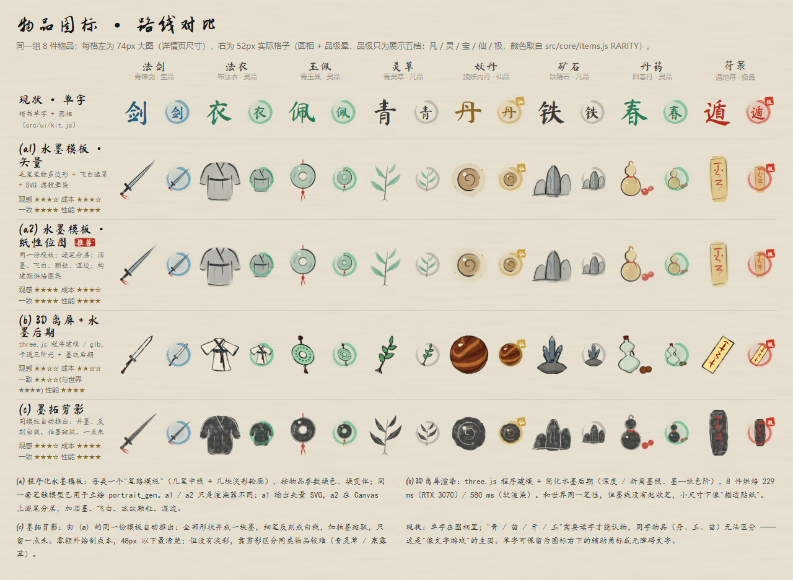
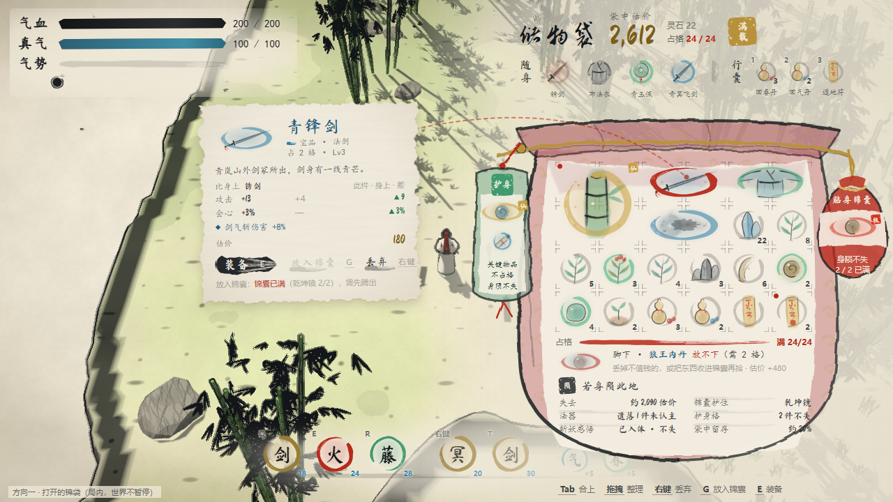
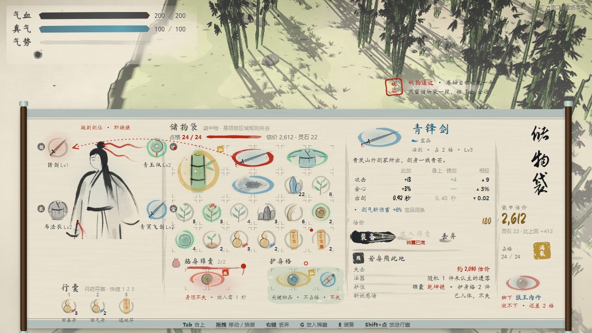
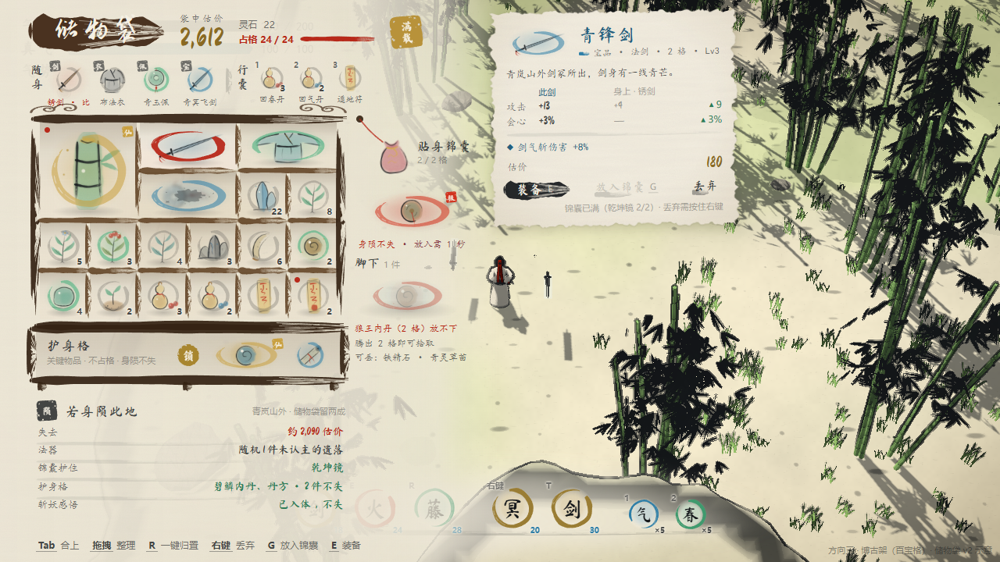
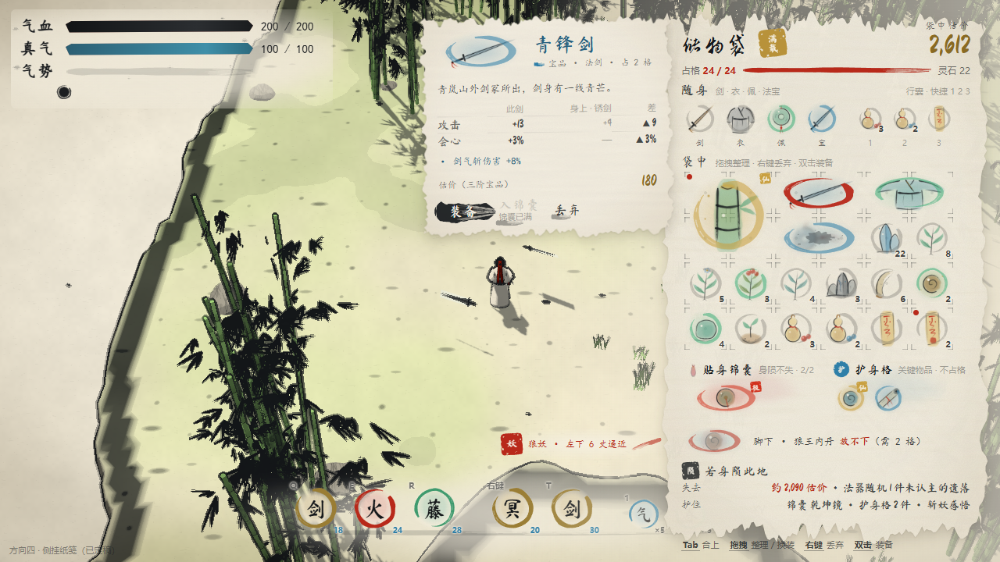

# 储物袋 v2 · 方案（**已定稿**）

> **定稿（用户拍板，2026-11）**
> 1. 图标：**(a2) 程序化水墨模板 + 纸性位图**为主路线；**(c) 墨拓剪影**用于未鉴定物品（以及搜取"先露形、后显色"）。
> 2. 局内储物袋：**方向四"侧挂纸笺"**，借用方向一的小锦囊（贴身锦囊组标）与玉牌 / 护符（护身格组标）。
> 3. 满袋：**纯手动取舍**，不做"可弃"建议、不做一键腾格；只提示"脚下 · ××× 放不下（需 N 格）"。
> 4. 局外：撤离结算用**方向二"手卷"**，洞府仓库用**方向三"博古架"**（落地说明见 `docs/ui/v2/储物袋_v2_落地说明_局外.md`）。
> 5. 风格指南 §11 改为"**图标为主，单字为辅**"（已改）。
>
> **已实现**（见文末 §8）：图标管线与图集、物品签组件、kit.itemCell 换图标、局内纸笺（src/ui/bagui.js）、测试 tools/scenarios/loop_bag_v2.mjs。
> 下文 §0–§7 保留讨论稿原文（带删除线 / "定稿"标注处以定稿为准）。

> 起因：用户反馈"储物袋的 UI 看起来像文字游戏"。本轮只出方案与示意图，**没有改游戏代码**。
> 现状截图：`work/shots/loop_flow_bag.png`；现有实现：`src/ui/bagui.js`、`src/ui/kit.js`。
> 示意图：`docs/ui/v2/png/bag_v2_*.png`；示意图源文件：`docs/ui/v2/mock_bag_v2/`（HTML，用 `node docs/ui/v2/mock_bag_v2/shoot.mjs <页面> <输出png>` 截图）。

---

## 0. 诊断（在主管四条的基础上修正、补充）

| # | 问题 | 判断 |
|---|---|---|
| 1 | 物品只有单个汉字（青 / 苗 / 牙 / 玉），没有图像 | **同意，是主因。** 而且根子在《UI 风格指南》§11 "图标首选单字"。单字还有一个硬伤：同字物品分不开（5 种妖丹都是"丹"，2 种玉都是"玉"，5 种苗都是"苗"）。建议把 §11 改成"**图标为主，单字为辅**"：单字退到无障碍文字或悬停名称里。 |
| 2 | 红色米字格像练字本；格子小，左侧信息和右上提示各自漂着 | 同意。补充一点：米字格本身没错，错在它是每格最显眼的东西，比物品还显眼。v2 把格位降成"四角星点"（像棋盘星位、裁切记号），物品签（圆相 + 图标 + 品质晕）成为主体。信息按"标题估价 → 随身 → 袋中 → 安全区（锦囊 / 护身）→ 脚下 → 身陨风险"一条线组织，不再三处漂着。 |
| 3 | 局内大横幅提示压在储物袋上 | 同意，而且横幅说的内容（"储物袋已满…按 Tab 取舍"）在袋子打开以后已经没意义。规则：**袋子开着时，所有与袋子有关的提示都收进袋内状态行**（满载印 + 朱色占格条 + "脚下 · 狼王内丹 · 放不下 · 还差 2 格"）；其他通知改到袋子另一侧显示，不压面板。 |
| 4 | 看不到身上装备和储物袋的关系，没有拖拽、比较、详情的组织 | 同意。四个方向都加了"随身"区（剑 / 衣 / 佩 / 法宝 + 行囊 1·2·3）、详情里的"比身上 X"对比（▲▼），以及拖拽到装备位直接换装。 |
| 5（补） | 世界不暂停，但现版是全屏薄纸，战场基本看不见；也没有任何"敌近"提示 | 打开储物袋本身就是搜打撤的风险决策，界面必须留出主角周围的视野，并在袋子边缘提示逼近的敌人。 |
| 6（补） | 满袋时只能自己挑丢什么，没有帮助 | ~~腾格建议~~ —— **定稿：不做**。用户决定满袋时保持纯手动取舍；纸笺只提示"脚下 · ××× 放不下（需 N 格）"。 |
| 7（补） | 现版 `.ink-grid > .it.q-ji` 等样式和搜取窗口的格子是两套 | 刚做好的搜取窗口用"圆相格 + 墨封"。储物袋应**用同一种物品签**，物品从搜取窗口飞进袋子时外观不变，两个窗口同屏时也不打架。 |

---

## 1. 物品图标（重点）

### 1.1 对比图

`docs/ui/v2/png/bag_v2_icons_compare.png`：同一组 8 件物品（法剑、法衣、玉佩、灵草、妖丹、矿石、丹药、符箓），五种做法。每格左边是 74px 大图（详情页尺寸），右边是 52px 的实际格子（圆相 + 品质晕）。

### 1.2 三条路线

#### (a) 程序化水墨模板（推荐；a1 / a2 是同一套模板的两种渲染器）

- **做法**：每**类**物品写一个"笔路模板"，内容是几笔中线控制点加几块淡彩轮廓。毛笔笔触模型直接沿用立绘生成器 `tools/portrait_gen.mjs` 的那一套（提按、起笔顿、收笔出锋、飞白），所以图标和立绘、圆相、笔触进度条是同一种笔性。
  - 每件**物品**只填一行参数，例如：
    - 竹影剑：`["sword", { blade: 石绿, node: 1 }]`
    - 锈剑：`["sword", { blade: 赭石, rust: 1 }]`
    - 凝露花：`["herb", { flower: 花青 }]`
    - 赤炎果：`["herb", { fruit: 朱砂 }]`
  - 模板按格子比例自适应：1×1 是 128×128；2×1 是 256×128，剑放平、法衣展袖、玉佩流苏横飘；2×2 是 256×256。
  - 样例：`docs/ui/v2/mock_bag_v2/icons/inkicons.js`，16 个模板、29 件物品。
- **a1 矢量 SVG**：笔触是多边形，飞白用遮罩，晕染用 SVG 滤镜。线条干净，能任意缩放，但略显"数字感"。
- **a2 纸性位图（推荐）**：同一份模板，在 Canvas 上逐笔分层渲染。墨身之下先垫一层洇开的淡墨，尾段飞白按笔毫行擦出，没骨淡彩做多遍叠染并带湿边，最后用纸纹颗粒擦淡。效果最像"画在宣纸上"，和 3D 画面的水墨后期、纸纹也最接近。
- **成本**：全库约 13 类，需要 16–18 个模板（法剑、法衣、玉佩、灵草 / 花 / 果、苗、妖丹、矿、灵石、丹药、符箓、兽牙 / 皮 / 鳞、卷轴、丹方竹简、大件灵物、法宝、剧情物）。每个模板连调约 1.5–3 小时，变体参数每件几分钟。**全库约 4–6 人日**（模板 3–4 天，参数与审图 1 天，烘焙管线 0.5–1 天）。以后新增物品，多数只要加一行参数。
- **一致性**：最高。笔触模型与立绘同源；颜色只用指南的矿物色（朱砂、石青、石绿、泥金、赭石、黛、藤黄、花青）。
- **性能**（实测，headless Chromium）：
  - a2 一次渲染 29 件（2× 分辨率）约 50 ms，墨拓约 23 ms。
  - 16 件 256px 的 webp 图集为 274 KB。按此推算，全库 70 件、128px 一格（64px 显示、2× 清晰度）的 webp 图集约 **0.3 MB**。
  - **建议在构建期烘焙**：`tools/` 下加一个脚本，用 Playwright 跑模板，输出 `items_atlas.webp` 和 `items_atlas.json`（id → x, y, w, h）。运行时一张贴图，CSS 用 `background-position` 取图，DOM 节点数不变。世界里的掉落 sprite（`pickups.js` 的 `lootGlyphTex`）也可以用同一张图集取 UV。
  - 不要在玩家机器上开局时现烘，不用 SVG 滤镜做运行时动画，这与《风格指南》§13.4 一致。

#### (b) 3D 离屏渲染 + 水墨后期

- **做法**：three.js 程序建模（或者以后用 glb），材质用卡通三阶光，再走简化的 `src/render/ink.js` 后期：深度和折角出墨线，亮度映射到墨—纸色阶，保留点色。样例在 `mock_bag_v2/icons_b/`（`render.html`、`shoot.mjs`、`atlas_b.png`、`preview_b.png`、`timing*.json`）。
- **观感**：体积感、光影统一，但墨线粗细几乎不变，没有起笔和收锋。小尺寸下像"卡通描边贴纸"，48px 以下细长物件（剑、草）只剩 1–2px。妖丹做出来像篮球或行星。
- **成本**：硬物好做（剑、矿、玉、葫芦、符纸，每件 20–40 行），软物难做（法衣只能拼成"T 恤 + 裙"，草叶要逐片调朝向）。每件 0.5–1 小时，**全库约 5–8 人日**。变体只能换材质色，改形状要改模型。
- **一致性**：与 3D 世界一致，与 2D 笔触 UI（圆相、印章、立绘）**不一致**。图标是放在 UI 里的，所以这一条更重要。
- **性能**：8 件烘焙 229 ms（RTX 3070）/ 580 ms（软渲染），推算全库约 2 s，同样只能构建期烘焙。运行时开销为零。
- **适用**：如果以后要给法宝做"鉴宝台 3D 转动展示"，或者世界掉落物要用 3D 模型，这条管线可以用于**少数硬质法宝**，但不适合做全品类图标主路线。

#### (c) 墨拓剪影（碑拓 / 木刻）

- **做法**：由 (a) 的同一份模板**自动推出**，不用额外绘制：所有形状并成一块墨，细笔反刻成白线，加拍墨斑驳，朱色部件留作"一点朱"。
- **观感**：剪影最强，48px 以下最清楚，金石味很足。缺点是没有淡彩：同形不同色的物品（青灵草 / 寒露草，青玉佩 / 水灵佩）只能靠形状区分，一屏全是墨块也偏重。
- **成本**：几乎为零（随 a 一起出）。性能同 a。
- **建议的用途**（作为 a 的补充，不作主路线）：
  1. **未鉴定物品**：只见其形、不见其色，正好表达"宝光内敛，看不真切"，比现在的模糊"？"更有信息量，也和搜取窗口的墨封呼应。
  2. 天机镜、结算账册里的小图标（≤32px）。
  3. "放不下 / 脚下"这类虚影签。

### 1.3 结论

**主路线用 (a) 程序化水墨模板 + a2 纸性位图渲染，构建期烘焙成 webp 图集；(c) 墨拓由同一份模板自动生成，用于未鉴定和极小尺寸；(b) 不作图标主路线。**

### 1.4 图标规范（落地时写进风格指南 §11）

1. **构图**：主体占画面约 80%，留出圆相内圈。斜放物（剑、卷）走左下到右上。2×1 物品横构图，2×2 物品竖构图。
2. **颜色与品级分开**：
   - 图标里是物品本色，用低饱和淡彩（饱和度约 ≤ 35%）。
   - **品级只由格子的圆相颜色、同色晕和名称字色表达**，严格用 `src/core/items.js` 的 RARITY 五档（凡 #6a6760 / 灵 #3fae7a / 宝 #2f7fa8 / 仙 #c9a040 / 极 #d2321e），仙、极再加角印。
   - 图标本身**不随品级换色**。否则绿色的灵草会被误读成灵品。
   - 去饱和截图检查时，品级靠"圆相浓淡 + 角印 + 名称"三重区分。
3. **一点朱**：剑穗、绳结、符文可以用朱砂，每个图标最多一处。
4. **单字的去处**：不再画在格子中央。保留在悬停名称、详情标题和无障碍朗读里。也可以做成设置项"格内显示代表字"（默认关）。
5. **数量**：右下黑体小字，外加纸色描边（同现版）。

---

## 2. 物品签与格位（四个方向通用）

- **物品签** = 一笔圆相（多格物品拉成长圆或大圆，与搜取窗口相同）+ 图标 + 品质淡彩晕 + 数量 + 仙 / 极角印。
  - 状态：新得（左上朱点）、选中（圆相换朱）、未鉴定（墨拓剪影加残留墨封）、放不下（朱色淡圆相 + 半透明）、可弃（朱色虚笔圈 + "可弃"小印）。
  - 样式草稿：`mock_bag_v2/base.css` 的 `.tok`。
- **格位**：不画格线，每格四角各一个淡墨"星点"，空格中央一个清墨点，所以空格数一眼可数，又不像练字本。
- **占格**：靠物品签本身的形状表达（1×1 圆、2×1 长圆、2×2 大圆）。
- **锦囊与护身格必须一眼区分**：
  - **贴身锦囊**：胭脂色锦缎晕底 + 小锦囊图标或朱绳结。占格，1–3 格，放入需 1 秒，身陨不失。
  - **护身格**：石青 / 石绿玉牌或护符底 + "护"字圆印。关键物品自动进入，不占格，身陨不失。
  - 两者颜色、形状和文字都不同，去饱和后也能分开。

---

## 3. 布局方向

四张图使用同一份"局中实况"，便于横比：竹海·溪谷，袋 24/24 满载，袋中估价 2,612，灵石 22，选中宝品青锋剑（对比身上的锈剑），锦囊 2/2 装着乾坤镜，护身格里有碧鳞内丹和丹方，脚下有狼王内丹放不下。数据在 `mock_bag_v2/data.js`。

> 注：示意图里"若身陨此地 · 失去约 2,090"是示意数。按 `regions.js` 竹海·溪谷 `keepBag: 0.25`，实际应为约 1,959。落地时直接用 `deathPreview()` 的结果。

### 方向一 · 打开的锦袋

`png/bag_v2_jindai.png`：画面右侧画一只打开的胭脂锦袋（约 x 668–1275），袋口内衬浅绢，6×4 格放在袋里。束绳左端系石绿玉牌"护身"，右端挂朱色小锦囊"贴身锦囊"。袋口上方是竖排标题、估价、随身与行囊。详情浮签浮在战场左上，用朱色虚线指回袋中的青锋剑。

| 优点 | 缺点 / 风险 |
|---|---|
| "储物袋"这个物件被画出来了，最不像文字游戏，叙事感最强 | 遮挡大：袋子加玉牌约占右侧 47% 的宽度，浮签再盖住左上一块 |
| 锦囊和护身格挂在束绳两端，"身陨不失"的两种机制不用读字就能区分 | 插画要随 16 / 24 / 32 格伸缩，32 格时袋子还要再大；玉牌也要能伸缩，实现成本高 |
| 物品签和搜取窗口一致，物品"飞进袋口"的动效最顺 | 袋身是锦缎，搜取窗口是宣纸，同屏时材质打架；胭脂色和极品朱、锦囊朱容易混 |
| 满载、放不下、身陨风险都收在袋内 | 袋内塞了四块信息，字号已降到 11–13px，接近下限 |

### 方向二 · 宣纸手卷

`png/bag_v2_shoujuan.png`：一幅横向手卷（1172×474，从 y≈236 铺到底），从左到右依次是：林墨半身立绘配四个装备位和行囊、储物袋 6×4 加锦囊 / 护身格、详情比较与"若身陨此地"、卷首竖题"储物袋"和估价、满载、脚下。另画了一条从青锋剑拖到剑位的朱色虚线，示意拖拽换装。

| 优点 | 缺点 / 风险 |
|---|---|
| 信息最全，"身上的"和"袋里的"关系最直观（立绘 + 装备位），直接解决诊断第 4 条 | **遮挡最大**：主角（y≈330–380）被卷盖住，战场只剩上方一条。局内必须配"妖近自动半收"，否则玩家会被打 |
| 手卷是风格指南认可的装裱结构（天机镜也用），从左到右分段，读序清楚 | 密度高，详情和身陨两段已压到 12.5–13px，小屏会挤 |
| **局外可直接复用**：洞府整理、撤离结算、出行准备都需要这种全量视图 | 展卷、半收、全收三种状态和动画要额外设计，开关比侧栏慢 |

### 方向三 · 博古架（百宝格）

`png/bag_v2_bogu.png`：画面左侧一座赭墨木格多宝阁。隔板按物品占格画出不同大小的龛（2×2 大龛、2×1 长龛、1×1 小格），阁顶匾额写"储物袋"和估价。锦囊挂在阁边钉子上，护身格是阁底带锁的暗屉。详情浮签浮在战场上缘。

| 优点 | 缺点 / 风险 |
|---|---|
| 占格最直观，龛的大小就是物品大小 | **重排抖动**：每拾取或丢弃一件，隔板就要重画甚至整阁重排，边打边捡时画面频繁跳动 |
| 器物感强，和洞府、博古陈设的世界观一致 | 碎片化后"总空格够、却没有连续长龛"，比方格更难懂；需要拖拽预览和一键归置 |
| 三种"安全等级"有三种物理隐喻（挂着的锦囊、带锁的暗屉、身上的装备） | 隔板、龛内明暗、圆相、品质晕叠了四层，24 格已偏满，32 格时图标会很小 |
| 左侧放置，主角和右侧战场露在外面 | **盖住了左上角的气血 / 真气条**，世界不暂停时这是硬伤，要么挪 HUD，要么面板下移 |

> 建议：博古架更适合**洞府仓库**（局外、没有时间压力、物品多），不适合局内储物袋。

### 方向四 · 侧挂纸笺（我的提议，推荐作为局内默认）

`png/bag_v2_zhijian.png`：画面右缘挂一张竖长宣纸（约 x 846–1266，宽约 420），只在右侧四成压一层渐变薄纸，**主角、左上气血条、技能栏主体都不遮挡**。纸笺内自上而下是一条信息线：

1. **标题行**：储物袋 + 满载印 + 袋中估价（泥金大字），下面一行占格 24/24（朱色一笔）和灵石数。
2. **随身**：剑 / 衣 / 佩 / 法宝四位，加行囊 1·2·3（开袋时 HUD 的行囊可以隐藏，避免重复）。
3. **袋中**：6×4，格位用四角星点，物品签与搜取窗口同一套。
4. **贴身锦囊 | 护身格**：左右并排，胭脂锦缎底对石青护符底。
5. **脚下**：狼王内丹 **放不下**（需 2 格）——只提示，取舍完全由玩家手动完成。
6. **若身陨此地**：两行，失去多少、法器风险、护住了什么。
7. **键位**。

选中物品时，**详情浮签贴着纸笺左外沿、出现在主角头顶上方的空处**（不压主角），内容是名称（品级色）、品级 · 类别 · 占格、描述、与身上装备的三列对比（此件 / 身上 / 差 ▲▼）、词条、估价，以及"装备 / 入锦囊（满则灰并注明原因）/ 丢弃"。不选中时浮签不出现。纸笺左沿还有一个**敌近提示**：朱印"妖" + "狼妖 · 左下 6 丈逼近"。

| 优点 | 缺点 / 风险 |
|---|---|
| **遮挡最小**：常驻部分只占右侧约 1/3，主角、气血、技能栏都在；浮签只在选中时出现 | 不如锦袋、博古架那样"一眼有物件感"，靠图标和纸性撑氛围 |
| 和搜取窗口是同一种材质（宣纸）和同一种物品签，两窗同屏时一左一右不打架 | 纵向信息多，24 格时刚好放下；**32 格**要么 8×4、格子缩到约 44px、纸笺加宽到约 460，要么 6 列、纸笺内滚动（不推荐滚动） |
| 一条从上到下的信息线：估价 → 随身 → 袋中 → 安全区 → 脚下 → 风险，"左侧漂着"的问题消失 | 右侧来的敌人仍会被挡，靠敌近提示和"受击时浮签自动收起"补救 |
| 改动最小：沿用现有 `kit.panel`、`.ink-paper`、搜取窗口的签样式，`bagui.js` 主要是重排布局，加图标图集和腾格建议 | 右缘挂纸的形式略"保守"，需要在纸边、题字、图标质量上做出精致感 |

---

## 4. 推荐

1. **图标**：(a) 程序化水墨模板 + a2 纸性位图渲染，构建期烘焙图集；(c) 墨拓剪影用于未鉴定和极小尺寸。这一步单独做就能解决"像文字游戏"的大半问题，而且**和选哪个布局无关**，可以先动工。
2. **局内储物袋**：**方向四 · 侧挂纸笺**，并借用方向一的两个元素：锦囊用"挂在绳上的小锦囊"小插画作组标，护身格用"玉牌"作底。这样物件感有了，又不用整只袋子的插画。
3. **局外全量视图**（洞府整理、撤离结算、出行准备）：**方向二 · 宣纸手卷**。那里没有时间压力，立绘加装备位加比较的全信息布局最合适。局内按住 Shift+Tab 也可以临时展卷，配"妖近自动半收"。
4. **方向三 · 博古架**：留给洞府仓库，不用于局内。

---

## 5. 通用交互规则（无论选哪个方向）

| 规则 | 说明 |
|---|---|
| 世界不暂停 | 打开时只压局部薄纸，主角周围 ±160px 不放任何面板。受击时详情浮签自动收起，纸笺淡到 60%，0.6 秒后恢复。 |
| 敌近提示 | 视野外或被面板挡住的敌人进入约 8 丈时，在面板朝向敌人的一侧出朱印"妖" + 方位距离。 |
| 通知 | 袋子开着时，与袋子相关的通知收进状态行，不弹横幅；其他通知改在面板另一侧，`body.mk-bag-open .mk-toasts` 的位置随方向调整。 |
| 拖拽 | 拖动时原位留半透明残影，目标位显示朱色淡晕；拖到装备位 = 换装（被换下的回袋，放不下就落地并提示）；拖到锦囊 = 放入（1 秒读条，读条画在锦囊组标上）；拖出面板 = 丢弃（宝品以上需确认，见风格指南 §5.15）。 |
| 比较 | 选中或悬停装备时，详情里固定出现"此件 / 身上 / 差"三列，▲ 用石绿、▼ 用朱。同时随身区对应装备位亮一圈朱色"比"。 |
| 满袋 | 纯手动取舍：满载印 + 朱色占格条 + "脚下 · ××× 放不下（需 N 格）"；不标"可弃"、不做一键腾格（定稿）。 |
| 键位 | Tab 开合；点选看详情；双击 = 装备 / 拾取 / 取出；右键 = 丢弃；拖拽 = 整理（拖到别的物品前）/ 换装（拖到装备位）/ 入锦囊 / 拖出纸笺丢弃。G、E 是局内已有按键（遁地符、法术），袋子里不再占用。 |
| 容量 | 16 格 4×4（格 64）；24 格 6×4（格 54）；32 格 8×4（格 44，纸笺加宽）。图集按 128px 一格烘焙，三种尺寸都清晰。 |
| 性能 | 面板 DOM 控制在约 150 个节点内；图标是同一张图集的 `background-position`；开合动画只改 opacity、transform、clip-path。 |

---

## 6. 需要用户 / 主管拍板的问题（已全部拍板，见文首"定稿"）

1. 图标走 (a) 程序化水墨（推荐），还是要等画师手绘？a 的模板结构允许以后用手绘图逐件覆盖，同一张图集、同一个 id。
2. 局内布局选方向四（推荐）还是方向一（物件感更强、遮挡更大）？
3. 是否同意"局外用手卷全量视图"，让局内纸笺可以更精简？
4. "腾格建议""一键腾格拾取"会降低满袋取舍的操作量。这是否违背搜打撤"取舍"的设计意图？我的看法是：建议只标出、不替玩家决定，按 F 仍需确认，取舍还在玩家手里。
5. 风格指南 §11"图标首选单字"是否改为"图标为主，单字为辅"？

---

## 7. 文件

| 文件 | 内容 |
|---|---|
| `docs/ui/v2/png/bag_v2_icons_compare.png` | 图标路线对比：现状 / a1 / a2 / b / c × 8 件 |
| `docs/ui/v2/png/bag_v2_jindai.png` | 方向一 · 打开的锦袋 |
| `docs/ui/v2/png/bag_v2_shoujuan.png` | 方向二 · 宣纸手卷 |
| `docs/ui/v2/png/bag_v2_bogu.png` | 方向三 · 博古架 |
| `docs/ui/v2/png/bag_v2_zhijian.png` | 方向四 · 侧挂纸笺（**已定稿**，示意图已去掉"可弃"与"腾格拾取"） |
| `docs/ui/v2/mock_bag_v2/icons/inkicons.js` | 水墨图标模板与三种渲染器（a1 SVG / a2 Canvas / c 墨拓），示意用 |
| `docs/ui/v2/mock_bag_v2/icons_b/` | 3D 路线样例：`render.html`、`shoot.mjs`、图集、计时 |
| `docs/ui/v2/mock_bag_v2/{base.css, data.js, fonts.css}` | 示意图共用样式（物品签 `.tok`、星点格位）、局中实况数据、完整书法字体引用 |
| `docs/ui/v2/mock_bag_v2/{jindai, shoujuan, bogu, zhijian, icons_compare}.html` | 各示意图源文件 |
| `docs/ui/v2/mock_bag_v2/shoot.mjs` | 截图：`node docs/ui/v2/mock_bag_v2/shoot.mjs <页面.html> <输出.png> [宽 高 full]` |

---

## 8. 落地记录（已实现）

### 8.1 图标管线

| 环节 | 文件 | 说明 |
|---|---|---|
| 笔路模板 | `tools/icons/inkicons.js` | 29 个物品模板（法剑、法衣、玉佩、灵草 / 花 / 果、苗、块根、藤、灵土、矿、灵石、兽牙、兽皮、蝠翼、鳞、灵丝、妖丹、遗骨、蚌珠、灵玉、竹心、丹药、符箓、卷轴、残页、竹简、阵盘、印、镜、鼎、锦囊、信、烟杆）；`specOf(def)` 按 **id 专属 → 类别 + 名称 / 五行规则 → 类别默认** 选模板与参数（颜色随五行 `el`、丹药按效果、五行符按元素、卷轴系绳按 id 散列） |
| 渲染器 | 同上 | `renderCanvas`（a2 纸性位图：洇墨、飞白、颗粒、湿边）、`renderRubbing`（c 墨拓剪影）、`renderSVG`（a1，备用） |
| 烘焙 | `tools/icons_gen.mjs` + `tools/icons/bake.html` | 构建期：Vite + Playwright 打开烘焙页，注册全部物品（items_db + 流程 / 洞府 / 委托兜底），出图集。`node tools/icons_gen.mjs`，约 0.25 s 画完 |
| 产物 | `src/ui/icons/items.webp`（2048×1024，约 594 KB）、`items_sil.webp`（2048×896，约 195 KB，用到剪影时才下载）、`items.json` | 128px 一格；2×1 的剑 / 衣 / 佩另有横构图；13 个 `_cat_<类别>` 兜底 + `_generic` |
| 运行时 | `src/ui/icons.js` | `iconFor / iconStyle / iconEl / itemTag / setTagState / tagReveal / ICONS`；CSS 背景取图，零绘制；品级色从 RARITY 生成 |

规则：图标是物品本色、低饱和淡彩，**不随品级变色**；品级只由圆相色、同色晕、名称字色、仙 / 极角印表达（RARITY）。新物品未重跑脚本时按类别兜底，不报错。

### 8.2 物品签组件（给搜取窗口、炼器页复用）

`itemTag(inst, { size: 40 | 52 | 74, box: "1x1" | "2x1" | "2x2", gap, count, cap, sel, disabled, sealed, sil, isNew, nofit, onClick })`

- 状态：正常 / 未鉴定（自动剪影 + 呼吸晕）/ 选中（朱圆相）/ 不可用（淡 + 去色）/ 墨封（一团浓墨盖住）/ 放不下（朱色淡圆相）/ 新得（朱点）。
- 搜取两段揭示：`itemTag(inst, { sealed: true, sil: true })` → `setTagState(t, { sealed: false })`（露形）→ `setTagState(t, { sil: false }); tagReveal(t)`（显色）。
- `kit.itemCell` 同步换成图标（单字取消；类名 `g-<cat>` → `c-<cat>`）。

### 8.3 局内纸笺（`src/ui/bagui.js`）

- 右缘挂纸（按窗口右边缘锚定、随 `--mk-scale` 缩放），右侧四成渐变薄纸；主角、气血、技能栏不遮挡。
- 自上而下：标题 + 满载印 + 袋中估价（？）→ 占格条 + 灵石（？）→ 随身（剑 / 衣 / 佩 / 宝 + 行囊）→ 袋中（16 格 4 列 / 24 格 6 列 / 32 格 8 列，`packBag` 按物品顺序摆放）→ 贴身锦囊（锦囊小图标组标）| 护身格（"护"印组标）→ 脚下 → 若身陨此地（？）→ 键位。
- 详情浮签：贴纸笺左外沿、主角头顶上方；名称（品级色）/ 品级 · 类别 · 占格 · 阶 / 描述 / 与身上同栏装备对比（此件 · 身上 · 差 ▲▼）/ 奇效词条 / 估价 / 所在；操作：装备、入锦囊（1 秒；满或超格时灰并注明原因）、丢弃（宝品以上确认）、取出、拾取（放不下注明需 N 格）、卸下。
- 拖拽：整理顺序、拖到装备位换装、拖到锦囊、拖出纸笺丢弃、从脚下 / 锦囊拖回袋中。
- 敌近：约 6 丈内仇恨中的妖物 → 纸笺左沿朱印"妖" + 名称 · 方位 · 丈数 + 屏幕方向箭头；8 米内印跳动。
- 受击：浮签收起、纸笺淡到 60%，0.6 秒后恢复。世界不暂停。
- 袋子开着时"储物袋已满"横幅不再弹；其他通知移到画面左中；HUD 右上的袋中估价让位。

### 8.4 测试与截图

- `node tools/run.mjs loop_bag_v2 "scene=run&region=r1&slot=4"`：图集覆盖全部物品、无单字、未鉴定剪影、RARITY 色、随身 / 锦囊 / 护身、世界不暂停、纸笺不遮主角、选中对比、装备、拖拽整理、入锦囊、右键丢弃、袋满"放不下（需 N 格）"、无"可弃 / 腾格"、敌近朱印、Tab 合上、未知物品兜底、无页面报错。
- `loop_flow scene=title`、`loop_gather_ui` 里储物袋相关断言已改为新选择器（`.mk-bagui .bv-grid .mk-tok`），全部通过。
- 截图：`docs/ui/v2/png/bag_v2_ingame_{normal,select,full,enemy}.png`、`docs/ui/v2/png/items_icons_overview.png`（全物品：彩图 + 墨拓剪影）。

### 8.5 技能图标（用户选定"甲 · 意象写意"，已落地）

- 草图：`docs/ui/v2/png/skill_icons_compare.png`；模板 `tools/icons/skillicons.js`（28 个），并入同一张图集（图集 2048×1280，约 755 KB）。
- 接口：`iconForSkill(id) / skillIconStyle(id) / skillIconEl(id)`（`src/ui/icons.js`）。
- 技能栏 `src/ui/skillbar.js` 已接入；掉落物 sprite 改用 `src/fx/loot_icon_tex.js`。截图：`docs/ui/v2/png/skillbar_icons_ready_cd.png`（就绪 + 冷却）、`skillbar_icons_locked.png`（锁定）、`skillbar_icons_nomp.png`（真气不足）。
- 待分派清单见 `docs/ui/v2/储物袋_v2_落地说明_局外.md` §3。

### 8.6 地图图标（用户选定"甲 · 剪影意象"，已落地）

- 草图：`docs/ui/v2/png/map_icons_compare.png`；模板 `tools/icons/mapicons.js`（34 个：主角、古传送阵、残阵三态、首领出口、破洞府、妖群 / 精英 / 首领 / 已斩首领、五行盾环 ×5、宝箱三档 × 开合、草 / 矿 / 灵光点 / 灵土、遗府、委托旗、奇遇、遗落储物袋、妖潮、墨点、勾、朱斜笔）。
- 单独一张 64px 小图集 `src/ui/icons/items_map.webp`（512×320，约 49 KB，只有天机镜加载）；地图图标不加纸纹颗粒（20px 下看不出）。
- 接口：`iconForMap(kind, state)`（state：cleared / opened / searched / empty / done / old / slain → 透明度 + 叠加勾或朱斜笔）、`mapIconStyle(kind)`（图例 DOM）、`atlasImage("map")`。
- `src/ui/screens/mirror_map.js` 已接入：预载图集；所有标记用 drawImage + 纸色 shadow；精英先画五行盾环再画妖面；已清 / 已开 / 已采 / 取空变淡加勾，首领已斩加朱斜笔；主角箭头按朝向旋转；图集加载前退回文字印章；图例换成图标；仍只在地图重绘时绘制。
- 测试：`loop_map "scene=run&region=r1&slot=2"` 15 项通过（新增"图集 drawImage + 图例图标"一条）；截图 `docs/ui/v2/png/map_icons_ingame_{half,night,mirror}.png`。
