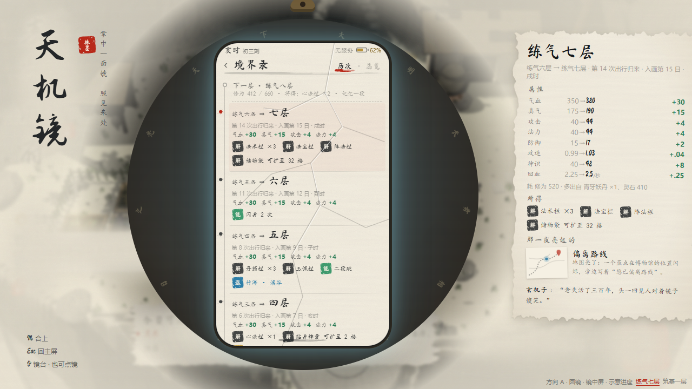
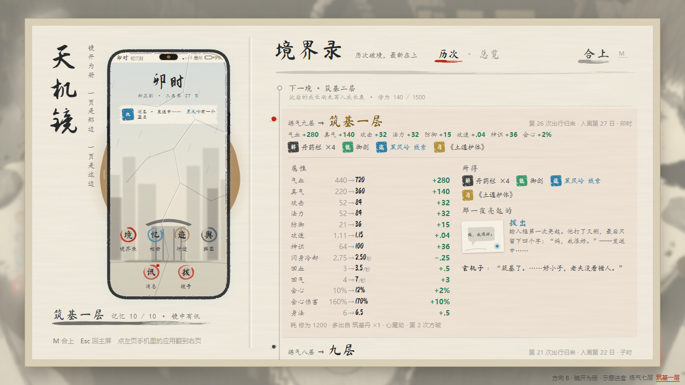
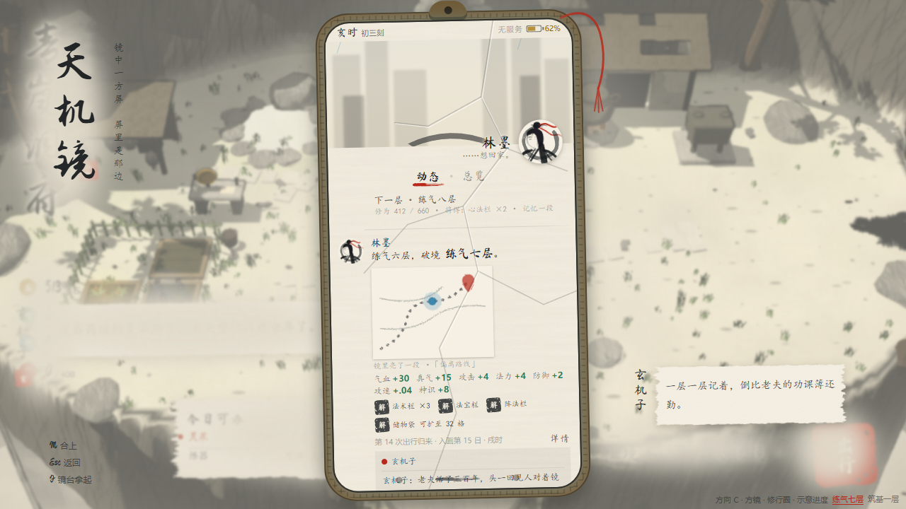

# 天机镜 v2 方案（UI 草图 · 待选）

> **实现状态（2026-11-17）**：用户选定 **A 圆镜 · 镜中屏**，境界录用时间轴备忘录写法，局内 M 照旧只开舆图，状态栏细节全留。
> 已进游戏：`src/ui/cave/mirror_v2.js / mirror_v2.css`（懒加载）、`src/world/cave_scene.js`（天机镜台：镜面竖屏、呼吸、亮屏、朱点、泥金）、
> `src/game/cave/index.js`（`openMirror`）、`src/game/cave/facilities.js`（`mirrorUnread / markMirrorSeen`、今日可办）、`src/ui/cave/index.js`（M / 按钮 / 挂签）。
> 测试：`node tools/run.mjs loop_mirror_v2`；截图 `work/shots/loop_mirror_v2_{home,realm,total,album,msg_zhuji}.png`。
> 缺数据的格子显示"—"，待写入的字段见 §4。

> 起因：用户在洞府小院看到石案上那面铜镜，问"这个是天机镜么？是不是也补充点交互。然后天机镜除了有现代手机，也能查看历史突破境界后获得了哪些提升。"
> 这一轮只交草图和说明，**不改游戏代码**。
>
> - 可交互草图：`docs/ui/v2/mirror_v2/index.html`（file:// 直接打开；三个方向可以并排看，也可以单独点进去）
> - 截图：`docs/ui/v2/png/mirror_v2_a.png`、`mirror_v2_b.png`、`mirror_v2_c.png`（另附 `mirror_v2_b_total.png` 累计总览、`mirror_v2_c_msg.png` 筑基后的消息、`mirror_v2_a_album.png` 相册）
> - 风格依据：`docs/UI风格指南_v1.md`、`src/ui/ink/`、灵泉册页 `work/shots/loop_cave_spring.png`、储物袋定稿 `bag_v2_zhijian.png`；品级颜色只用 `src/core/items.js` 的 `RARITY`
> - 数据：属性照抄 `src/data/progression.js` 的成长公式，解锁照抄 `unlocks / grants`，记忆与玄机子台词照抄 `src/game/cave/story.js`；出行次数、日数、时辰、行迹统计是编的

---

## 0. 一句话

**石案上的铜镜就是天机镜。** 走近按 F、点它、或者在洞府任何地方按 M，都会打开它。打开后，镜面里是一部**被水墨重新画过的手机**：裂屏、锁屏时间换成时辰、电量换成修为、信号写着"无服务"，桌面上几个用一笔圆相画成的应用。新增的**境界录**记下每一次破境：哪天、从哪层到哪层、各项属性涨了多少、开了哪些栏位、学会了什么，以及那一夜亮起的那段记忆；另有一页**总览**，列出从练气一层到现在累计长了多少。

---

## 1. 三个方向

三个方向用的是**同一套应用和数据**（`common.js` 里的 `mj-*` 内容块），区别在外框、布局，以及境界录用什么写法。

### A 圆镜 · 镜中屏　`a_yuanjing.html` → `png/mirror_v2_a.png`



- 石案上那面**圆铜镜**放大到屏幕中间：铜色外缘，一圈回纹刻度，镜钮上系一根朱绳，镜面边缘一圈淡金铭文（"见日之光，天下大明，长毋相忘"，汉镜常见的铭文）。
- 镜面里嵌着一块**竖屏**，屏幕是一张被点亮的宣纸，边缘带一点石青冷光，会慢慢呼吸。
- 屏幕里放列表；**详情写在镜子右侧的一张浮签上**（点一条境界记录、点一张照片，浮签就换成对应内容）。
- 左边是竖排的"天机镜"大字和题跋，左下角是按键提示。

| 优点 | 缺点 |
|---|---|
| "铜镜里是手机"这个意象最完整，一眼就能看出来；3D 里的镜台和 UI 是同一样东西，可以做"镜子从石案上升起、放大"的转场 | 屏幕只有 320×560，字号只能到 12–13px，境界录一条最多显示 4 项属性，其余要看右侧浮签 |
| 列表放在屏里、详情放在镜外，两边各干各的，层次清楚 | 圆镜四周的深色镜面占了很大一块，画面偏重；暗色的镜面和"不画方框、以纸为底"的总基调有一点冲突 |

### B 镜开为册　`b_ceye.html` → `png/mirror_v2_b.png`、`png/mirror_v2_b_total.png`



- 铜镜打开后展开成一本**装裱册页**，和灵泉、境界用同一种结构：绫边，中间一道折痕。
- **左页**：一圈淡赭色的铜镜圆相，里面立着一部用焦墨一笔勾出外框的手机，屏幕上是主屏（时辰、通知、应用）。它同时是导航：点左页手机里的应用，右页就翻到那一页。当前打开的应用圈一道朱笔。
- **右页**：内容，地方大。境界录的条目**在原地展开**，分成两栏，左栏是属性的前后对比（14 项），右栏是所得、那一夜亮起的记忆和玄机子的一句话。总览也分两栏：左栏是各项属性"练气一层 → 现在"，带一笔泥金进度；右栏是累计开出的栏位与身法、学会的功法，以及 10 个记忆点。
- 洞府里打开时，右页不会空着，默认翻到境界录。

| 优点 | 缺点 |
|---|---|
| **读得最清楚**：境界录的数字多（14 项属性 + 栏位 + 功法 + 记忆），只有这个方向能一眼看全 | 手机退成了左页上的一幅画，"手机感"比 A、C 弱 |
| 和用户认可的灵泉册页是同一套装裱、同样的字号，放进洞府里不会显得突兀 | 全屏，盖住了洞府 |
| 左页手机始终在，既是"这是我的手机"的提示，也是导航，不用来回点返回 | |

### C 方镜 · 修行圈　`c_fangjing.html` → `png/mirror_v2_c.png`、`png/mirror_v2_c_msg.png`



- 一面**手机形状的方铜镜**：铜框上刻回纹，镜钮正好长在前置镜头的位置，挂一根朱绳。所有内容都在镜框里，两边仍看得见洞府（打开时洞府的界面会收起）。
- 境界录写成**"修行圈"**（朋友圈的样子）：封面是穿越前那晚的城市，头像是林墨的立绘，签名会随记忆变化（练气九层后变成"画中人欲归，须补全山河。"）。每次破境发一条动态，**配图就是那一夜亮起的记忆**，下面一行属性、一行所得；**玄机子点一个朱点、留一句评论**（直接用 `XJZ_BREAK` 的台词），个别条目林墨会回一句嘴。点一条就在原地展开属性对比。
- 镜子右下方有一张玄机子的对白签，随打开的应用换台词。
- 底部三个墨点充当返回、主屏和最近。

| 优点 | 缺点 |
|---|---|
| **最像手机**，也最好玩：玄机子在朋友圈下面评论，正好接上"老派修士 × 现代人"的吐槽 | 一屏只放得下一条半动态，查数字要往下翻；总览也挤在窄屏里 |
| 现代和仙侠混在一起，但用的都是游戏里已有的台词和记忆，不会出戏 | "朋友圈"这层壳对一部分玩家可能有点太现代，林墨的回嘴需要文案另外写 |
| 洞府不被遮住，打开天机镜不像"切到另一个界面" | 竖屏放在 16:9 里，两边留白多 |

### 我的推荐：**B 作底，借 C 的玄机子**

- 境界录是这次的主角，它的信息量（属性前后对比、栏位、功法、记忆、时间）决定了界面必须**读得清**。B 是唯一不用翻页就能看全一条记录的方向，也和灵泉、境界册页一脉相承。
- B 的手机感弱，用两件事补回来：① **打开时的转场**：3D 镜台上那块屏一亮，光飞到左页，变成那部手机；② 左页的手机**一直可点**，是真正的导航，不只是一幅画。
- C 的"玄机子评论"在 B 里已经保留成每条记录下面的一句话（`玄机子：“……”`），如果用户喜欢，可以再把"朱点 + 评论 + 林墨回嘴"整套搬过来。
- 如果用户更看重"像手机"、愿意为此多翻几下，就选 C；A 是两者之间的折中，但屏太小，不推荐作为境界录的主界面。

---

## 2. 应用清单（三个方向通用）

| 应用 | 图标 | 内容 | 什么时候能用 |
|---|---|---|---|
| **境界录**（新增） | 泥金圆相"境" | **历次**：时间轴，最新的在上；最上面一条是虚线框的"下一层预告"（修为进度、将得什么）；点一条就展开 ↓<br>**总览**：练气一层 → 当前，各项属性的起点、现在、增量、倍数，加上累计开出的栏位与身法、学会的功法、记忆 n/10 | 练气一层起 |
| ↳ 一条记录 | — | 抬头：`练气六层 → 七层`、`第 14 次出行归来 · 入画第 15 日 · 戌时`<br>属性：气血 / 真气 / 攻击 / 法力 / 防御 / 攻速 / 神识 / 闪身 / 闪身冷却 / 回血 / 回气 / 会心 / 会心伤害 / 身法，**只列有变化的**，每项"前 → 后 ＋差值"<br>所得：解（栏位，墨印）、能（二段跳、闪身、御剑，石绿印）、途（区域，石青印）、习 / 悟（法术、心法，泥金印）<br>耗：这一层用掉的修为，筑基另记"筑基丹 ×1 · 心魔劫第 2 次方破"<br>那一夜亮起的：记忆的缩略图 + 标题 + 第一句，点开进相册<br>玄机子：当时说的那句话 | |
| **相册** | 石青"忆" | 10 张"照片"（每段记忆配一幅几笔的水墨速写）。没亮起的照片是**模糊的灰影**，下面写"练气八层亮起"；筑基那张标成石青色。点开看全文和"亮于练气六层 · 第 11 次出行归来" | 始终 |
| **行迹** | 赭石"迹" | 出行 / 撤离 / 身陨 / 斩妖四个大数；带回最多的一次（估价 · 件数 · 第几次 · 哪里）；最好的一件（名字用 RARITY 颜色 + 品级小印）；斩首领；采药 · 开箱；取回遗落储物袋；头一回身陨 | 始终 |
| **舆图** | 黛色"舆" | 洞府里只列已知去处与着墨程度；出行时按 M，镜面直接展开成现有的舆图手卷（`mirror_map.js`，不改） | 始终 |
| **消息 / 拨号**（底栏） | "讯""拨" | 筑基前：图标退成清墨，名字写"无服务"；点进去能看到那晚妈发来的两条旧消息，输入框是"无服务"。拨号页是最近通话：妈未接 ×3（那晚）……<br>筑基后：多了一条林墨发出的"妈，我很好。"，状态**永远是"发送中……"**；下面是一张"裂纹连成的地图"，标着黑风岭的蓝点，旁边一个按钮"在舆图上标出"（回家线索的入口）；再往下，一个"未知 · 黑风岭"的联系人正在输入…… | 筑基一层起有信号 |

**状态栏（克制，只放这四样）**：

- 左：**时辰**（真实钟点换算，比如 21:40 → "亥时 初三刻"）。
- 中：**镜钮**就是前置镜头。
- 右：**信号**，筑基前写"无服务"，筑基后是"墨州"加一格信号；**电量 = 当前境界的修为进度**（泥金色，悬停显示"修为 412 / 660"）。
- 屏幕上一直有一道淡淡的**裂纹**，走向和游戏里现有的 `cv-mirror` 裂纹一样。

**主屏**：壁纸是穿越前那晚的城市（淡墨远楼、雨丝、博物馆的屋檐、一点暖灯）。上面是时辰大字和"入画第 N 日"。下面一张通知纸条：有没看过的新突破时写"境界录 · 新记一条：练气七层"；筑基后改成"消息 · 发送中……黑风岭有一个蓝点"。图标的未读用朱点。

**刻意不做的**：天气、步数、相机、应用商店、通知角标的数字、玻璃质感、渐变高光。

---

## 3. 请用户拍板

1. **外框选哪个？**
   A 圆镜 · 镜中屏 ／ **B 镜开为册（推荐）** ／ C 方镜 · 修行圈 ／ B 的册页 + C 的修行圈写法
2. **境界录用哪种写法？**
   **时间轴备忘录（A、B 现在的样子，推荐）**：信息密、好扫读 ／ 修行圈动态（C）：配图、玄机子评论、林墨回嘴，更有人情味，但要加文案（每层一句回嘴可选）
3. **局内按 M 打开什么？**
   **只开舆图手卷，和现在一样（推荐）**：局内时间不停，不该分心 ／ 打开整面天机镜，默认停在舆图应用，可以回主屏看别的
4. **状态栏的小细节留哪些？**
   **全留（推荐）**：时辰、修为当电量、无服务 → 墨州一格、裂屏 ／ 只留时辰和信号 ／ 都不要，屏上只放应用

---

## 4. 实现需要的数据

### 4.1 突破历史：突破时写进存档（新增）

写入位置：`CaveMode.breakthrough()`（`src/game/cave/index.js`）里，`F.doBreakthrough(p)` 和 `F.grantRealm(p)` 之后、`this.save()` 之前。也可以挂在已有的 `cave:breakthrough` 事件上。

```js
profile.stats.breakHistory = [
  {
    v: 1,
    from: "1:6", to: "1:7",          // PROGRESSION.order 的 key
    run: 14,                          // 当时的 profile.stats.runs（序章那一次为 0）
    day: 15,                          // 入画第几日。游戏目前没有日历，先用 runs + 1（一出一归算一日）；以后有了日历再换
    at: 1731850000000,                // 真实时间戳 → 显示时辰（只用到钟点）
    playTime: 18234,                  // 当时的 profile.playTime（秒），以后可以算"这一层用了多久"
    xp: 520,                          // 这一层用掉的修为 = PROGRESSION.xp[from]
    stats: { hp: 30, mp: 15, atk: 4, spell: 4, def: 2, aspd: 0.039, sense: 8, hpRegen: 0.25 },
                                      // growth[to] − growth[from]，只存非零项。存差值，不要每次现算：
                                      // 以后调平衡改了成长表，旧记录仍然是"当时长了多少"
    base: { hp: 380, mp: 190, ... },  // 可选：growth[to] 的快照，展开时显示"前 → 后"；不存就用 base − stats 倒推
    unlocks: [{ key: "spellSlots", value: 3 }, { key: "artifactSlot", value: true }, { key: "formationSlot", value: true }, { key: "bagMax", value: 32 }],
                                      // doBreakthrough 的返回值原样存，显示用 overlays.js 的 UNLOCK_NAME / unlockText
    grants: [{ kind: "spells", id: "sword_qi", name: "剑气斩" }],  // grantRealm 的返回值原样存
    memory: "1:7",                    // 这次亮起的 MEMORIES key（没有则 null）
    trial: { id: "xinmo", tries: 2 }, // 有试炼时才写；tries = 第几次才过（需要在心魔劫失败时 +1：profile.flags.trialTries[key]）
    src: null,                        // 可选，第二步再做："这一层的修为主要来自"，例如 { stones: 410, items: [{ id: "qingya_core", n: 1 }] }
                                      // 需要灵泉炼化时按层累计，第一版可以不做
  },
  // ……按时间顺序 push，显示时倒过来（最新在上）
];
```

- **旧档补记**：`migrate()` 里，如果 `realm` 已经高于练气一层而 `breakHistory` 为空，就按成长表补齐每一层，写上 `backfill: true`、`run: null`、`day: null`，界面上把时间显示成"早年 · 未记"。
- **总览不读历史，现算**：`growth[当前] − growth["1:1"]`，栏位从 `PROGRESSION.unlocks` 取"不晚于当前境界"的最后一项，功法取 `profile.flags.learned`。总览只算**境界本身**的成长，不含装备和心法加成（标题写明"自练气一层起"）。
- 序章那一次（凡人 → 练气一层）也记一条，`run: 0`，显示成"序章"。

### 4.2 记忆

- `profile.flags.memories` 已经有了（亮起的 key 列表）。相册里"亮于练气六层 · 第 11 次出行归来"从 `breakHistory` 里按 `memory` 字段反查，不用另外存。
- 洞府现在的 `mirrorList()`（`src/ui/cave/overlays.js`）由相册应用替代；突破演出 `breakFx` 里的那张记忆卡保持不变。

### 4.3 行迹统计（`profile.stats` 里补字段）

| 字段 | 现状 | 写入时机 |
|---|---|---|
| `runs / extracted / deaths / kills` | **已有** | `run.js` 结算 |
| `bestHaul: { run, region, value, items }` | 新增 | 撤离结算时，本局带回的估价总和若超过记录就替换 |
| `bestItem: { id, rarity, name, run, region }` | 新增 | 撤离结算时，按 RARITY 再按估价比较 |
| `bosses: { qingya: 5, bilin: 2 }` | 新增 | 首领死亡时 |
| `herbs / chests` | 新增 | 采集、开箱时 +1 |
| `lostBagBack` | 新增 | 取回遗落储物袋时 +1 |
| `firstDeath: { run, by, region }` | 新增 | 第一次身陨时写一次 |

### 4.4 消息

- 筑基后 `profile.flags.mirrorMsg = { sent: true, at }`，用来决定主屏通知和底栏是否亮起；读过以后写 `read: true`，朱点消失。
- "在舆图上标出"：在 `profile.map` 里给黑风岭方向加一个线索标记（下一章用），第一版可以只显示一句"已记下"。

### 4.5 未读

- `profile.flags.mirrorSeen = { realm: "1:7", msg: true }`：最新一条突破记录如果还没在境界录里看过，图标亮朱点，主屏出通知，3D 镜台闪得更勤（§5）。

---

## 5. 3D 天机镜台（洞府组实现）

现有模型：`src/world/cave_scene.js` 的 `appraise`（鉴宝台），包括石案、铜镜（`CylinderGeometry` 铜面 + `TorusGeometry` 金边，位置 `(-0.35, 1.48, -0.15)`）、纸、小灯。鉴定已经挪到结算页，这张台现在空着。

**改名**：玩家看到的名字从"鉴宝台"改成"**天机镜台**"，挂签写"天机镜"。代码里的 id 可以保持不变。

**镜面加一块"屏"**：

- 在铜镜正面略靠前 0.005 的地方，加一块竖长的圆角矩形面片（大约 0.26 × 0.46，按铜镜半径 0.36 来定，正好内切）。材质用 `MeshBasicMaterial`，颜色 `#cfe9ee`，`transparent`，`depthWrite: false`。
- **呼吸**：透明度在 0.06 ↔ 0.16 之间，周期 4 秒，用正弦。
- **偶尔亮屏**：每隔 20–40 秒随机一次，透明度 0.15 秒内升到 0.6，停 1.2 秒，再用 0.8 秒淡回去。同时开一盏小点光源（`0x9fd8e6`，强度 0.6，距离 3），节奏一样。像手机收到消息时屏幕亮了一下。
- **有未读时**（§4.5）：亮屏改成每 6–8 秒一次，屏上右上角加一个很小的朱点（sprite）。
- **筑基后**：亮屏的颜色从石青换成泥金（和突破漩涡的 gold 一致）。
- 后处理是水墨风，屏的亮度不要超过 0.6，避免泛白发光、出戏。

**交互（三种入口，打开的是同一个界面）**：

| 入口 | 行为 |
|---|---|
| 走近 | 进入 1.8 米范围，和其他设施一样浮出挂签"天机镜 **F**" |
| 按 F | 林墨转身面向镜台，打开天机镜 |
| 点击镜台 | 和设施的"点一下直达"一样：先走到镜台前，再打开 |
| 按 M | 洞府里任何位置都能直接打开，不用走过去 |
| 局内按 M | 维持现状，打开舆图手卷（见问题 3） |

**打开 / 合上的转场**：

- 打开：镜台上的屏 0.15 秒亮到最亮，然后从**铜镜在屏幕上的投影位置**开始，界面墨晕开、放大到位（`ink-bleed-in` 0.32 秒，`transform-origin` 取铜镜的屏幕坐标）。B 方向是光点飞到左页，变成那部手机。
- 合上（M / Esc / 点"合上"）：反过来，缩回铜镜，屏再闪一下、熄灭。
- 打开时洞府的界面（今日可办、资源、挂签）收起；C 方向保留 3D 画面，A、B 方向压一层纸。

**默认停在哪个应用**：如果有没看过的新突破，打开境界录并选中最新那一条；如果有筑基后没读的消息，打开消息；否则回到上次关闭时的应用，没有就停在主屏。

**玄机子**：第一次走近镜台时说一句（`XJZ_TIPS.mirror`，**需要文案确认**），例如："你那面会亮的镜子，老夫替你摆在石案上了。破一回境，它便多记一笔。"

---

## 6. 文件

| 文件 | 说明 |
|---|---|
| `docs/ui/v2/mirror_v2/index.html` | 入口：三个方向并排、单独查看、切换示意进度（练气七层 / 筑基一层） |
| `a_yuanjing.html` / `b_ceye.html` / `c_fangjing.html` | 三个方向 |
| `common.js` | 公用渲染：状态栏、主屏、境界录（历次 / 总览 / 展开）、相册、行迹、消息、舆图；状态写在地址栏 hash 里 |
| `data.js` | 假数据：成长表公式、解锁、记忆、玄机子台词、行迹统计、记忆速写 SVG、壁纸 |
| `base.css` | 公用样式（只给草图用）；字体先读 `assets/fonts/*.ttf` 全字库，读不到再用 `src/ui/ink/*.woff2` |
| `bg_cave.png` | 洞府底图（`work/shots/loop_cave_cave_repaired.png` 的副本；截图里的洞府 HUD 用纸色抹掉了） |
| `shoot.mjs` | 截图：`node docs/ui/v2/mirror_v2/shoot.mjs <页面> <输出png> "<hash>"` |

截图用的 hash：

```
a: p=qi7&app=realm&open=1:7&t=21:40
b: p=zj&app=realm&open=2:1&t=05:40        b_total: p=zj&app=realm&tab=total&t=05:40
c: p=qi7&app=realm&t=21:40                c_msg:   p=zj&app=msg&mtab=msg&t=05:40
a_album: p=qi7&app=album&mem=1:6&t=21:40
```

草图里的快捷键：Esc 回主屏（相册里先关掉照片）；右下角可以切换示意进度。
