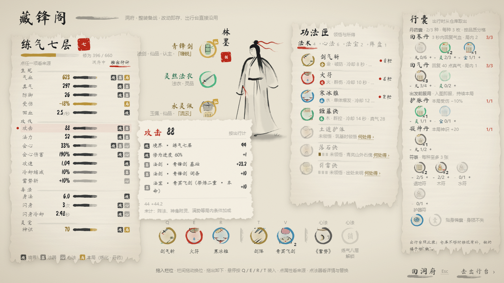
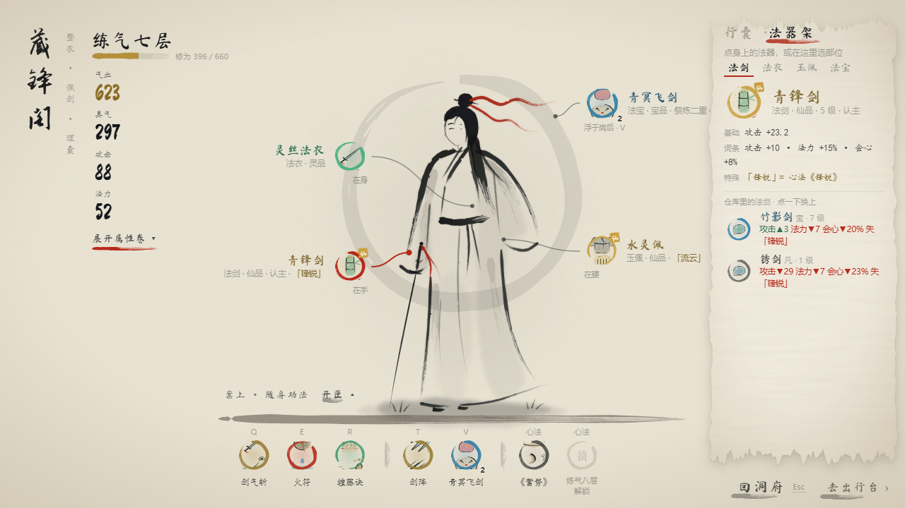
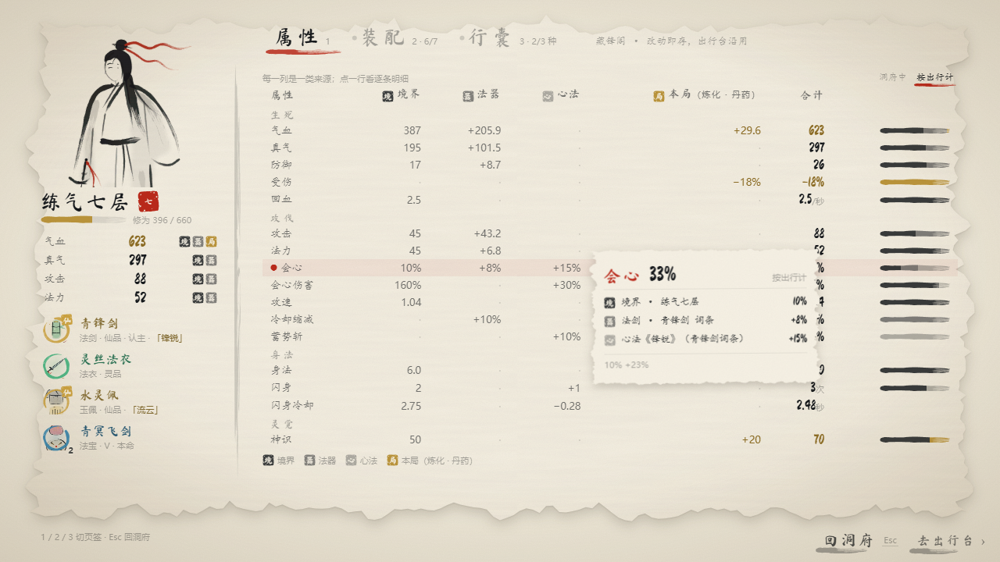

# 静室（洞府备战建筑）方案（UI 草图 · 待选）

> 起因：用户原话"洞府里加个建筑，可以查看玩家的属性、更换背包的备战物品、更换功法等。和出行时的界面比起来就是差了左侧的地图预览、怪物预览那些。"
> 这一轮只交草图和说明，**没有改 `src/` 下的游戏代码**。
>
> - 可交互草图：`docs/ui/v2/静室/index.html`（file:// 直接打开；三个方向可以并排看，也可以单独点进去，右侧有"状态"快捷链接）
> - 截图（1280×720）：`docs/ui/v2/png/静室_A.png`、`静室_B.png`、`静室_C.png`；补充状态 `静室_A_换装.png`、`静室_B_属性卷.png`、`静室_B_功法匣.png`、`静室_C_行囊.png`、`静室_C_装配.png`
> - 截图命令：`node docs/ui/v2/静室/shoot.mjs "<页面.html#hash>" <输出.png> "<点击选择器|drag:源>目标>" [悬停选择器]`
> - 数据：示例角色是练气七层（修为 396 / 660），每个数字都按真实公式算出（`common.js` 文件头列了出处）：境界成长 `src/data/progression.js`、法器底材与词条 `items_db.js / loot.js`、法宝被动与心法 `src/data/items.js`、炼化增益 `recipes.js REFINE.buff`、叠加公式 `src/core/combat.js Stats.get`。品级色由 node 直接从 `RARITY` + `inkReadable` 导出，五行色取 `loadout.js EL`。
> - 功法栏 / 功法匣的行为直接复用装配 v2 草图的 `docs/ui/v2/loadout_v2/data.js`（与游戏里 `src/ui/loadout.js LoadoutUI` 同一套规则：互换、拖出卸下、同名不叠加、锁栏提示）。

---

## 0. 一句话

在洞府东侧石径的尽头加一座小阁。走进去，看到的就是**"出行准备减去左边的去处"**：中间是林墨和他身上的法器，旁边是功法匣和随身功法栏，右边是行囊；原来放去处的地方换成一整卷**属性**，每一项都能点开，看这个数是境界、法器、心法、法宝、炼化增益、丹药各给了多少。阁里定下的东西就是存档里的东西，出行台**直接沿用**，不再各管一份。

## 1. 名字

现有站点 `spring` 的全名已经叫 **"灵泉·静室"**（`src/game/cave/data.js STATIONS`），新建筑再叫"静室"会撞名。草图文件夹先用"静室"作工作名，界面上写的是候选一。

| 候选 | 意思 | 适合的理由 |
|---|---|---|
| **藏锋阁**（推荐） | 收剑入鞘、蓄势待发 | 正好是"整装备战"的意思，剑修味道，和"量力而归"的题跋同一口气 |
| 内观阁 | 道家"内观"：反观己身 | 偏"看属性"，备战的意思弱 |
| 炼心阁 | 修心 | 偏"功法、心法"，但和心魔劫的"炼心"容易混 |

## 2. 三个方向

三个方向用的是**同一套组件和数据**（`docs/ui/v2/静室/widgets.js`：属性卷、法器签、功法栏 + 功法匣、行囊），区别只在版式和信息展开的方式。都能点：切功法页签、拖法术进栏、丹药 ＋/－（按品质分格，种类与枚数上限会提示）、点法器看详情并换装（属性跟着变）、点属性看来源、切"洞府中 / 按出行计"。

### A 出行同版式 · 左侧属性卷　`a_xingjuan.html` → `png/静室_A.png`（推荐）



- 版式与 `src/ui/screens/prep.js` 一一对应：中间立绘、左侧三件随身法器（右对齐）、立绘右侧功法匣、立绘下随身功法栏（Q E R ｜ T V ｜ 心法 心法），右栏行囊。
- 左侧扇面去处、区域情报、护盾覆盖**整块换成一卷属性**：
  - 卷首：境界名 + 境界印 + 修为一笔（泥金）；"洞府中 / 按出行计"切换。
  - 四组：生死（气血 真气 防御 受伤 回血）· 攻伐（攻击 法力 会心 会心伤害 攻速 冷却缩减 蓄势斩）· 身法（身法 闪身 闪身冷却）· 灵觉（神识）。没有来源的可选项（受伤、冷却缩减、蓄势斩）不显示。
  - 每项：名 · 数（本局临时加成时字转泥金）· **一笔分段条**（境 焦墨 / 器 重墨 / 心 淡墨 / 局 泥金；洞府中"局"那段是虚线）· 来源小印。
  - 点一项 → 卷右侧浮出明细纸签：逐条来源（"法剑 · 青锋剑 基础 +23.2""心法《锋锐》（青锋剑词条）+15%""炼化 · 灵气充盈三档（余 3 分 30 秒）"），底下一行算式，攻击 / 法力加注"未计：阵法、神龛附灵、满势等局内条件加成"。
- 点法器（`png/静室_A_换装.png`）→ 详情纸签：品级色名、级、认主；基础 / 词条 / 特殊词条（"「锋锐」= 心法《锋锐》"，心法栏也装了会提示同名不叠加）；下面列仓库里同部位的法器，每件写与身上比的 ▲▼（含"失「锋锐」"），点一下就换上。
- 右下"回洞府 Esc"和"去出行台 ›"，**没有启程印**（出门的决定留给出行台）。

| 好处 | 代价 |
|---|---|
| **出行准备 = 本页 + 左侧换回去处**，两处一套组件、一份数据，用户说的"差了左侧的地图预览、怪物预览"字面上就成立 | 这一屏信息最密；属性卷占掉左侧，立绘区偏窄 |
| 改动面最小，prep.js 的版式、测试（`prep_layout.mjs`）大部分可沿用 | 和出行台长得几乎一样，"进阁"的仪式感弱，要靠转场补 |
| 属性来源一眼全在，点开就有算式 | |

### B 更衣 · 立绘为中心　`b_gengyi.html` → `png/静室_B.png`



- 阁中一幅"更衣图"：林墨立在画心，背后一圈淡墨圆相；四件法器用**一笔引线挂在身上**——法剑在手、法衣在身、玉佩在腰、法宝浮在肩后（锚点按立绘 svg 600×1000 坐标换算，换正式立绘只改锚点表）。
- 左上"气象"：境界 + 修为 + 四个大数（气血 真气 攻击 法力）；点"展开属性卷 ▾"从顶上**垂下一轴立轴**，就是 A 的那卷属性（`png/静室_B_属性卷.png`）。
- 下方一道案沿 = 随身功法栏；点"开匣 ▴"，功法匣从案上**展开成两列横卷**（`png/静室_B_功法匣.png`）。
- 右侧纸笺在"行囊 / 法器架"之间切换；点身上任一件法器，纸笺切到法器架并定位到这个部位，引线和挂点转朱。

| 好处 | 代价 |
|---|---|
| 最有"进阁更衣"的画面，和建筑本身呼应；法器在身上的位置一眼明白 | 属性、功法匣都要多点一下才看得到 |
| 平时只露四个大数，界面安静，最符合"留白"原则 | 和出行准备不是同一版式：组件能共用，版式要维护两套 |
| | 立绘是程序生成的占位图，锚点要随正式立绘调；引线在小屏上细 |

### C 页签式 · 属性 / 装配 / 行囊　`c_yeqian.html` → `png/静室_C.png`



- 一张整纸 + 三个页签（1 / 2 / 3 键切换）。**左栏常驻**：半身像、境界、四个主数、四件随身法器；换任何东西，左栏的数字当场跳一下（朱色一闪）。
- 属性页是**来源矩阵**：行 = 属性，列 = 境界 / 法器 / 心法 / 本局（炼化 · 丹药），再加合计和分段条；"洞府中"时本局一列划掉。点一行出同一张明细纸签。
- 装配页（`png/静室_C_装配.png`）：随身功法栏 + **三列**功法匣——功法 v2 的法术变多也放得下。
- 行囊页（`png/静室_C_行囊.png`）：丹药囊 / 出发前服用 / 符箓 · 锦囊三列，丹药按品质分格。

| 好处 | 代价 |
|---|---|
| 最紧凑、最好读：所有来源并排对照，数字最好比 | 看属性和换功法不在同一页（靠左栏跳数弥补） |
| 最能容纳功法 v2 扩充和丹药品质 | 最像传统"角色面板"，水墨意象最弱；表格感重，表线要压得很淡 |
| 每页的组件可以原样嵌进出行准备 | |

### 我的推荐：**A**，借 B 的转场

1. 用户的描述本身就是 A："和出行时的界面比起来就是差了左侧的地图预览、怪物预览"。照这个做，玩家不用学第二套界面：阁里怎么摆、出行台就怎么摆。
2. A 让**出行准备直接变成"藏锋阁 + 左侧去处"**（§3），一份代码、一份存档，最不容易出现"阁里改了、出门时又不一样"。
3. A 的弱点是仪式感，用两件事补：① 沿用天机镜的"从 3D 物件长出来"转场（范例 2.4），界面从阁里的剑架 / 衣桁处展开；② 法器签上加 B 的"挂在身上"一笔引线作装饰（可选，不加功能）。
4. 如果用户更看重"这是另一处地方"的感觉，选 B；如果更看重数字（以后词条、心法越来越多），选 C——C 的矩阵也可以作为 A 里属性卷的"展开"状态。

## 3. 和出行准备共用同一套组件与数据（避免两份逻辑）

### 3.1 组件：四块，两处都用

| 组件 | 现状 | 落地 | 藏锋阁 | 出行准备 |
|---|---|---|---|---|
| 属性卷 StatSheet | 没有；prep 底部一行"气血 · 真气 · 攻击 · 法力"，只算了攻击的装备固定值 | 新 `src/ui/stat_sheet.js`，数据来自 §5 的 `statBreakdown` | 左侧整卷 | 收成一行四个主数 + "看全部 ›"弹出同一卷 |
| 随身法器 GearSlots | prep 用 `kit.prompt` 列表选；仓库页另有"佩戴" | 新 `src/ui/gear_slots.js`：法器签 + 详情纸签 + 同部位 ▲▼ 对比 + 换上 | 有 | 有 |
| 功法栏 + 功法匣 | 已有 `src/ui/loadout.js LoadoutUI`（出行准备、`openLoadout` 弹层都在用） | 不动；未领悟的行加"来源一行"（§3.3） | 有 | 有 |
| 行囊 PackUI | prep.js 里的 `counter / trimPills / pickPouch / protectList`，选择存在临时的 `st.take` | 新 `src/ui/pack.js`（从 prep.js 抽出），选择写进存档（§3.2） | 有 | 有 |

**出行准备 = 藏锋阁的中间与右栏 + 左侧"去处卷"**（扇面、去处列表、区域情报、护盾覆盖、委托）+ 右下"启程"。阁里没有去处卷，所以没有护盾提示和委托；需要按去处调功法时，在出行台调——两边改的是同一份 `profile.build`。

### 3.2 数据：行囊在阁里定好，出行时直接沿用

- 功法：`profile.build`（已存档）；法器：`profile.equip`（已存档）；锦囊：`profile.pouch`（放进去就是真的移进去，已存档）。这三样两处天然一致。
- **行囊现在不存档**：`prep.js` 的 `st.take` 每次进出行准备都重算默认值。要做到"阁里定好、出门沿用"，需要一个**行囊预案**：
  ```js
  profile.pack = {
    pills:  { huichun_dan: { 1: 2, 2: 1 }, huiqi_dan: { 0: 3 } }, // 丹药 id → { 品质 rarity: 枚数 }
    preRun: { humai_dan: { 1: 1 }, ningshen_dan: { 0: 1 } },     // 出发前服用
    fu:     { dundi_fu: 2, fu_wood: 2 },                         // 符箓
  };
  ```
  - 预案只是"打算带多少"，**不从仓库移出**；启程时才按预案取（`takeFromStorage` 要加品质参数，现在按仓库顺序取、不分品质）。仓库不够时按现有补，缺的格子标"缺"，不拦启程。
  - 出行准备打开时读预案（不再自己算默认值）；第一次没有预案时，用现在的默认规则生成一份。
  - 种类上限 `unlocks.pillSlots`、每种上限 `cave.pillCap`、出发前每种 1 枚，这些校验放进 `pack.js` 一处，两边共用。
- 属性：两处都调同一个 `statBreakdown`；prep 底部那行和 `loadout.js heroNow()` 也改成调它，免得三处算法不一致。

### 3.3 和另外两组的边界（只留位置，不替他们设计）

- **战斗设计 · 功法体系 v2**：功法匣里未领悟的法术 / 心法 / 阵盘多一行"来源"：残页进度小印（■■□ = 2/3）+ 一句出处 + "何处得 ›"。"何处得 ›"打开战斗组的**功法来源指引面板**；草图里只弹提示。数据只需每条给 `{ page: [已得, 共需], src: "一句出处" }`。法术变多时：A / B 的功法匣列表滚动，C 是三列。
- **玩法 · 行囊按丹药品质选择**：行囊格子按 `have[id][rarity]` 逐品质出一格，每格"－ 品 已带/仓库 ＋"。"种类按丹名算、品质共用每种上限"是草图的假设，以玩法组定的规则为准；品质对效果的影响（现在只有聚气丹分档）也由他们定，格子不变。
  - 注意：`recipes.js` 注释里丹药品质叫"下 / 中 / 上 / 极"，全局约定品级只用 `RARITY`（凡 / 灵 / 宝 / 仙 / 极）。草图按 RARITY 显示，请玩法组确认界面文案也用 RARITY。

## 4. 建筑：位置、外观、入口

### 4.1 位置
东侧石径的尽头。`cave_scene.js _paths()` 里有一条 `(4.4, 1.7) → (7.5, 1.0) → (10, 0.6)` 的石径，走到头是空地（截图 `work/shots/loop_cave_cave_repaired.png` 右侧中部），右后是大石和迎客松 `(15.6, 6.4)`，北面是丹器房 `(8.2, −5.6)`。

| 项 | 建议值 |
|---|---|
| 模型中心 `CAVE_MODELS.loadout` | `[12.2, 1.2]`，正面朝西（朝院子中心） |
| 站点 `CAVE_STATIONS.loadout` | `at: [12.0, 1.0], r: 3.0, tagY: 4.2, stand: [10.2, 0.8]`（站在石径尽头） |
| 占地 | 约 3.2 × 2.6 米；碰撞体两个圆 r≈1.4；离丹器房 ≥ 5 米、离崖沿还有余量（`caveHeight` 里 r≈0.6，崖沿从 0.93 起） |
| 溪谷版（搬迁后） | 位置不变（与其他设施同规则），竹林环绕 |

和左侧的天机镜台、药园大致对称，院子东半边不再空着。

### 4.2 外观意向（模型由美术管线后续做）
- 一座**半敞的小轩**：三面木壁、正面敞开，歇山小顶。修缮前是茅草顶 + 一面塌了的竹帘（`M.thatch`），修缮后换青瓦（`M.tile`），与丹器房、仓库同一套材质和后期墨线。
- 敞口里看得见三样东西，正好对应界面三块：**剑架**（横一柄剑，剑穗朱红 = `M.cloth`）↔ 法器；**衣桁**（搭一件法衣）↔ 法衣；**低案 + 一只功法匣**（漆盒、半开、露一卷书）↔ 功法。案前一个蒲团。
- 檐下挂一块竖匾写阁名（大字用场景里的书法贴图，与洞府题字同源）。
- 提示方式沿用天机镜台的约定：**不放常驻红点**；有"新领悟未装 / 新开栏空着"时，功法匣盖缝里透一线微光（透明面片改 opacity + `glowSprite`，不加 PointLight，见 坑.md §3），待办进"今日可办"。
- 参考：现有 `BUILD.study`（蒲团、低案、残卷）、`BUILD.workshop` 的小屋比例、天机镜台的发光做法（`setMirror`）。

### 4.3 入口（与天机镜一致：几种方式打开同一个界面）
- 走近按 **F**；点建筑（`cave.goTo("loadout")` 自动走过去再打开）；挂签只在悬停 / 靠近时显示。
- 快捷键：见选择题 3（现在洞府里 **C 已经是"境界"→ 灵泉**，右下按钮"境界 C"）。
- 右下按钮加一枚"藏锋"（在"境界""天机镜"之间）。
- "今日可办"一行：`藏锋阁 · R 栏空着` / `新领悟：寒冰锥，未装`，点了走过去并定位到对应页签。
- 已有的两个快捷入口改成打开藏锋阁：仓库参悟后的"去装配"、心魔试炼前的"调整功法"（现在都调 `openLoadout` 弹层）。弹层可以保留作过渡。
- 稳定接口：`cave.open("loadout", 标签, { sel })`，标签 `stat / ld / pack`（A 版式下是定位用），`sel` 键 `{ stat: "atk", gear: "sword", tab: "xinfa" }`。
- 实现约定（本项目约定 §4）：界面懒加载 `import("/src/ui/cave/loadout_hall.js")`，打开时构建、合上就移除；进场动画 480ms 后 `ctx.hold3d = true`。

## 5. 数据接口：属性来源拆解

叠加公式（`src/core/combat.js Stats.get`）：**最终 = (基础 + Σ固定) × (1 + Σ百分比) × Π(1 + 独立乘区)**；每条加成都带 `source` 标签。百分比来源的"贡献值"按 `(基础 + Σ固定) × 百分比` 显示（草图明细里写成"+5%（+29.6）"）。

### 5.1 现在拿得到的
| 来源 | 怎么拿 |
|---|---|
| 境界 | `heroStats(p, { base: true })`（`src/game/progression.js`） |
| 修为进度加成 | `progressBonusStats(p)`（0.4 × 进度 × 到下一层的差） |
| 单件法器 | `gearMods(inst)`（基础 + 词条，已滤掉 flag）；基础与词条分开用 `facilities.js gearLines(inst)` |
| 心法（含装备词条） | `XINFA[id].mods`；生效集合 = 心法栏 ∪ 装备特殊词条，同名只算一次（`skills/index.js applyLoadout`）；界面用 `loadout.js gearXinfa(P)` 标"由哪件提供" |
| 法宝被动 | `ARTIFACTS[artifactId].passive(level)`，`level = inst.level + def.bonusLevel`（`run.js loadoutOf`） |
| 炼化增益 | `profile.buffs`，`run.js buffMods / buffName / buffText`、`facilities.js currentBuff`；剩余时长 `remain`（秒，只在局内计时） |
| 认主惩罚 | `profile.flags.bloodDebuff`（下一局气血 −10%） |

### 5.2 拿不到、需要别组补的
| 需要 | 现状 | 建议 / 归属 |
|---|---|---|
| **`statBreakdown(P, { pack, mode })`** 纯函数 → `{ [属性]: { final, base, flat: {来源: 值}, pct: {…}, more: {…} } }` | 没有；`applyHeroStats` 直接写进 Stats，prep 底部那行只算了攻击固定值 | 放 `src/game/progression.js` 或 `run.js` 旁边；`applyHeroStats / applyProfileToHero` 改成复用它。**玩法系统（流程）**，数值策划核对 |
| 法器按部位拆分 | 运行时三件都在 `"equip"` 一个标签下 | 标签改 `equip:sword / equip:robe / equip:jade`；过滤 `gx_*`、`special`、`bagCells`、`extractTime`。**玩法系统** |
| 出发前丹药预览 | 只在进图时写入；护脉丹走 `preRun` 标签，**凝神丹的神识不进 Stats**（`containers.pillSense`） | `statBreakdown` 接收行囊预案模拟；凝神丹最好也走 Stats（`sense` flat，标签 `preRun`），否则界面要特判。**玩法系统** |
| 行囊预案存档 `profile.pack` + 按品质取出 | `st.take` 不存档；`takeFromStorage` 不分品质 | 见 §3.2。**玩法系统**（与"行囊按品质"同一个人做最好） |
| 功法来源 `{ page, src }` | 只有一句 `src` 文案 | **战斗设计 · 功法体系 v2** |
| 法宝词条不生效（疑似 bug） | `loadout.js gearXinfa` 会扫法宝栏词条，但 `applyEquipStats` 只加三件法器 → 极品法宝的词条（含特殊词条）实际不生效 | 请**战斗设计 / 玩法**决定修不修；修之前属性卷里法宝词条显示"—" |
| 祭炼升级 | 代码里没有祭炼升级；`inst.level` 是掉落时的区域等级（竹海 5–9），"祭炼 N 重"可能超出设想的 1–5 | **数值策划**确认显示口径（草图写"祭炼二重"） |
| 丹药品质文案 | `recipes.js` 注释是"下 / 中 / 上 / 极" | 统一用 RARITY（见 §3.3） |
| 局内条件加成（阵法、神龛附灵、满势、`status:*`） | 只在局内、按条件生效 | 不进属性卷，明细里注一句"未计" |

缺数据的格子一律显示"—"，不编数（本项目约定 §4）。

## 6. 给用户的选择题

1. **版式**：A. 出行同版式，左侧属性卷（推荐）；B. 更衣图，法器挂在身上、属性卷垂下；C. 页签式（属性矩阵 / 装配 / 行囊）。也可以组合，例如"A 的版式 + B 的法器引线装饰"或"A 的属性卷点'展开'变成 C 的矩阵"。
2. **和出行准备的关系**：A. 出行准备改成"藏锋阁 + 左侧去处"，两处都能改、同一份数据（推荐）；B. 出行准备只读，只能快速换法术，细调必须回阁；C. 维持两套各自完整的界面（不推荐：两份逻辑）。
3. **名字和快捷键**：名字 A. 藏锋阁（推荐）/ B. 内观阁 / C. 炼心阁 / 用户另起。快捷键 A. **C 改给藏锋阁**（"角色面板"通用习惯），右下"境界"按钮改成"藏锋"，灵泉仍可点 / 走近 F / 从今日可办进（推荐）；B. 另起一个键（如 B"备"）；C. 不设快捷键，只走过去。
4. **属性默认口径**：A. 默认"按出行计"——炼化增益、出发前丹药都算进去，泥金字标"本局"（推荐，出门前看到的就是出门后的数）；B. 默认"洞府中"，只算长期的，本局加成虚线显示。

## 7. 草图文件

| 文件 | 内容 |
|---|---|
| `docs/ui/v2/静室/index.html` | 并排入口 + 单独查看 + 状态链接 |
| `a_xingjuan.html` / `b_gengyi.html` / `c_yeqian.html` | 三个方向；hash：`stat=atk`、`gear=sword`、`mode=cave`、`tab=xinfa`；B 另有 `pane=rack&rack=sword`、`zhou=1`、`box=1`；C 另有 `page=ld / pack` |
| `common.js` | 数据与计算：属性分项（同 Stats 公式）、法器、行囊（丹药按品质）、明细纸签、法器详情与 ▲▼ 对比 |
| `widgets.js` | 四个组件：属性卷、法器签、功法栏 + 功法匣（含来源一行）、行囊——落地时一一对应 §3.1 |
| `common.css` | `cf-` 前缀样式（来源小印、分段条、明细纸签、丹药品质格） |
| `icons.js` | 图集坐标（自动摘自 `src/ui/icons/items.json`） |
| `shoot.mjs` | 截图脚本（支持 hash、点击、拖拽 `drag:源>目标`、悬停） |
