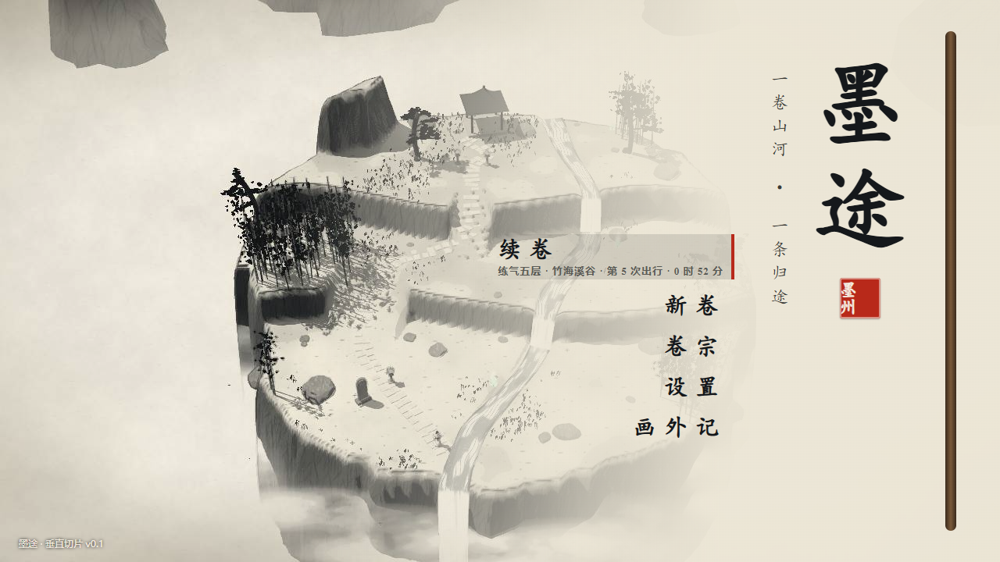
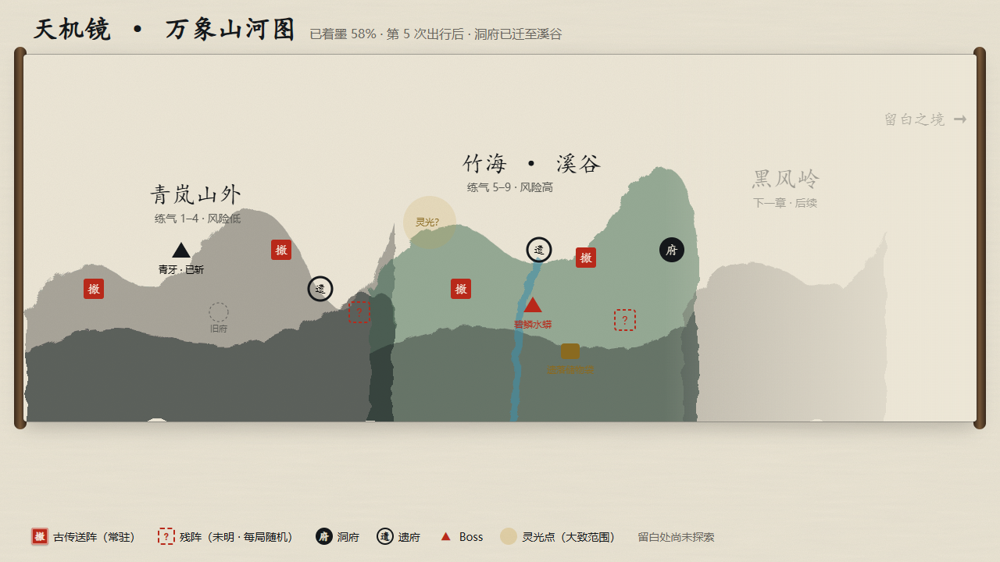
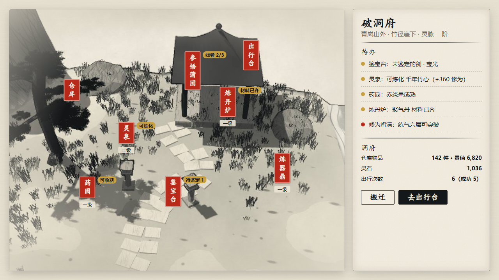
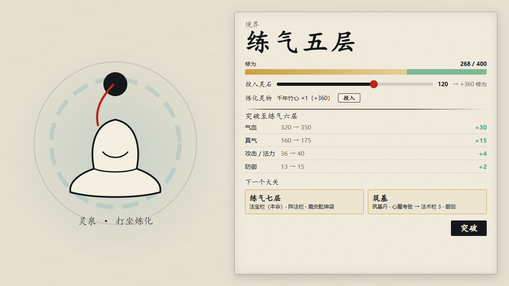
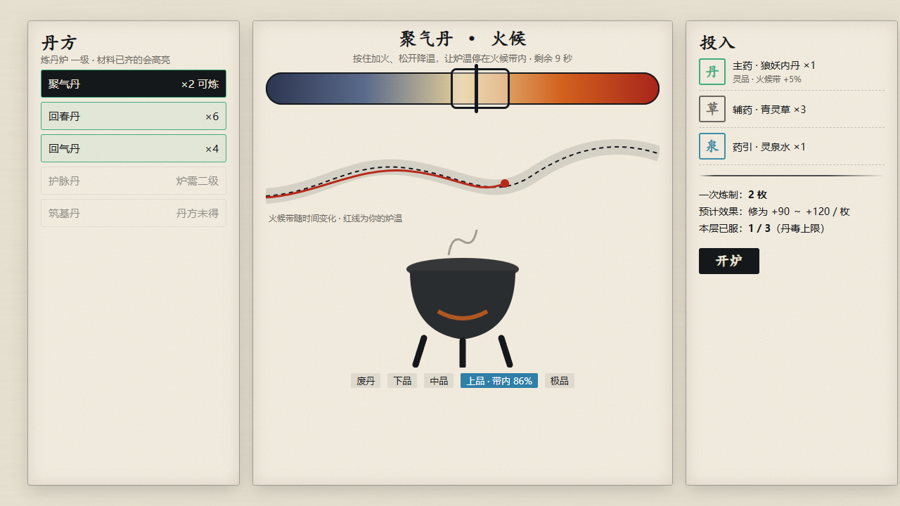
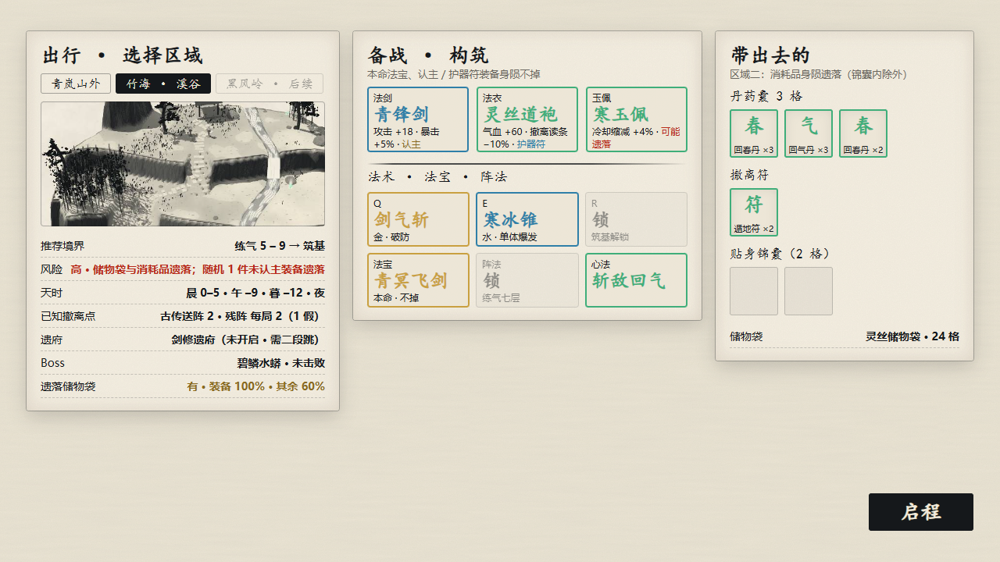
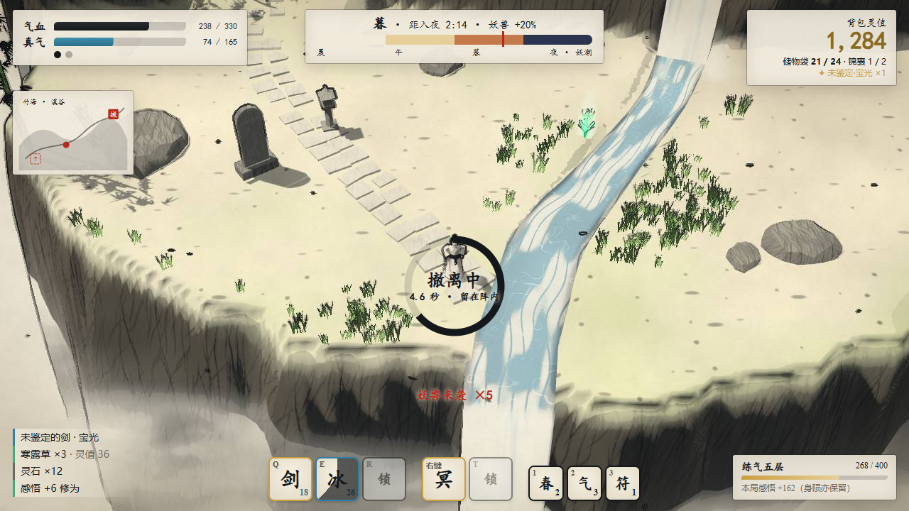
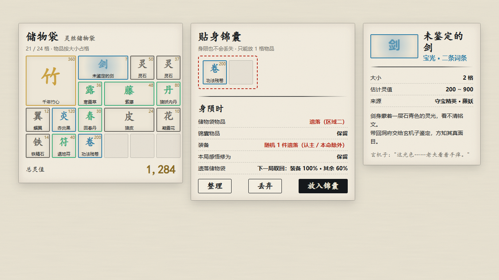
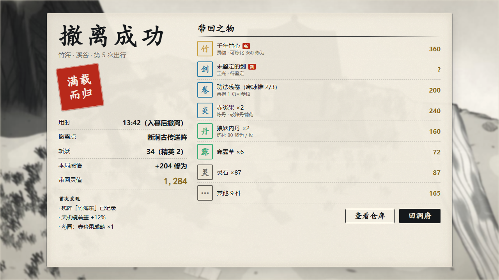

# 《墨途》最小闭环设计 v1.1（练气一层 → 筑基一层）· 单机"搜打撤"

> 主基调：**单机搜打撤**。在洞府准备 → 进入区域地图"出行" → **搜**（采集、拾宝、探遗府）→ **打**（妖兽、精英、Boss）→ **撤**（找到撤离点把收获带回洞府）→ 洞府把收获转化为修为、丹药、装备、功法 → 下一次出行更强。
> 第一版范围：**两个区域**、开始界面、UI、从开局到**筑基一层**（约 **7 次出行、1.3 小时**）。
> 依据：[设计文档_v0.3.md](设计文档_v0.3.md)（战斗 v0.3、美术 §5、解耦约定 §6.1）与当前实现（`src/data/*.js`、`src/game/shields.js`、`src/core/combat.js`）。
> 标记：**【MVP】** 第一版必须实现；**【后续】** 第一版之后。已决定事项见 §15.5。界面示意图在 `docs/ui/png/`。
>
> v1.1 变更：范围缩为两区域（原区域三及其内容改为【后续】）；区域二（高风险区）引入"装备风险"；坊市延后；主角固定为林墨；待定问题改为已决定列表。

---

## 目录

1. 一句话与正反馈循环
2. 背景与开场
3. 开始界面与存档
4. 出行局（一次"搜打撤"的完整结构）
5. 风险与保障：身陨会失去什么
6. 撤离点
7. 局内压力：天时与妖潮、负重
8. 战利品价值、品质、鉴定与掉落
9. 区域与出行地图
10. 境界与数值曲线、出行次数估算
11. 洞府：局间的家
12. 丹药限制与反"无脑"规则
13. 栏位与构筑解锁时间线
14. UI 设计
15. 新手引导、节奏校验、MVP 范围、风险与已决定事项

---

## 1. 一句话与正反馈循环

**一个现代人穿进一卷未画完的山水长卷，成了无门无派的散修。每一次出行都是一场赌局：深入妖兽横行的山野搜宝，越贪越险；活着撤回洞府，宝物就化作修为、丹药和法宝——为的是有朝一日穿过画卷的留白，回到原来的世界。**

### 1.1 正反馈循环（最小闭环）

```
 ┌───────────────────────── 洞府（安全区 · 存档）─────────────────────────┐
 │  仓库 → 鉴宝 → 炼化（修为）/ 炼丹 / 炼器 / 参悟功法 → 突破 → 备战（选装备、带丹药、带撤离符）│
 └───────┬──────────────────────────────────────────────────────▲───────┘
         │ ① 出行（选区域、带上要冒险的东西）                      │ ⑤ 撤离成功：收获全部入库
         ▼                                                      │    身陨：只保住锦囊 + 已得感悟 + 本命法宝
 ┌──────────────── 区域地图（一局 7–13 分钟）────────────────┐   │
 │ ② 搜：采集灵草矿石、拾取宝箱、开启遗府封印、发现撤离点       │   │
 │ ③ 打：妖兽（感悟立即到手）、精英（护盾、妖丹）、Boss（稀有）  │   │
 │ ④ 撤：赶到撤离点，读条撤离（天越黑越难撤）                   ├───┘
 └──────────────────────────────────────────────────────────┘
```

**每一局都让下一局更强**：

| 这一局带回 | 在洞府变成 | 下一局的变化 |
|---|---|---|
| 灵石、妖丹、灵物 | 灵泉炼化 → **修为** → 突破 | 属性提升、解锁新栏位 / 身法 / 区域 |
| 灵草、妖兽材料 | 炼丹 → **丹药** | 带更好的丹药出门、撤离更从容 |
| 矿石、兽皮、装备 | 炼器 / 鉴定 → **装备** | 输出更高、更耐打、储物袋更大 |
| 功法残卷、遗府秘籍 | 参悟 → **法术 / 心法** | 新打法、能破新的五行护盾 |
| 极品法宝（罕见） | 鉴定、祭炼 → **法宝** | 质变——"这一把发了" |

**失败也不白来**：斩妖获得的"**感悟**"修为立即入体，身陨也保留；贴身锦囊里的宝物、本命法宝保留；首次发现的撤离点和地图着墨保留；药园照样生长。

### 1.2 节奏

| 循环 | 时长 | 内容 |
|---|---|---|
| 局内短循环 | 1–3 分钟 | 清一片妖兽、采几株药、开一个宝箱 → 掂量背包："还撤不撤？" |
| 一局 | 7–13 分钟 | 出行 → 搜打 → 撤离 → 结算 |
| 局间 | 2–3 分钟 | 洞府：入库、鉴定、炼化、炼丹炼器、突破、备战 |
| 区域 | 约 35–45 分钟 | 一个区域：遗府、Boss、突破到下一个大段 |

---

## 2. 背景与开场

### 2.1 主角

**林墨**（固定主角，男，二十多岁，白衣剑修）。第一版不做外观自定义；造型即现有主角模型（白衣、朱砂发带、长剑）。

### 2.2 剧情梗概

1. **穿越**：林墨是普通上班族，加班到深夜在博物馆古画展厅避雨。展柜里残缺的山水长卷《万象山河图》泛起墨光，他的手机屏幕一闪——醒来时躺在画中世界的溪边，口袋里只剩一部碎了屏、却在微微发光的手机。
2. **画中世界**："墨州"，一个灵气稀薄、宗门凋零的修仙界。世界的边缘是未画完的空白宣纸，叫"留白之境"；传说穿过留白，就能离开此界。
3. **散修**：没人收一个"来历不明、灵根驳杂"的外乡人。他只能自己闯山野、捡宝物、守着一座破洞府，一点点修上去。
4. **回家的线索**：手机化成了法器"**天机镜**"——修为越高，裂屏上亮起的画面越多：地铁、写字楼、家人的消息……它是回家的指南针，也是坚持的理由。天机镜同时是游戏里的地图与撤离指引（§6）。
5. **长线目标**：穿过留白需要能"破界"的修为（元婴，第一版之外）。筑基后天机镜第一次完整亮起，指向画卷北方的黑风岭——下一章。

### 2.3 引路人：残魂「玄机子」

- 破洞府原主人，陨落老修士的残魂，寄居在洞府灵泉中，搬迁时随灵泉一起被收进储物袋。
- 职责：新手教学、洞府功能讲解、鉴定宝物、吐槽搭档（老派修士 × 现代人）。
- 第一局林墨身陨时，是他把魂魄"捞"回洞府——从此洞府是林墨的家。
- 台词示例：
  - 玄机子："此乃遁地符，捏碎即可遁回洞府。"
  - 林墨："……需要联网吗？"
  - 玄机子："联什么网？撒网捕鱼吗？"

### 2.4 开场分镜（约 3 分钟，可跳过）

| # | 画面 | 时长 | 说明 |
|---|---|---|---|
| 1 | 开始界面：画卷半展，留白处竖写「墨途」 | — | 见 §3 |
| 2 | 黑屏：手机提示音、雨声、展厅脚步声 | 5 秒 | 现代感的纯音频开场 |
| 3 | 水墨插画：长卷泛起墨光，墨汁漫出画框吞没画面 | 10 秒 | 2–3 张静帧 + 墨晕转场 |
| 4 | 镜头从画卷上空俯冲，云海群山逐渐"被画出来"，落到溪边 | 8 秒 | 用游戏实景，首次展示"着墨"效果 |
| 5 | 林墨起身，手机亮起裂屏 → 字幕「墨州 · 青岚山外」 | 4 秒 | 进入第一局（教学局，§4.4） |

---

## 3. 开始界面与存档



### 3.1 开始界面

- 背景：半展开的画卷（实时渲染的青岚山远景 + 慢速推镜），右侧留白竖排书法「墨途」与朱红印章。

| 菜单项 | 行为 |
|---|---|
| **续卷**（继续） | 进入最近存档（总是在洞府；局内不存档，见 §3.2） |
| **新卷**（新游戏） | 选择空存档位 → 开场演出 → 教学局 |
| **卷宗**（存档管理） | 3 个存档位：境界、出行次数、游戏时长、截图缩略；可删除 |
| **设置** | 画面（水墨 / 淡彩 / 写实、画质）、声音、操作（键位、镜头）、辅助（伤害数字、震屏强度、引导提示） |
| **画外记** | 版本号、致谢 |

网页没有"退出"，用"**收卷**"返回开始界面。

### 3.2 存档【MVP】

| 项 | 规则 |
|---|---|
| 存储 | `localStorage`，每个存档位一个 JSON（`moxian.save.1~3`），附版本号便于迁移 |
| 何时保存 | 进入洞府、出行前（备战确认）、撤离结算后、突破后 |
| 局内中途关闭页面 | 按"**身陨**"结算（防止刷新逃跑）；第一次发生时弹出说明并豁免一次 |
| 内容 | 境界与修为、属性、仓库、装备与构筑、锦囊、洞府设施、药园、地图着墨与已发现撤离点、遗落储物袋、剧情旗标、统计 |
| 导出 | 【后续】导出 / 导入存档字符串 |

---

## 4. 出行局（一次"搜打撤"的完整结构）

### 4.1 一局的流程

| 阶段 | 地点 | 玩家做什么 | 关键规则 |
|---|---|---|---|
| **备战** | 洞府 · 出行台 | 选区域；装备、法术、法宝；丹药囊；撤离符；锦囊放什么 | 界面明确显示本区域风险等级与身陨损失（§5）；见 [出行准备](ui/png/prep.png) |
| **入图** | 区域入口（随机 1 个） | 天机镜显示：已知撤离点、上次的着墨区域、遗落储物袋 | 每局天时从"晨"开始 |
| **搜** | 区域各处 | 采集、开宝箱、拾取掉落、解遗府封印、调查"灵光"（随机高价值点） | 储物袋格数有限（§7.2） |
| **打** | 区域各处 | 妖兽、巡游精英、守宝精英、地区 Boss | 斩妖感悟立即入体（保底进度） |
| **撤** | 撤离点 | 赶到撤离点读条（期间敌人会被吸引） | 天越黑读条越长、敌人越多（§7） |
| **结算** | 洞府 | 撤离成功：全部入库；身陨：按 §5 结算 | 见 [结算界面](ui/png/result.png) |

### 4.2 一局的目标长度

| 区域 | 推荐境界 | 风险 | 地图大小（米） | 目标时长 | 撤离点（常驻 / 每局随机） |
|---|---|---|---|---|---|
| 一 青岚山外 | 练气 1–4 | 低 | 160 × 120 | 7–10 分钟 | 2 / 1 |
| 二 竹海·溪谷 | 练气 5–9 → 筑基 | **高** | 220 × 160 | 9–13 分钟 | 2 / 2（含 1 处假阵） |
| 黑风岭 | 金丹前段 | — | — | — | 【后续】 |

### 4.3 地图的"固定 + 随机"

- **固定**：地形、主要路线、遗府入口、Boss 场地、常驻撤离点（玩家可以熟悉地形、规划路线）。
- **每局随机**：入口位置（2–3 选 1）；宝箱、灵草、矿脉的位置与品质（从候选点抽取）；守宝精英及其护盾五行；**灵光点** 1–3 个（高价值，常有精英看守）；随机残阵 1–2 处（"未明"，需靠近确认）。
- 【后续】程序化妖巢（房间模板拼接）随黑风岭一起推出。

### 4.4 第一局：教学局（必定拿到洞府）

1. 溪边醒来 → 移动、闪身、捡**锈剑** → 打两只落单狼妖（教普攻）→ 采第一株青灵草（教采集）→ 捡到 2 枚回春丹（教丹药）。
2. 天机镜指向一处"墨点"：崖下的**破洞府**，这是第一个撤离点（无读条，教撤离）。
3. 两种结局都通向洞府：
   - **走到破洞府**：撤离成功，第一次结算。
   - **途中被狼群伏击而身陨**：剧情身陨，玄机子把魂魄捞回破洞府，**本局不损失任何东西**（教"身陨"概念）。
4. 进入洞府：玄机子讲解入库、灵泉炼化 → **引气入体 = 练气一层**，学**剑气斩**，送 2 张遁地符。

### 4.5 局内信息

- **天机镜**（M 键 / HUD 左上小卷）：已着墨区域、已知撤离点、当前天时、林墨位置、遗落储物袋；未探索处为留白。
- **背包灵值**：HUD 显示储物袋当前"**灵值**"（全部物品的估价，§8.1）。
- **灵光提示**：高价值点在天机镜上以金色微光标出大致范围（不精确）。

---

## 5. 风险与保障：身陨会失去什么

原则：**单机、爽快，但赌注随区域升高**。区域一只赌"这一局的收获"；区域二（高风险区）连**身上的装备**也要上桌——但给出清晰的保护手段和取回机会。

### 5.1 身陨结算总表

| 东西 | 撤离成功 | 身陨 · 区域一（低） | 身陨 · 区域二（高） |
|---|---|---|---|
| 斩妖"**感悟**"修为 | ✔ | ✔ 保留 | ✔ 保留 |
| 储物袋里本局拾取的物品 | ✔ 入库 | **保留 50%**（玄机子护持） | ✘ 留在遗落储物袋（§5.4） |
| **贴身锦囊**里的物品 | ✔ | ✔ | ✔ |
| **本命法宝**（§5.3） | ✔ | ✔ | ✔ |
| 已装备的法剑 / 法衣 / 玉佩（未受保护） | ✔ | ✔ | **随机 1 件**落入遗落储物袋 |
| 已学法术、心法 | ✔ | ✔ | ✔ |
| 带出去的消耗品（丹药、撤离符） | 未用完的入库 | ✔ 保留 | ✘ 失去（锦囊内除外） |
| 地图着墨、撤离点、开启过的遗府 | ✔ | ✔ | ✔ |
| 未鉴定的宝物 | 入库待鉴定 | 按储物袋规则 | 按储物袋规则 |

### 5.2 区域二的装备风险规则【MVP】（参数可调）

| 参数 | 默认值 | 说明 |
|---|---|---|
| `gearRiskCount` | 1 | 身陨时从"已装备且未受保护"的装备中随机掉落几件 |
| `gearRiskSlots` | 法剑、法衣、玉佩 | 参与随机的部位（法宝栏不参与，见本命） |
| `gearRiskWeight` | 按品质加权：凡 1、灵 2、宝 3、仙 4 | 越好的越容易掉——让"穿着好东西去高区"有压力 |
| 掉落去处 | 遗落储物袋 | 不直接销毁，下一局可取回 |
| 取回比例 | **装备 100%**，其余物品 60% | 装备一定能找回，只要你去捡 |
| 二次身陨 | 未取回前再次身陨 → 旧袋中的装备**消失** | 风险的真正兑现点 |

**保护手段**（让玩家对风险有掌控感）：

| 手段 | 效果 | 获取 |
|---|---|---|
| **滴血认主** | 永久保护 1 件装备（只能有 1 件认主装备，可更换，更换需重新认主） | 炼器鼎 Lv2（区域二搬迁后） |
| **护器符** | 本局保护 1 件指定装备（消耗品） | 炼器鼎制作：灵石 40 + 狼皮 ×2 |
| 不穿 | 把好装备留在洞府，穿次一级的出门 | — |

### 5.3 本命法宝

- 林墨获得的**第一件法宝**（青冥飞剑，§9.2）自动成为**本命法宝**：永不掉落。
- 之后获得的法宝可通过"祭炼至二重"设为新的本命（同时只有 1 件本命）；非本命法宝装备在法宝栏时**不参与**随机掉落（第一版只有 1 个法宝栏，规则留给后续的第 2 法宝栏）。

### 5.4 遗落的储物袋

- 区域二身陨后，储物袋（含本局物品、掉落的装备）留在身陨位置。
- **下一局**进入同一区域时，天机镜标出它的位置；赶到按 F 取回：**装备 100%，其余 60%**。
- 再次身陨前没取回，旧储物袋消失。
- 一局失败变成下一局的明确目标——"回去把剑捡回来"。

### 5.5 贴身锦囊（安全格）【MVP】

| 等级 | 格数 | 获取 |
|---|---|---|
| 布锦囊 | 1 | 开局 |
| 灵丝锦囊 | 2 | 炼器（练气 4） |
| 乾坤锦囊 | 3 | 碧鳞首杀 |

- 只能放 1 格大小的物品（§7.2），大件灵物放不进去，必须真撤出来。
- 局内随时可拖入（1 秒动作，战斗中有风险）。

### 5.6 风险提示（出行准备界面）

出行台选择区域时，风险等级与身陨损失**明确列出**（见 [出行准备](ui/png/prep.png)）：

| 区域 | 风险标签 | 准备界面文字 |
|---|---|---|
| 教学局 | 无 | — |
| 区域一 | 低（墨色） | "身陨：储物袋保留一半；装备与丹药无损" |
| 区域二 | **高（朱红）** | "身陨：储物袋与消耗品遗落；随机 1 件未认主装备遗落（下一局可取回）" |

首次选择区域二时弹出一次确认卡片，并提示"滴血认主 / 护器符"。

---

## 6. 撤离点

### 6.1 撤离方式

| 类型 | 位置 | 读条 | 次数 | 获取 / 发现 | MVP |
|---|---|---|---|---|---|
| **古传送阵**（常驻） | 地图固定位置 | 8 秒（随天时增加） | 不限 | 首次靠近后永久点亮在天机镜上 | 【MVP】 |
| **残阵**（随机） | 每局随机 1–2 处 | 6 秒 | 每局一次性 | 天机镜显示"未明"，靠近 30 米确认；区域二含 1 处假阵 | 【MVP】 |
| **遁地符**（消耗品） | 任意地点 | 12 秒，**受击打断** | 每张 1 次 | 炼器 / 掉落；开局送 2 张 | 【MVP】 |
| **Boss 出口** | 击败 Boss 后场地中央 | 3 秒 | Boss 局 | 击败 Boss | 【MVP】 |
| **洞府令**（法器） | 任意地点 | 20 秒，打断后需重来 | 每局 1 次 | 灵泉 Lv3 | 【后续】 |
| 妖巢出口 | 妖巢深处 | 5 秒 | — | 随黑风岭 | 【后续】 |

### 6.2 撤离读条中的危险

- 读条时林墨在地上画出撤离阵，**阵内可以移动与战斗**（离开阵范围读条暂停），不是站桩挨打。
- 读条开始时**吸引附近 30 米内的妖兽**，并根据天时额外刷出一波（晨：无；暮：1 波小妖；夜：1 波 + 精英）。
- 受伤不打断读条（遁地符除外）；身陨则失败。
- 撤离本身是一场"守点战"，把高潮放在一局的结尾。

### 6.3 撤离点的发现与显示

- 常驻古传送阵：首次进入区域时，天机镜只显示离入口最近的一个；其余需探索发现。
- 打坐点（石灯）激活后，"观想"揭示附近 60 米内的撤离点。
- 随机残阵：闪烁的"未明"印章、范围模糊，靠近才知真假。

---

## 7. 局内压力：天时与妖潮、负重

### 7.1 天时（局内时钟）【MVP】

| 天时 | 区域一 | 区域二 | 效果 |
|---|---|---|---|
| **晨** | 0–4 分钟 | 0–5 | 平静；撤离读条为基础时长 |
| **午** | 4–7 | 5–9 | 巡游精英出现；灵光点品质 +1 |
| **暮** | 7–10 | 9–12 | 妖兽 +20% 属性、数量 +30%；撤离读条 +50% |
| **夜** | 10+ | 12+ | **妖潮**：每 60 秒一波妖兽涌向林墨；撤离读条 ×2；"夜明宝箱"出现（高价值） |

- 画面随天时变化：宣纸色 → 暖黄 → 暮色朱赭 → 夜晚墨蓝。
- 妖潮强度按默认值实现，后续根据试玩调整。
- 【后续】妖王巡游（夜间移动 Boss）随黑风岭推出。

### 7.2 负重：储物袋格子与物品大小【MVP】

- 格子背包；物品占 1 / 2 / 4 格（灵石一堆 1 格、狼妖内丹 1 格、一捆紫藤 2 格、千年竹心 4 格）。
- 满了只能**取舍**：丢低价值物品，或趁早撤离。不做重量减速。

| 储物袋 | 格数 | 获取 |
|---|---|---|
| 粗布储物袋 | 16 | 开局 |
| 灵丝储物袋 | 24 | 炼器（练气 3） |
| 鹿皮乾坤袋 | 32 | 炼器（练气 7，需蟒皮） |
| 乾坤袋 | 40 | 【后续】 |

### 7.3 局内决策点（"心跳时刻"）

| 时刻 | 选择 |
|---|---|
| 背包满了、前面还有灵光点 | 丢掉什么？还是现在撤？ |
| 入暮，撤离点在地图另一头 | 冒险去更远的残阵，还是捏遁地符硬读 12 秒？ |
| 守宝精英的护盾我没有克制法术 | 绕开，还是硬拼？ |
| 夜明宝箱出现 | 留下来等妖潮，还是见好就收？ |
| 捡到"未鉴定·仙光" | 塞进锦囊（挤掉别的），还是赌一把带出去？ |
| 区域二出发前 | 穿最好的剑去（掉了要捡），还是穿次一点的？给哪件认主？ |

---

## 8. 战利品价值、品质、鉴定与掉落

### 8.1 灵值（估价）

- 每件物品有"**灵值**"（以灵石为单位的估价）：HUD 背包总灵值、结算、取舍比较。
- 第一版**没有坊市**（【后续】）：灵值只用于估价和"**化灵**"——把不需要的物品按灵值 50% 转成灵石，保证"带回来的东西总有用"。

### 8.2 品质

| 品质 | 颜色 | 装备词条 | 灵值倍率 | 出现 |
|---|---|---|---|---|
| 凡品 | 墨灰 `#6a6760` | 0 | ×1 | 普通 |
| 灵品 | 石绿 `#3fae7a` | 1 | ×3 | 常见 |
| 宝品 | 石青 `#2f7fa8` | 2 | ×10 | 精英、遗府、灵光点 |
| 仙品 | 泥金 `#c9a040`（带光晕） | 3 + 特殊词条 | ×40 | Boss、遗府、夜明宝箱 |
| **极品**（大奖） | 泥金 + 朱印 | 法宝 / 法器专属 | ×200 | **极低概率** |

> 朱砂红保留给主角与危险提示；"极品"用朱红印章作为唯一例外。

### 8.3 鉴定【MVP】

- 宝品以上的**装备、法宝、功法残卷**掉落时"**未鉴定**"：只显示品质光晕，属性未知。
- 撤回洞府后在**鉴宝台**（玄机子）鉴定：揭示词条 / 法宝种类，印章盖下的演出；仙品以上有"墨色翻涌"的开箱演出。
- 把开箱快感放在安全的洞府，同时让局内的"未知宝光"制造是否冒险带出的悬念。

### 8.4 物品类别

| 类别 | 大小 | 来源 | 用途 |
|---|---|---|---|
| 灵石 | 1（一堆 50） | 一切 | 炼化修为、设施升级、炼器 |
| 灵草、矿石 | 1–2 | 采集 | 炼丹、炼器 |
| 妖兽材料（牙、皮、骨） | 1–2 | 击杀 | 炼器、炼丹 |
| 妖丹 | 1（Boss 内丹 2） | 精英、Boss | 炼化（大量修为）、高级丹药 |
| 灵物（大件） | 4 | 灵光点、遗府 | 炼化或特殊配方，灵值高 |
| 装备（法剑、法衣、玉佩） | 2 | 随机掉落、炼器、Boss | 属性与词条 |
| 法宝 / 法器 | 2 | 遗府、Boss、极品掉落 | 法宝栏，可祭炼 |
| 功法残卷 | 1 | 遗府、Boss、灵光点 | 参悟后学会法术 / 心法 |
| 丹方、器方、阵盘 | 1 | Boss、遗府、守宝精英 | 解锁配方 / 阵法 |
| 丹药、符箓 | 1（可叠 5） | 炼制、少量掉落 | 恢复、撤离、修为、护器 |

### 8.5 装备随机词条

- 物品等级 = 掉落区域等级 ±1；基础属性随等级增长。

| 词条 | 灵 / 宝 / 仙 | 部位 |
|---|---|---|
| 攻击 +X | 3 / 6 / 10（×区域系数） | 法剑、玉佩 |
| 法力 +X% | 6% / 10% / 15% | 法剑、玉佩 |
| 气血 +X | 30 / 60 / 100 | 法衣、玉佩 |
| 防御 +X | 4 / 8 / 12 | 法衣 |
| 暴击率 +X% | 3% / 5% / 8% | 法剑、玉佩 |
| 冷却缩减 +X% | 4% / 6% / 10% | 玉佩 |
| 五行强度 +X | 10 / 20 / 35 | 全部 |
| 真气回复 +X/秒 | 1 / 2 / 3 | 法衣、玉佩 |
| 撤离读条 −X% | 10% / 15% / 25% | 法衣（搜打撤专属） |
| 储物袋 +X 格 | 2 / 3 / 4 | 玉佩（搜打撤专属） |
| **仙品特殊**：斩敌回气、闪身留剑影、暴击引雷、首击必暴…… | — | 仅仙品 |

- **注灵**（炼器）：消耗一件同部位装备，把它的一条词条转移到另一件上——定向追求词条。

### 8.6 掉落表

| 来源 | 必得 | 概率 | 装备 / 法宝 |
|---|---|---|---|
| 普通妖兽 | 感悟修为 | 灵石 1–3（60%）、本区材料（50%） | 装备 4%（凡 80 / 灵 17 / 宝 3） |
| 巡游 / 守宝精英 | 感悟、妖丹 1、灵石 6–10 | 稀有材料 40% | 装备 35%（灵 60 / 宝 35 / 仙 5） |
| 宝箱（普通 / 灵光 / 夜明） | 灵石 | 材料、丹方残页、功法残卷 | 10% / 40% / 70%，品质依次提高 |
| 遗府（首次） | **固定**：功法或法宝 | 宝箱随机 | — |
| 遗府（重复） | 灵石、材料 | 功法残卷 20% | 宝 / 仙 |
| 地区 Boss（首杀） | 突破材料、丹方、宝品装备 1 | 仙品 10% | 极品法宝 **1%** |
| 地区 Boss（重复） | 突破材料（数量减半） | 宝 50%、仙 3% | 极品法宝 **0.5%** |

**保底**：连续 25 只普通妖兽没出灵品以上装备 → 下一件必为灵品；遗府核心奖励固定；Boss 首杀必掉突破材料；极品"**机缘值**"——每次未出 +0.2%，出货清零（隐藏）。

---

## 9. 区域与出行地图



### 9.1 区域一：青岚山外（练气 1–4，风险低）

| 项 | 内容 |
|---|---|
| 地形 | 溪畔、竹径、山神庙、狼谷；台地 2 层 |
| 撤离点 | 古传送阵：溪畔石桥、狼谷北；残阵：每局随机 1 处 |
| 敌人 | 竹林狼妖（群）、灰毛狼妖（快、弱）、山神庙石傀（硬壳） |
| 精英 | 狼妖头目（**木盾**，剑气斩克制——护盾教学） |
| 采集 | 青灵草（木）、凝露花（水）、铁精石（金） |
| 灵光点 | 狼窝"狼王遗骨"（灵物 4 格）、溪中"灵蚌"（宝品材料）、"炼器鼎残件" |
| 遗府 | **山神庙地窖**（小）：转石灯机关 + 石傀守卫 → 首次固定：功法《**缠藤诀**》、器方《法衣》 |
| Boss | **青牙**（狼王，狼谷深处）：扑咬连击、召狼、嚎叫；**木盾 → 土盾**两段（剑气斩 → 缠藤诀，学会切换）→ 狼王内丹、丹方《聚气丹》、灵品法剑（保底）；击败后开 Boss 出口，并解锁区域二 |
| 洞府 | 破洞府（教学局获得） |

### 9.2 区域二：竹海 · 溪谷（练气 5–9 → 筑基，风险高）

| 项 | 内容 |
|---|---|
| 地形 | 竹海（遮挡多）、溪谷瀑布、深潭、断涧（二段跳门槛） |
| 门槛 | 击败青牙；练气 5 后二段跳可跃过断涧 |
| 洞府 | **溪谷灵脉洞府**（首次进入区域二时搬迁，§9.3） |
| 撤离点 | 古传送阵 ×2（其一在断涧对面）；残阵每局 2 处（含 1 处假阵） |
| 敌人 | 蝠妖（飞行俯冲）、藤妖（远程施法，**火 / 土盾**）、竹林狼妖精英 |
| 采集 | 寒露草（水）、紫藤（木，2 格）、赤炎果（火，断涧对面）、**千年何首乌**（筑基丹辅药，灵光点 / 遗府，4 格） |
| 灵光点 | 瀑布下"水灵玉"、竹海深处"千年竹心"（4 格）、"阵盘·剑阵"（首次固定） |
| 遗府 | **剑修遗府**（瀑布后，需二段跳）：3 间机关房 + 守关剑傀 → 首次固定：**青冥飞剑**（法宝，自动成为本命）、功法《**寒冰锥**》 |
| 功法残卷 | 《火符》残卷 ×3（区域二宝箱、灵光点），集齐参悟 |
| Boss | **碧鳞水蟒**（深潭）：潜水突袭、水柱、甩尾；三阶段护盾 **火 → 土 → 木** 轮换（寒冰锥 → 缠藤诀 → 剑气斩）→ **碧鳞内丹**（筑基丹主药）、丹方《筑基丹》、宝品装备、锦囊升级 |
| 结尾 | 筑基后御剑飞渡断涧上空的"孤峰"：残碑、天机镜完整亮起，指向黑风岭（下一章预告） |

### 9.3 洞府搬迁（进入区域二时）

1. 击败青牙后，玄机子："青岚山灵脉已薄，要修得更高，得去溪谷那条灵脉。"
2. 洞府中点「**搬迁**」：全部设施（含等级）、仓库、药园灵草收入储物袋（演出：器物化作墨点飞入袋中）。
3. 第 5 局是"**搬家出行**"：带着全部家当进入区域二（剧情保护，本局身陨不损失家当），在溪谷灵脉落地「**开府**」，同时完成区域二首次探索。
4. 新址：灵脉 +1（灵泉炼化 +1 档、药园 +2 块地），区域二出行台就在门口；炼器鼎在新址可升到 Lv2（解锁滴血认主）。
5. 以后每推进一个大区域都会再搬迁一次（黑风岭【后续】）。

### 9.4 后续区域：黑风岭 · 黑风洞【后续】

原区域三（瘴气林、程序化妖巢黑风洞、山魈石傀、妖王巡游、黑风熊精、驱毒丹 / 破障丹门槛）整体移到下一章（筑基期），本版只在结尾预告。

---

## 10. 境界与数值曲线、出行次数估算

### 10.1 修为来源

| 来源 | 何时到账 | 身陨保留 | 占比目标 |
|---|---|---|---|
| 斩妖**感悟** | 击杀即得 | ✔ | 30% |
| 灵泉**炼化**（灵石、妖丹、灵物） | 撤回洞府后 | 区域一保留一半，区域二否（锦囊内除外） | 55% |
| 丹药（聚气丹，每小境界最多 3 枚） | 洞府 | — | 10% |
| 首杀 / 遗府首通 | 即得 | ✔ | 5% |

| 来源 | 修为 |
|---|---|
| 普通妖兽感悟（区域一 / 二） | 3 / 8 |
| 精英感悟 | ×8 |
| Boss 首杀感悟 | 青牙 150、碧鳞 400（重复为 20%） |
| 遗府首通 | 山神庙 80、剑修遗府 250 |
| 炼化 1 灵石 | 灵泉 Lv1：2、Lv2：3、Lv3：4 |
| 炼化妖丹 | 狼妖内丹 40、狼王内丹 180、蝠妖 / 藤妖内丹 90 |
| 炼化灵物 | 狼王遗骨 150、水灵玉 300、千年竹心 360 |
| 聚气丹（下 / 中 / 上 / 极） | 60 / 90 / 120 / 180 |

### 10.2 境界需求

| 境界 | 升到下一层所需 | 累计 |
|---|---|---|
| 凡人 → 练气 1 | 剧情（教学局后引气入体） | 0 |
| 练气 1 → 2 | 100 | 100 |
| 练气 2 → 3 | 150 | 250 |
| 练气 3 → 4 | 220 | 470 |
| 练气 4 → 5 | 300 | 770 |
| 练气 5 → 6 | 400 | 1170 |
| 练气 6 → 7 | 520 | 1690 |
| 练气 7 → 8 | 660 | 2350 |
| 练气 8 → 9 | 820 | 3170 |
| 练气 9 → 筑基 1 | 1200 + **筑基丹** + 心魔战 | 4370 |

### 10.3 七局路线

| 局 | 区域 | 主要目标 | 带回修为（感悟 + 炼化 + 丹） | 累计 | 结束时境界 |
|---|---|---|---|---|---|
| 1 | 教学 | 获得破洞府、学剑气斩 | 60 | 60 | 练气 1 |
| 2 | 一 | 熟悉撤离、天时；第一次满载 | 260 | 320 | 练气 3 |
| 3 | 一 | 山神庙遗府（缠藤诀、法衣器方）、修炼丹炉 | 300 | 620 | 练气 4 |
| 4 | 一 | Boss 青牙（木→土盾）、狼王内丹、聚气丹 | 450 | 1070 | 练气 5（二段跳） |
| 5 | 二 | **搬家出行**、区域二首探、发现撤离点 | 800 | 1870 | 练气 7 |
| 6 | 二 | 剑修遗府（青冥飞剑、寒冰锥）、阵盘·剑阵 | 1000 | 2870 | 练气 8 |
| 7 | 二 | Boss 碧鳞（火→土→木）、碧鳞内丹 → 筑基丹 | 1300 + 聚气丹 ×3（≈270） | 4440 | **筑基 1** |

- **时长**：教学 6 分钟 + 区域一 3 局 ×（8.5 + 2.5）+ 区域二 3 局 ×（11 + 3）+ 筑基演出与心魔战 5 分钟 ≈ **80 分钟（约 1.3 小时）**。
- 考虑 1–2 次身陨或补材料，实际 7–9 局、1.3–1.6 小时；熟练玩家约 1 小时。

### 10.4 林墨属性成长

练气每层固定成长（境界即基础属性）；装备、法宝、心法在此之上叠加（flat → pct → more）。

| 境界 | hp | mp | atk | spell | def | 其他 |
|---|---|---|---|---|---|---|
| 练气 1（= 当前 `PLAYER.stats`） | 200 | 100 | 20 | 20 | 5 | crit 0.10，critDmg 1.6，move 6 |
| 每层 +（练气 2–9） | +30 | +15 | +4 | +4 | +2 | — |
| 练气 5 | 320 | 160 | 36 | 36 | 13 | 二段跳 |
| 练气 9 | 440 | 220 | 52 | 52 | 21 | — |
| **筑基 1**（跃升 ×1.5） | 720 | 360 | 84 | 84 | 36 | mpRegen +3，move +0.5，御剑 |

### 10.5 敌人曲线

| 区域 | 等级 | 普通 hp | 普通 atk | 精英 hp（含 45% 护盾） | Boss hp |
|---|---|---|---|---|---|
| 一 青岚山外 | 1–4 | 60–110 | 10–14 | 450–700 | 青牙 1800 |
| 二 竹海·溪谷 | 5–9 | 160–320 | 18–28 | 1300–2400 | 碧鳞 7000 |
| 心魔 | — | — | — | — | 林墨属性 ×0.8 的倒影，3000 |

暮时 ×1.2 属性，夜时 ×1.35。

### 10.6 "逐步变强"校验

普攻三段 = atk ×（1.0 + 1.0 + 1.6）= 3.6 atk。目标：**刚进入新区域时普通妖兽 3–4 下，区域末 2 下，回旧区域 1 下**。

| 林墨阶段（含平均装备） | 有效 atk | 区域一狼妖（80 hp） | 区域二蝠妖（220 hp） |
|---|---|---|---|
| 练气 1（锈剑） | 24 | **3–4 下** | — |
| 练气 3（灵品剑） | 38 | 2 下 | — |
| 练气 5 | 56 | 1–2 下 | **3–4 下** |
| 练气 7 | 78 | 1 下 | 2–3 下 |
| 练气 9 | 100 | 1 下 | **2 下** |
| 筑基 1 | 150 | 1 下 | 1 下 |

承伤目标：普通妖兽一次命中约占林墨气血 8%，精英 15–20%，Boss 重击 25–35%。

---

## 11. 洞府：局间的家



### 11.1 回洞府的标准流程（局间 2–3 分钟）

1. **结算** → 储物袋全部自动入库（本局灵值、新物品高亮）。
2. **鉴宝台**：鉴定宝品以上的未鉴定物。
3. **灵泉**：炼化灵石 / 妖丹 / 灵物 → 修为；可突破时提示。
4. **药园**：收获 → 重种。
5. **炼丹 / 炼器 / 参悟**：清单高亮"材料已齐"的配方。
6. **出行台**：备战（装备、认主 / 护器符、丹药囊、撤离符、锦囊）→ 选区域出发。

### 11.2 设施

| 设施 | MVP | 等级 | 作用 |
|---|---|---|---|
| **出行台**（画卷） | 【MVP】 | — | 选择区域、风险提示、备战、出发 |
| **仓库** | 【MVP】 | 无限 | 按类别分页；"化灵"把物品按灵值 50% 换灵石 |
| **鉴宝台** | 【MVP】 | — | 鉴定（玄机子） |
| **灵泉** | 【MVP】 | 1–3 | 炼化 → 修为；突破场所 |
| **炼丹炉** | 【MVP】 | 1–2 | 炼丹（火候小游戏） |
| **炼器鼎** | 【MVP】 | 1–2 | 炼装备、注灵、遁地符、护器符、扩容；Lv2：**滴血认主** |
| **参悟蒲团** | 【MVP】 | — | 功法残卷集齐 3 页或完整秘籍 → 学会法术 / 心法 |
| **药园** | 【MVP】 | 1–2 | 移植灵草苗；按出行次数生长 |
| **搬迁** | 【MVP】 | — | 打包全部进储物袋，换灵脉 |
| 坊市 | 【后续】 | — | 买卖物品（灵值成为价格依据） |
| 藏经阁 | 【后续】 | — | 法术修炼变体（三选一）、心法升级 |
| 灵兽圈 / 坐骑 | 【后续】 | — | 灵宠助战 / 局内搬运 / 坐骑 |
| 傀儡房 | 【后续】 | — | 傀儡"代出行"采集低级材料 |
| 护山大阵 | 【后续】 | — | 妖兽夜袭洞府的防守事件 |
| 洞府令 | 【后续】 | — | 灵泉 Lv3 解锁的随身撤离法器 |
| 洞府装饰 | 【后续】 | — | 外观 |

### 11.3 升级花费

| 设施 | Lv1 | Lv2 | Lv3 |
|---|---|---|---|
| 灵泉 | 剧情赠送（残破） | 灵石 120 + 凝露花 ×6 | 搬迁到溪谷灵脉后自动 |
| 炼丹炉 | 灵石 30 + 铁精石 ×5（修复） | 灵石 200 + 铁精石 ×10 + 赤炎果 ×3 | 【后续】 |
| 炼器鼎 | 炼器鼎残件（区域一灵光点）+ 灵石 60 | 灵石 300 + 蝠翼 ×6 + 水灵玉 ×1（搬迁后） | 【后续】 |
| 药园 | 灵石 50 + 灵土 ×3（2 块地） | 灵石 200（4 块地；搬迁后 +2） | 【后续】 |

### 11.4 修炼方式（不做离线挂机）

- 修为 = 局内**感悟** + 局后**炼化**；不做真实时间挂机。
- 炼化：灵泉旁 F → 选择投入（灵石滑条、妖丹、灵物）→ 打坐 3 秒演出 → 修为条上涨。
- 修为满：练气小层直接突破（演出 5 秒）；练气 9 → 筑基需筑基丹 + 心魔战。



### 11.5 炼丹炉

| 丹药 | 效果 | 主药 | 辅药 | 药引 | 炉 | 丹方 |
|---|---|---|---|---|---|---|
| 回春丹 | 3 秒回复 80 气血 | 青灵草 ×2 | 凝露花 ×1 | 灵泉水 | 1 | 开局 |
| 回气丹 | 回复 50 真气 | 凝露花 ×2 | 青灵草 ×1 | 灵泉水 | 1 | 开局 |
| 聚气丹 | 修为 +60～180 | 狼妖内丹 ×1 | 青灵草 ×3 | 灵泉水 | 1 | 青牙 |
| 护脉丹 | 本局受到伤害 −10%（出行前服用） | 寒露草 ×2 | 紫藤 ×1 | 灵泉水 | 2 | 剑修遗府 |
| **筑基丹** | 筑基必需 | **碧鳞内丹** ×1 | 千年何首乌 ×1、赤炎果 ×3 | 灵泉水 ×3 | 2 | 碧鳞 |
| 驱毒丹、破障丹 | 黑风岭门槛 | — | — | — | — | 【后续】 |

**火候小游戏**：15–25 秒；按住鼠标 / 空格加火、松开降温，让温度指针停在随时间变化的火候带内。带内时间比例：<40% 废丹，40–60% 下品，60–80% 中品，80–95% 上品，≥95% 极品。炉等级、药材品质越高火候带越宽；一次可炼 1–3 枚；同丹方炼出过极品后可"**熟练**"跳过小游戏（直接出中品）。



### 11.6 炼器鼎

| 器方 | 产出 | 材料 | 获取 |
|---|---|---|---|
| 法剑 | 法剑 | 铁精石 + 妖兽材料 | 开局 |
| 法衣 | 法衣 | 狼皮 / 蝠翼 + 紫藤 | 山神庙遗府 |
| 玉佩 | 玉佩 | 灵玉 / 水灵玉 + 任意妖丹 | 练气 5（区域二首探） |
| **遁地符** | 撤离符 ×2 | 黄纸（凝露花）+ 灵石 20 | 开局 |
| **护器符** | 本局保护 1 件装备 | 灵石 40 + 狼皮 ×2 | 区域二解锁时 |
| **滴血认主** | 永久保护 1 件装备 | 灵石 100 + 本人精血（气血上限 −10% 持续一局） | 炼器鼎 Lv2 |
| 丹药囊扩容 | 每格上限 +1 | 狼皮 ×4 + 灵石 80 | 炼器鼎 Lv1 |
| 储物袋 / 锦囊升级 | 见 §7.2、§5.5 | 灵丝 / 蟒皮 + 灵石 | 炼器鼎 Lv1–2 |

品质：主材料品质决定上限，炼器鼎等级决定下限；注灵见 §8.5。

### 11.7 药园

- 采集时 25% 概率"**带根采出**"灵草苗（运笔达到完整品时 60%）。
- 按**出行次数**生长：每完成一局（无论成败）算一个时辰；青灵草 1 时辰成熟，赤炎果 2 时辰。
- 一键收获，产出 3–5 份。药园让"失败的一局"也有收成。

---

## 12. 丹药限制与反"无脑"规则

| 规则 | 数值 | 目的 |
|---|---|---|
| **丹药囊**格数 | 开局 1、练气 2 时 2、练气 5 时 3、筑基 4 | 防止背一包药硬吃 |
| 每格上限 | 3 枚（炼器扩容 +1，最多 5） | 同上 |
| 补充 | 只在洞府备战时装填；局内拾得的丹药可补入（1 秒动作） | 出行前的取舍 |
| 丹药冷却 | 回春丹 6 秒、回气丹 4 秒；同类共享 | 防连吃 |
| 聚气丹丹毒 | 每个小境界最多 3 枚 | 防止刷丹跳级 |
| 打坐点（石灯） | 激活后：回满气血真气、揭示附近撤离点；**每局每个石灯 1 次** | 局内续航有限，逼迫撤离决策 |
| Boss 场地 | 进入后不能打坐 | Boss 战靠构筑和操作 |

---

## 13. 栏位与构筑解锁时间线

### 13.1 栏位

| 栏位 | 开局 | 解锁 | 来源 |
|---|---|---|---|
| 法剑栏 | ✔ 锈剑 | — | 教学局 |
| 锦囊（安全格） | 1 | 练气 4：2；碧鳞首杀：3 | 炼器 / Boss |
| 丹药囊 | 1 格 | 练气 2：2；练气 5：3；筑基：4 | 境界 |
| 储物袋 | 16 | 练气 3：24；练气 7：32 | 炼器 |
| 法术栏 | ✘ | 练气 1：1；练气 5：2；筑基：3 | 境界（与 `REALMS` 一致） |
| 法衣栏 | ✘ | 练气 3–4 | 山神庙遗府器方 → 炼出第一件法衣 |
| 心法栏 | ✘ | 练气 4：1；练气 8：2 | 境界 |
| 玉佩栏 | ✘ | 练气 5 | 境界 |
| 法宝栏 | ✘ | 练气 7–8（第 1 个，本命）；第 2 个【后续】 | 剑修遗府 |
| 阵法栏 | ✘ | 练气 7–8 | 区域二灵光点「阵盘·剑阵」（首次固定） |
| 身法 | 闪身 | 练气 5：二段跳；筑基：御剑 | 境界 |

### 13.2 构筑内容获取

| 内容 | 获取 | 时机 | 五行 / 定位 |
|---|---|---|---|
| 剑气斩 | 玄机子传授 | 练气 1 | 金 · 破防（克木盾） |
| 缠藤诀 | 山神庙遗府 | 练气 3 | 木 · 群控（克土盾） |
| 寒冰锥 | 剑修遗府 | 练气 7–8 | 水 · 单体爆发（克火盾） |
| 火符 | 区域二功法残卷 ×3 | 练气 7–9 | 火 · 群伤 |
| 土遁护体 | 筑基奖励 | 筑基 1 | 土 · 保命 |
| 青冥飞剑（本命法宝） | 剑修遗府 | 练气 7–8 | 法宝 · 日常输出 |
| 镇山印、紫金葫芦 | 【后续】（碧鳞仙品掉落 5% 可得镇山印） | — | 法宝 |
| 极品法宝（随机一件，如「赤霄剑」「乾坤镜」） | Boss 1% / 夜明宝箱 0.5% | 任意 | 大奖 |
| 剑阵 | 区域二灵光点 | 练气 7–8 | 阵法 |
| 火阵、聚灵阵 | 【后续】 | — | 阵法 |
| 心法：斩敌回气 | 练气 4 自动领悟 | 练气 4 | 续航 |
| 心法：剑影 / 雷引 / 金刚体 / 锋锐 | 遗府重复、碧鳞、仙品装备 | 练气 6–9 | — |

**护盾克制链（两区域版）**：

| 区域 | 精英护盾 | 克制法术（获取地） |
|---|---|---|
| 一 | 木盾 | 剑气斩（开局） |
| 一 Boss 青牙 | 木 → 土 | 剑气斩 → 缠藤诀（山神庙遗府） |
| 二 | 火盾、土盾 | 寒冰锥（剑修遗府）、缠藤诀 |
| 二 Boss 碧鳞 | 火 → 土 → 木 | 寒冰锥 → 缠藤诀 → 剑气斩（检验三法术切换） |

练气 5 后才有第 2 个法术栏，筑基才有第 3 个；所以碧鳞战需要玩家在 2 个栏位中提前规划，或带阵法 / 法宝补位——这正是构筑的取舍。

---

## 14. UI 设计

### 14.1 视觉语言

- 底色宣纸 `#ece6d6`，面板半透明宣纸 + 淡墨晕边；文字墨色 `#15181b`。
- 字体：标题、按钮用楷体（`STKaiti / KaiTi`）；数字与说明用无衬线（`PingFang SC / 微软雅黑`）。
- 装饰：朱红印章（标题、确认、极品）、墨笔横线、卷轴木轴。
- 品质色见 §8.2；朱砂红只用于主角、危险（含"高风险"区域标签）、极品印章。
- 动效：墨迹晕开（打开）、笔锋划出（进度条 / 读条）、印章盖下（确认 / 鉴定），0.15–0.35 秒。

### 14.2 界面导航

```
开始界面 ─┬─ 续卷 / 新卷（→ 开场 → 教学局）
          ├─ 卷宗 · 设置
          ▼
     洞府（局间） ── F 设施：出行台 / 仓库 / 鉴宝台 / 灵泉 / 炼丹炉 / 炼器鼎 / 参悟 / 药园 / 搬迁
          │
          └─ 出行台 → 出行准备（选区域 · 风险 · 装备 · 认主/护器 · 丹药囊 · 撤离符 · 锦囊）→ 启程
                                                     ▼
                                          局内 HUD（Tab 储物袋 · M 天机镜 · Esc 暂停）
                                          ├─ 撤离读条 HUD
                                          └─ 结算：撤离成功 / 身陨 → 回洞府
```

### 14.3 界面要点

| 界面 | 布局 | 关键信息 | MVP |
|---|---|---|---|
| **开始界面** | 画卷远景 + 竖排标题 + 菜单 | 存档摘要 | 【MVP】 |
| **出行准备** | 左：区域画卷（推荐境界、**风险等级与身陨损失**、天时节奏、已知撤离点、遗落储物袋）；中：装备（认主 / 护器标记）、法术、法宝、阵法；右：丹药囊、撤离符、锦囊、储物袋容量 | 风险提示 | 【MVP】 |
| **局内 HUD** | 左上：气血 / 真气 + 天机镜小卷；上中：天时（晨午暮夜）；右上：**背包灵值**与格数；下中：Q/E/R、法宝、阵法、丹药囊；右下：境界与修为（感悟实时增长）；左下：拾取信息流 | 天时、灵值、最近撤离点方向 | 【MVP】 |
| **撤离读条** | 屏幕中下：毛笔圆环读条 + "撤离中 · 6.2 秒" + 阵范围 | 剩余时间、是否在阵内、来袭提示 | 【MVP】 |
| **储物袋** | 左：格子网格（物品按大小占格）；中：锦囊格与身陨规则；右：详情（灵值、大小、用途、未鉴定） | 灵值、格数、锦囊 | 【MVP】 |
| **撤离结算** | 成功：朱印"撤离成功"、时长、灵值、感悟、物品列表、首次发现；身陨：失去 / 保住 / 遗落清单 | 得失清单 | 【MVP】 |
| **洞府总览** | 洞府水墨插画 + 设施印章；右侧待办 | 可鉴定 / 可炼化 / 可收获 / 可突破 | 【MVP】 |
| **鉴宝台** | 宝物 + 墨色翻涌 → 揭示词条，印章盖下 | 品质、词条 | 【MVP】 |
| **灵泉炼化 / 境界** | 打坐剪影；境界、修为条、属性成长预览；投入滑条 | 投入后修为到哪 | 【MVP】 |
| **炼丹炉 / 炼器鼎** | 配方 / 丹炉与火候带 / 材料与预计品质 | 火候带、温度 | 【MVP】 |
| **药园** | 地块网格，"还需 N 次出行" | 成熟度 | 【MVP】 |
| **天机镜（地图）** | 横向长卷，已着墨 / 留白；撤离点、遗府、Boss、灵光点、遗落储物袋 | 撤离规划 | 【MVP】 |
| 突破演出 | 墨色漩涡 → 境界大字 → 新解锁卡片 | 新栏位、身法 | 【MVP】 |
| 设置 | 卷轴分页 | — | 【MVP】 |

### 14.4 示意图

| 界面 | 文件 |
|---|---|
| 开始界面 | [ui/png/start.png](ui/png/start.png) |
| 出行准备（含风险等级） | [ui/png/prep.png](ui/png/prep.png) |
| 局内 HUD（含撤离读条） | [ui/png/hud.png](ui/png/hud.png) |
| 储物袋 | [ui/png/bag.png](ui/png/bag.png) |
| 撤离结算 | [ui/png/result.png](ui/png/result.png) |
| 洞府总览 | [ui/png/cave.png](ui/png/cave.png) |
| 炼丹炉 | [ui/png/alchemy.png](ui/png/alchemy.png) |
| 境界 / 突破 | [ui/png/realm.png](ui/png/realm.png) |
| 天机镜地图 | [ui/png/map.png](ui/png/map.png) |






---

## 15. 新手引导、节奏校验、MVP 范围、风险与已决定事项

### 15.1 新手引导

原则：一次只教一件事，在需要的那一刻教；用场景和玄机子的一句话，不用文字墙。

| 系统 | 教法 | 时机 |
|---|---|---|
| 移动、闪身、普攻、采集、丹药 | 教学局场景引导 | 第 1 局 |
| 撤离 | 教学局终点：破洞府即撤离点（无读条） | 第 1 局 |
| 身陨 | 教学局伏击（不损失） | 第 1 局（可能） |
| 入库、炼化、突破 | 玄机子带着走一遍 | 第 1 局后 |
| 撤离读条、天时 | 第 2 局"晨"末，玄机子传音提醒天色 | 第 2 局 |
| 储物袋满 / 取舍 | 第 2 局狼窝灵光点（大件 4 格） | 第 2 局 |
| 锦囊 | 首次捡到"未鉴定·宝光"时提示 | 第 2–3 局 |
| 五行护盾 | 首个精英：木盾上浮现"金"字 + 一次性相克图卡片 | 第 2 局 |
| 法术切换 | 青牙第二阶段换土盾，提示"换缠藤诀" | 第 4 局 |
| 鉴定 | 首次带回未鉴定物，鉴宝台高亮 | 第 2 局后 |
| 炼丹火候 | 首次炼回春丹，火候带很宽 | 修好丹炉时 |
| 高风险与装备风险 | 首次选择区域二时的确认卡片 + 认主 / 护器符提示 | 第 5 局前 |
| 遗落储物袋 | 首次在区域二身陨后，下一局天机镜标出并提示 | 区域二 |

所有提示可在"设置 → 辅助"中关闭；"**玄机子笔记**"收录已出现过的提示。

### 15.2 节奏校验清单

- [ ] 每局都有"心跳时刻"：背包满的取舍、入暮后的撤离路线、守宝精英。
- [ ] 每局（无论成败）至少带来一项进步：感悟修为、新撤离点、地图着墨、药园收成。
- [ ] 每 1–2 局一次"变强时刻"（升层、新装备、新栏位、新法术）。
- [ ] 进入新区域时普通妖兽 3–4 下，离开时 1–2 下，回旧区域 1 下。
- [ ] 晨午时段撤离成功率 > 90%；夜间 < 60%。
- [ ] 区域一身陨只损失一半收获；区域二的装备风险总能通过遗落储物袋挽回（只要不连续身陨）。
- [ ] 每次回洞府至少 2 件可做的事。
- [ ] 7 局到筑基；首通 1.3–1.6 小时；熟练约 1 小时。

### 15.3 MVP 构建顺序

| 顺序 | 内容 | 依赖 |
|---|---|---|
| 1 | 物品与背包（格子、大小、品质、灵值、随机词条、未鉴定）、存档框架、开始界面 | — |
| 2 | **出行局框架**：出行准备 → 入图 → 天时 → 撤离点（古传送阵、残阵、遁地符）→ 撤离读条 → 结算；身陨规则、锦囊、遗落储物袋、装备风险 | 1 |
| 3 | 洞府：仓库、鉴宝台、灵泉炼化、突破（小层）、出行台 | 1, 2 |
| 4 | 区域一完整（地图、3 种敌人、精英木盾、采集、石灯、灵光点、山神庙遗府、Boss 青牙） | 现有战斗 |
| 5 | 炼丹炉、丹药囊限制、炼器鼎（遁地符、储物袋升级、法衣）、药园、参悟 | 3 |
| 6 | 搬迁、区域二（蝠妖、藤妖、剑修遗府、碧鳞）、二段跳、护器符与认主 | 4, 5 |
| 7 | 筑基丹、心魔战、御剑、结尾 | 6 |
| 8 | 开场演出、引导、数值调优、UI 打磨 | 全部 |

> **最小可玩闭环 = 1–4（+5 中的遁地符）**：教学局 + 区域一 3 局 + 洞府炼化与突破，约 40 分钟内容。先验证"搜 → 打 → 撤 → 变强"，再做区域二。

### 15.4 风险

| 风险 | 影响 | 应对 |
|---|---|---|
| 装备风险让玩家不敢穿好装备 | 挫败 | 只掉 1 件、掉进可取回的储物袋、认主与护器符、本命法宝不掉 |
| 地图固定导致重复感 | 后期乏味 | 入口、资源点、精英护盾、灵光点、残阵每局随机 |
| 撤离读条变成"站桩挨打" | 不爽 | 阵内可移动战斗；读条是守点战 |
| 只刷最赚的东西（灵石） | 节奏单调 | 突破材料只在对应 Boss；聚气丹丹毒；高区灵值显著更高 |
| 刷新页面逃避身陨 | 破坏规则 | 局内关闭按身陨结算（首次豁免） |
| 碧鳞三段护盾 vs 仅 2 个法术栏 | 过难 | 阵法 / 法宝补位；护盾量与破盾倍率可调；碧鳞重复挑战掉落降低护盾的玉佩词条（后续可加） |
| 怪物模型种类（狼、石傀、蝠妖、藤妖、水蟒、心魔） | 美术工作量 | 心魔复用主角；藤妖、石傀可程序化；水蟒用 Blender |

### 15.5 已决定事项

| # | 事项 | 决定 |
|---|---|---|
| 1 | 身陨风险 | 高风险区也赌装备：区域二身陨随机掉 1 件未受保护的装备进遗落储物袋（下一局可 100% 取回）；本命法宝、认主装备、护器符保护的装备不掉；区域一只赌储物袋（保留 50%） |
| 2 | 第一版范围 | **两个区域**，约 7 局、1.3 小时到筑基；黑风岭及其内容（妖巢、妖王巡游、驱毒 / 破障丹）为【后续】 |
| 3 | 坊市 | 第一版不做；灵值只用于估价和化灵 |
| 4 | 主角 | 固定主角**林墨**，男，白衣剑修，不做外观自定义 |
| 5 | 局内存档 | 局内不存档；中途关闭页面按身陨结算，首次豁免 |
| 6 | 穿越媒介 | 手机 → "天机镜"（地图与撤离指引） |
| 7 | 修炼方式 | 不做离线挂机；修为 = 局内感悟 + 局后炼化 |
| 8 | 妖潮强度 | 按默认值实现，后续根据试玩调整 |
| 9 | 灵兽 / 坐骑、傀儡代出行、护山大阵 | 【后续】 |

### 15.6 仍未决定

1. 区域二装备风险的参数（掉 1 件、按品质加权、取回 100%）在试玩后是否需要调整？
2. 碧鳞三段护盾（火 → 土 → 木）对只有 2 个法术栏的练气后期玩家是否过难？需要试玩验证，必要时改为两段。
